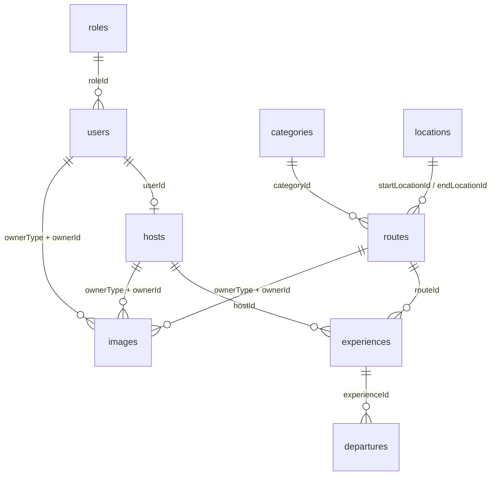

# Routly · base de datos completa

Especificación para implementar en `moto-routes-api` las nueve colecciones de Routly. Está escrita como **encargo para una IA** (o para quien programe): se puede pegar entera como prompt. Todo lo que hace falta decidir ya está decidido aquí; si algo no está, hay que preguntar antes de inventarlo.

> [!IMPORTANT]
> Estado: **implementado en `moto-routes-api`** (bloque A de `prompt-solucion.md`). Lo que cambia en el panel está en `NOTES.md`.

## Índice

1. [El encargo](#1-el-encargo)
2. [Contexto del proyecto](#2-contexto-del-proyecto)
3. [El patrón de `routes`, que hay que copiar](#3-el-patrón-de-routes-que-hay-que-copiar)
4. [Mapa de colecciones](#4-mapa-de-colecciones)
5. [Campos comunes: slug, estado y papelera](#5-campos-comunes-slug-estado-y-papelera)
6. [Especificación de cada colección](#6-especificación-de-cada-colección)
7. [Reglas entre colecciones](#7-reglas-entre-colecciones)
8. [Endpoints](#8-endpoints)
9. [Seed](#9-seed)
10. [Fases de trabajo](#10-fases-de-trabajo)
11. [Criterios de aceptación](#11-criterios-de-aceptación)
12. [Fuera de alcance](#12-fuera-de-alcance)
13. [Decisiones de diseño](#13-decisiones-de-diseño)

---

## 1. El encargo

**Rol.** Actúa como desarrollador backend senior con experiencia en Node.js, Express 5 y MongoDB con Mongoose.

**Objetivo.** Añadir a `moto-routes-api` las colecciones `roles`, `users`, `hosts`, `categories`, `locations`, `experiences`, `departures` e `images`, y cambiar `routes` para que use categorías y ubicaciones. Cada colección nueva debe funcionar **exactamente igual que `routes`**: mismas capas, mismos endpoints, mismo borrado lógico, mismo formato de error y misma documentación.

**Antes de escribir código**, lee estos archivos, porque son el modelo a seguir:

```
moto-routes-api/src/server.js
moto-routes-api/src/models/route.model.js
moto-routes-api/src/models/plugins/softDelete.plugin.js
moto-routes-api/src/schemas/route.schema.js
moto-routes-api/src/repositories/route.repository.js
moto-routes-api/src/services/route.service.js
moto-routes-api/src/controllers/route.controller.js
moto-routes-api/src/routes/route.routes.js
moto-routes-api/src/middlewares/validate.js
moto-routes-api/src/middlewares/errorHandler.js
moto-routes-api/src/utils/errors.js
moto-routes-api/src/utils/slugify.js
moto-routes-api/src/docs/openapi.js
moto-routes-api/src/config/swagger.js
moto-routes-api/src/seed.js
moto-routes-api/README.md
```

**Forma de trabajar.** Por fases (ver [sección 10](#10-fases-de-trabajo)). Al terminar cada fase, **para**, resume lo hecho y espera el OK antes de seguir.

**Reglas que no se negocian:**

- No leas `.env`. La configuración está en `.env.example`.
- No toques `moto-routes-frontend/`. El cambio de `routes` lo romperá a propósito; anótalo y sigue (ver [sección 12](#12-fuera-de-alcance)).
- La única dependencia nueva permitida es `bcrypt` (o `bcryptjs` si `bcrypt` no compila en Windows). Cualquier otra se pregunta antes.
- Nada de borrado físico desde la API. Solo el seed borra colecciones.
- Los mensajes de error de la API van **en inglés**, como los actuales. Los comentarios del código, **en español**, como los actuales.
- Si encuentras algo que contradice este documento, para y pregunta.

---

## 2. Contexto del proyecto

Routly es una plataforma de rutas en moto. Monorepo con dos aplicaciones:

| Carpeta | Qué es |
|---|---|
| `moto-routes-api/` | API REST. Node.js 20+, módulos ES (`import`/`export`), Express 5, Mongoose 9, Zod 4, Swagger con `swagger-jsdoc`, nodemon en desarrollo |
| `moto-routes-frontend/` | Panel de administración en Angular 20. Consume la API. **No se toca en este encargo** |

Hoy la API expone `/health`, `/api/docs` y `/api/routes/*`. No hay autenticación: los usuarios y roles se guardan, pero nadie inicia sesión todavía.

---

## 3. El patrón de `routes`, que hay que copiar

### 3.1 Archivos por recurso

Cada colección tiene estos archivos, en singular y en inglés (`role`, `user`, `host`, `category`, `location`, `experience`, `departure`, `image`):

| Archivo | Responsabilidad |
|---|---|
| `src/models/<recurso>.model.js` | Esquema de Mongoose, índices, `slug` e `isActive` derivados, plugin `softDelete` |
| `src/schemas/<recurso>.schema.js` | Esquemas de Zod: `create`, `update` y, si hace falta, otros |
| `src/repositories/<recurso>.repository.js` | Consultas a Mongoose. Lecturas con `.lean()`. Filtran `deletedAt: null` de forma explícita |
| `src/services/<recurso>.service.js` | Reglas de negocio y errores (404, 409, 400 de referencias) |
| `src/controllers/<recurso>.controller.js` | `async/await` con `try/catch`: lee `req`, llama al service y responde. Los errores se pasan con `next(error)` al `errorHandler` |
| `src/routes/<recurso>.routes.js` | Endpoints con `validate()`. Las rutas fijas van antes de `/:id` |
| `src/docs/openapi.js` | Una entrada por recurso en `RESOURCES`: los 11 endpoints se generan con `crudPaths()` y los cuerpos salen de los esquemas de Zod (`z.toJSONSchema`) |

El router se registra en `server.js` como `app.use("/api/<colección>", <recurso>Routes)`, antes de `notFoundHandler`. Los nombres de colección en la URL van en plural: `/api/roles`, `/api/users`, `/api/hosts`, `/api/categories`, `/api/locations`, `/api/routes`, `/api/experiences`, `/api/departures`, `/api/images`.

### 3.2 Piezas compartidas que hay que crear

Para no repetir código en nueve recursos, crea estas utilidades y úsalas también en `routes`:

| Archivo | Qué contiene |
|---|---|
| `src/models/status.js` | `export const STATUS = Object.freeze({ ACTIVE: "active", INACTIVE: "inactive", DELETED: "deleted" })`. `route.model.js` sigue exportando `ROUTE_STATUS` como alias de `STATUS`, para no romper nada |
| `src/models/plugins/status.plugin.js` | Añade `status` e `isActive` al esquema, y los hooks que derivan `isActive` de `status` (los mismos que hoy tiene `route.model.js`) |
| `src/models/plugins/slug.plugin.js` | Recibe una función que devuelve el texto del slug (`(doc) => doc.title`) y regenera `slug` con `buildSlug` al crear y cuando cambian los campos de los que depende. Añade `slug` con índice único |
| `src/schemas/common.schema.js` | `objectIdSchema`, `idParamSchema`, `slugParamSchema`, `setActiveSchema` y `restoreSchema`, que hoy están en `route.schema.js`. `route.schema.js` los reexporta |
| `src/utils/errors.js` | Añadir `fieldError(field, message)`: un 400 con `message: "Validation failed"` y `details: [{ field, message }]` |
| `src/middlewares/errorHandler.js` | Si un error propio trae `details`, incluirlos en la respuesta |
| `src/services/references.js` | `assertReference(repository, id, field, resource, { mustBeActive = true })`: lanza `fieldError` si el documento no existe, está eliminado o (si se pide) está inactivo, y lo devuelve. Recibe el repositorio, no el modelo, para respetar las capas. Además, `assertNoDependents` (409 al eliminar) y `assertRestorable` (409 al restaurar) |

> [!NOTE]
> Si la refactorización de `routes` hacia estas piezas cambia el comportamiento de algún endpoint actual, para y avisa. Las respuestas de `/api/routes` solo pueden cambiar en lo que dice la [sección 6.6](#66-routes-cambia).

### 3.3 Comportamiento que se hereda tal cual

- **Soft delete.** El plugin `softDelete` añade `deletedAt`, excluye los eliminados de todas las consultas (salvo `withDeleted: true` o un filtro explícito por `deletedAt`) y da `softDeleteById` y `restoreById`. Se registra con `deletedFields: { status: STATUS.DELETED, isActive: false }`.
- **Slug.** `buildSlug(texto, _id)`: el texto en minúsculas, sin tildes y con guiones, más los 6 últimos caracteres del `_id`. Al crear, el service genera el `_id` antes, calcula el slug y comprueba con `existsBySlug` (que incluye eliminados) que no existe. Si existe: 409 `A <resource> with this slug already exists`.
- **Estados.** `status` es `active`, `inactive` o `deleted`; `isActive` siempre es `status === "active"`. El `PATCH /:id` acepta `status` con `active` o `inactive`, nunca `deleted`.
- **Validación.** `validate({ params, query, body })` con Zod antes del controlador. Los campos que no están en el esquema se descartan, así el cliente no puede fijar `slug`, `status` al crear, `isActive`, `deletedAt`, `createdAt` ni `updatedAt`.
- **Errores.** Siempre `{ statusCode, error, message, details? }`. `details` solo en errores de validación (Zod, Mongoose o `fieldError`). Los 500 nunca muestran la traza.
- **Códigos.** 200 al leer, editar, activar y restaurar; 201 al crear; 204 al eliminar.
- **Antes de escribir.** Cada operación con id comprueba que el id es válido y que el documento existe y es el pedido (404 si no). Si el documento se elimina entre la búsqueda y la escritura, también 404.
- **PATCH.** Sin ningún campo: 400 `No fields to update`. Con un campo que no se puede cambiar (`_id`, `slug` y los propios de cada colección: `isSystem`, `passwordHash`, `userId`, `experienceId`, `sku`, `ownerType`, `ownerId`): 400 `<campo> cannot be changed`.
- **Activar o desactivar** un documento que ya tiene ese estado lo devuelve sin escribir.
- **Orden de los listados.** De más reciente a más antiguo (`createdAt: -1`). La papelera, por `deletedAt: -1`. Excepciones indicadas en cada colección.

### 3.4 Plantilla de modelo

Así debe quedar un modelo, con `category` como ejemplo:

```js
import mongoose from "mongoose";
import { slugPlugin } from "./plugins/slug.plugin.js";
import { softDeletePlugin } from "./plugins/softDelete.plugin.js";
import { statusPlugin } from "./plugins/status.plugin.js";
import { DELETED_FIELDS } from "./status.js";

const categorySchema = new mongoose.Schema(
  {
    name: { type: String, required: true, trim: true, minlength: 2, maxlength: 60 },
    description: { type: String, trim: true, maxlength: 300 },
  },
  { timestamps: true }
);

categorySchema.plugin(statusPlugin);
categorySchema.plugin(slugPlugin, { source: (doc) => doc.name, fields: ["name"] });
categorySchema.plugin(softDeletePlugin, { deletedFields: DELETED_FIELDS });

// Nombre único sin distinguir mayúsculas ni tildes (la ñ es una letra propia)
categorySchema.index({ name: 1 }, { unique: true, collation: { locale: "es", strength: 1 } });

export const Category = mongoose.model("Category", categorySchema);
```

---

## 4. Mapa de colecciones



| Colección | Modelo | Qué guarda | Apunta a |
|---|---|---|---|
| `roles` | `Role` | Tipos de usuario | nada |
| `users` | `User` | Cuentas | `roles` |
| `hosts` | `Host` | Perfil público del anfitrión | `users` |
| `categories` | `Category` | Tipo de ruta | nada |
| `locations` | `Location` | Lugares con coordenadas | nada |
| `routes` | `Route` | El recorrido | `categories`, `locations` |
| `experiences` | `Experience` | Salida guiada sobre una ruta | `hosts`, `routes` |
| `departures` | `Departure` | Fecha concreta de una experiencia | `experiences` |
| `images` | `Image` | Imágenes de cualquier colección | la que diga `ownerType` |

`images` puede pertenecer a `routes`, `users`, `hosts`, `experiences`, `categories` o `locations`. El diagrama solo dibuja las tres principales para no enredarlo. Ver [sección 6.9](#69-images).

---

## 5. Campos comunes: slug, estado y papelera

Todas las colecciones se activan, se desactivan y tienen papelera. Todas tienen `slug` menos `images`.

| Colección | `slug` a partir de | `status` + `isActive` | `deletedAt` | `createdAt` + `updatedAt` |
|---|---|:---:|:---:|:---:|
| `roles` | `label` | Sí | Sí | Sí |
| `users` | `name` | Sí | Sí | Sí |
| `hosts` | `name` | Sí | Sí | Sí |
| `categories` | `name` | Sí | Sí | Sí |
| `locations` | `city` | Sí | Sí | Sí |
| `routes` | `title` | Sí | Sí | Sí |
| `experiences` | `title` | Sí | Sí | Sí |
| `departures` | título de la experiencia + fecha de `startAt` | Sí | Sí | Sí |
| `images` | sin slug | Sí | Sí | Sí |

Definición de cada campo común. Los gestiona el servidor; en las tablas de la sección 6 aparecen como "auto".

| Campo | Tipo Mongoose | Por defecto | Comportamiento |
|---|---|---|---|
| `_id` | ObjectId | automático | Lo genera el service antes de crear, para poder calcular el slug |
| `slug` | String, `unique`, `lowercase`, `trim` | calculado | `buildSlug(texto, _id)`. Se regenera si cambia el texto de origen |
| `status` | String, enum `active` / `inactive` / `deleted` | `active` | Solo cambia con `PATCH /:id`, `/active`, `/delete` y `/restore` |
| `isActive` | Boolean | `true` | Siempre igual a `status === "active"` |
| `deletedAt` | Date | `null` | Fecha del borrado lógico |
| `createdAt` / `updatedAt` | Date | automático | `timestamps: true` |

**Qué significa "inactivo".** Un documento inactivo existe, se lista, se puede editar y se puede volver a activar, pero **no se puede usar en documentos nuevos ni en ediciones que cambien la referencia** (ver [sección 7](#7-reglas-entre-colecciones)). Desactivar nunca afecta a los documentos que ya lo usan.

---

## 6. Especificación de cada colección

Leyenda de las tablas: **Zod** es la validación de la petición y **Modelo** la del esquema de Mongoose, que debe tener los mismos límites. En `update`, todos los campos pasan a opcionales (`create.partial()`) y se añade `status` con `active` o `inactive`, salvo que se diga otra cosa.

### 6.1 `roles`

Tipos de usuario. Los tres roles base los crea el seed y están protegidos.

| Campo | Tipo | Obligatorio | Por defecto | Zod | Modelo |
|---|---|---|---|---|---|
| `name` | String | Sí | | `string().trim().toLowerCase().min(2).max(30).regex(/^[a-z0-9]+(-[a-z0-9]+)*$/)` | `unique`, `lowercase`, `trim`, `minlength: 2`, `maxlength: 30` |
| `label` | String | Sí | | `string().trim().min(2).max(50)` | `trim`, `minlength: 2`, `maxlength: 50` |
| `description` | String | No | | `string().trim().max(200).optional()` | `trim`, `maxlength: 200` |
| `isSystem` | Boolean | No | `false` | No se acepta desde la API | `default: false` |
| `slug`, `status`, `isActive`, `deletedAt`, `createdAt`, `updatedAt` | | auto | | | |

- `name` es la clave que usará el código (`admin`, `host`, `rider`) y `label` el nombre visible (`Administrador`). El slug sale de `label`.
- Índices: `name` único, `slug` único.

**Reglas del service**

| Situación | Respuesta |
|---|---|
| Crear con un `name` que ya existe (también en la papelera) | 409 `A role with this name already exists` |
| Cambiar `name` de un rol con `isSystem: true` | 409 `System roles cannot be renamed` |
| Desactivar un rol con `isSystem: true` (por `/active` o por `PATCH` con `status`) | 409 `System roles cannot be deactivated` |
| Eliminar un rol con `isSystem: true` | 409 `System roles cannot be deleted` |
| Eliminar un rol que tiene usuarios no eliminados | 409 `Cannot delete a role that has users` |

**Ejemplo de respuesta**

```json
{
  "_id": "6710a1b2c3d4e5f6a7b8c901",
  "name": "host",
  "label": "Anfitrión",
  "description": "Organiza experiencias sobre las rutas",
  "isSystem": true,
  "slug": "anfitrion-b8c901",
  "status": "active",
  "isActive": true,
  "deletedAt": null,
  "createdAt": "2026-10-16T10:00:00.000Z",
  "updatedAt": "2026-10-16T10:00:00.000Z"
}
```

### 6.2 `users`

Cuentas de la plataforma. Sin login por ahora, pero la contraseña se guarda ya bien protegida.

| Campo | Tipo | Obligatorio | Por defecto | Zod | Modelo |
|---|---|---|---|---|---|
| `name` | String | Sí | | `string().trim().min(2).max(100)` | `trim`, `minlength: 2`, `maxlength: 100` |
| `email` | String | Sí | | `string().trim().toLowerCase().email().max(254)` | `unique`, `lowercase`, `trim`, `maxlength: 254` |
| `password` | String | Sí al crear | | `string().min(8).max(72)` | No se guarda |
| `passwordHash` | String | auto | | No se acepta desde la API | `required`, `select: false` |
| `roleId` | ObjectId → `Role` | Sí | rol `rider` | `objectIdSchema.optional()` | `ref: "Role"`, `required` |
| `slug`, `status`, `isActive`, `deletedAt`, `createdAt`, `updatedAt` | | auto | | | |

- El service convierte `password` en `passwordHash` con bcrypt (10 rondas) al crear y al editar si llega `password`. **`passwordHash` nunca sale en una respuesta**, tampoco en la papelera ni en los `populate`.
- Si no llega `roleId` al crear, el service asigna el rol `rider`.
- Al leer, `roleId` se acompaña de `role: { _id, name, label }` (populate virtual, ver [sección 6.6](#66-routes-cambia)).
- Un usuario inactivo es una cuenta bloqueada: cuando haya login, no podrá entrar.
- Índices: `email` único (incluye eliminados, así el correo sigue reservado para poder restaurar), `slug` único, `roleId`.

**Reglas del service**

| Situación | Respuesta |
|---|---|
| Crear o cambiar a un `email` que ya existe | 409 `A user with this email already exists` |
| `roleId` inexistente, eliminado o inactivo | 400, `details: [{ field: "roleId", message: "roleId must reference an active role" }]` |
| Cambiar el rol a uno distinto de `host` si el usuario tiene perfil de anfitrión | 409 `User has a host profile` |
| Eliminar un usuario que tiene perfil de anfitrión no eliminado | 409 `Cannot delete a user that has a host profile` |

**Ejemplo de respuesta**

```json
{
  "_id": "6710a1b2c3d4e5f6a7b8c910",
  "name": "Lucía Ferrer",
  "email": "lucia@routly.dev",
  "roleId": "6710a1b2c3d4e5f6a7b8c901",
  "role": { "_id": "6710a1b2c3d4e5f6a7b8c901", "name": "host", "label": "Anfitrión" },
  "slug": "lucia-ferrer-b8c910",
  "status": "active",
  "isActive": true,
  "deletedAt": null,
  "createdAt": "2026-10-16T10:00:00.000Z",
  "updatedAt": "2026-10-16T10:00:00.000Z"
}
```

### 6.3 `hosts`

Perfil público de un anfitrión. `users` es la cuenta; `hosts`, lo que ve el público.

| Campo | Tipo | Obligatorio | Por defecto | Zod | Modelo |
|---|---|---|---|---|---|
| `userId` | ObjectId → `User` | Sí | | `objectIdSchema` | `ref: "User"`, `required`, `unique` |
| `name` | String | Sí | | `string().trim().min(2).max(100)` | `trim`, `minlength: 2`, `maxlength: 100` |
| `biography` | String | No | | `string().trim().max(1000).optional()` | `trim`, `maxlength: 1000` |
| `slug`, `status`, `isActive`, `deletedAt`, `createdAt`, `updatedAt` | | auto | | | |

- `userId` no se puede cambiar después de crear: no va en el esquema de `update`.
- Al leer: `user: { _id, name, email }`.
- Índices: `userId` único, `slug` único.

**Reglas del service**

| Situación | Respuesta |
|---|---|
| `userId` inexistente, eliminado o inactivo | 400 en `userId`: `userId must reference an active user` |
| El usuario no tiene el rol `host` | 400 en `userId`: `userId must reference a user with the host role` |
| El usuario ya tiene perfil (también en la papelera) | 409 `This user already has a host profile` |
| Eliminar un anfitrión con experiencias no eliminadas | 409 `Cannot delete a host that has experiences` |

### 6.4 `categories`

Tipo de ruta: costera, de montaña, de puertos, urbana...

| Campo | Tipo | Obligatorio | Por defecto | Zod | Modelo |
|---|---|---|---|---|---|
| `name` | String | Sí | | `string().trim().min(2).max(60)` | `trim`, `minlength: 2`, `maxlength: 60` |
| `description` | String | No | | `string().trim().max(300).optional()` | `trim`, `maxlength: 300` |
| `slug`, `status`, `isActive`, `deletedAt`, `createdAt`, `updatedAt` | | auto | | | |

- Listado ordenado por `name` ascendente.
- Índices: `name` único sin distinguir mayúsculas ni tildes (`collation: { locale: "es", strength: 1 }`), `slug` único. Con la intercalación española la `ñ` es una letra propia, no una `n` con tilde: `Montana` y `Montaña` son nombres distintos (igual que "ano" y "año").

**Reglas del service**

| Situación | Respuesta |
|---|---|
| `name` repetido (`Montaña` y `MONTAÑA`, o `Costa` y `Cósta`, cuentan como iguales) | 409 `A category with this name already exists` |
| Eliminar una categoría con rutas no eliminadas | 409 `Cannot delete a category that has routes` |

### 6.5 `locations`

Lugares que sirven de origen y destino de las rutas.

| Campo | Tipo | Obligatorio | Por defecto | Zod | Modelo |
|---|---|---|---|---|---|
| `city` | String | Sí | | `string().trim().min(2).max(80)` | `trim`, `minlength: 2`, `maxlength: 80` |
| `region` | String | No | | `string().trim().max(80).optional()` | `trim`, `maxlength: 80` |
| `country` | String | No | `España` | `string().trim().min(2).max(80).optional()` | `trim`, `default: "España"` |
| `latitude` | Number | No | | `number().min(-90).max(90).optional()` | No se guarda así |
| `longitude` | Number | No | | `number().min(-180).max(180).optional()` | No se guarda así |
| `coordinates` | GeoJSON Point | auto | | No se acepta desde la API | `{ type: { type: String, enum: ["Point"] }, coordinates: [Number] }` |
| `slug`, `status`, `isActive`, `deletedAt`, `createdAt`, `updatedAt` | | auto | | | |

- La API recibe `latitude` y `longitude` y guarda `coordinates: { type: "Point", coordinates: [longitude, latitude] }` (**longitud primero**, como exige GeoJSON). Al responder, devuelve `latitude` y `longitude` otra vez, no `coordinates`.
- `latitude` y `longitude` van las dos o ninguna: un `.refine()` en Zod con el error en `latitude`: `latitude and longitude must be sent together`.
- Listado ordenado por `city` ascendente.
- Índices: `slug` único; `{ city, region, country }` único con `collation: { locale: "es", strength: 1 }`; `2dsphere` sobre `coordinates`.

**Reglas del service**

| Situación | Respuesta |
|---|---|
| Ciudad, región y país repetidos | 409 `A location with this city, region and country already exists` |
| Eliminar una ubicación usada como origen o destino de rutas no eliminadas | 409 `Cannot delete a location that is used by routes` |

**Ejemplo de respuesta**

```json
{
  "_id": "6710a1b2c3d4e5f6a7b8c920",
  "city": "Sóller",
  "region": "Islas Baleares",
  "country": "España",
  "latitude": 39.7667,
  "longitude": 2.7150,
  "slug": "soller-b8c920",
  "status": "active",
  "isActive": true,
  "deletedAt": null,
  "createdAt": "2026-10-16T10:00:00.000Z",
  "updatedAt": "2026-10-16T10:00:00.000Z"
}
```

### 6.6 `routes` (cambia)

El origen y el destino dejan de ser texto libre y pasan a ser ubicaciones. Se añade la categoría.

| Campo | Tipo | Obligatorio | Por defecto | Zod | Modelo | Cambio |
|---|---|---|---|---|---|---|
| `title` | String | Sí | | igual que hoy | igual que hoy | |
| `description` | String | No | | igual que hoy | igual que hoy | |
| `difficulty` | String | Sí | | igual que hoy | igual que hoy | |
| `distance` | Number | Sí | | igual que hoy | igual que hoy | |
| `duration` | Number | Sí | | igual que hoy | igual que hoy | |
| `categoryId` | ObjectId → `Category` | Sí | | `objectIdSchema` | `ref: "Category"`, `required` | **Nuevo** |
| `startLocationId` | ObjectId → `Location` | Sí | | `objectIdSchema` | `ref: "Location"`, `required` | **Sustituye a `startPoint`** |
| `endLocationId` | ObjectId → `Location` | Sí | | `objectIdSchema` | `ref: "Location"`, `required` | **Sustituye a `endPoint`** |
| `startPoint`, `endPoint` | | | | | | **Desaparecen** |
| `slug`, `status`, `isActive`, `deletedAt`, `createdAt`, `updatedAt` | | auto | | | | |

- `endLocationId` puede ser igual que `startLocationId` (ruta circular).
- **Al leer**, la respuesta lleva los ids y además los objetos, con populate de virtuales:

```js
routeSchema.virtual("category", {
  ref: "Category", localField: "categoryId", foreignField: "_id", justOne: true,
});
// y lo mismo para startLocation y endLocation
// En el repositorio:
Route.find(...).populate("category", "name slug")
  .populate("startLocation", "city region country slug")
  .populate("endLocation", "city region country slug")
  .lean();
```

- Índices: `slug` único, `categoryId`, `startLocationId`, `endLocationId`.

**Reglas del service**

| Situación | Respuesta |
|---|---|
| `categoryId` inexistente, eliminado o inactivo | 400 en `categoryId`: `categoryId must reference an active category` |
| `startLocationId` o `endLocationId` inexistente, eliminado o inactivo | 400 en ese campo: `<campo> must reference an active location` |
| Eliminar una ruta con experiencias no eliminadas | 409 `Cannot delete a route that has experiences` |

**Ejemplo de respuesta**

```json
{
  "_id": "6abfc9f47a7195ca59df38e9",
  "title": "Caminos de Mallorca",
  "description": "Ruta por la Serra de Tramuntana con curvas sin fin",
  "difficulty": "medium",
  "distance": 120,
  "duration": 3,
  "categoryId": "6710a1b2c3d4e5f6a7b8c930",
  "category": { "_id": "6710a1b2c3d4e5f6a7b8c930", "name": "Montaña", "slug": "montana-b8c930" },
  "startLocationId": "6710a1b2c3d4e5f6a7b8c921",
  "startLocation": { "_id": "6710a1b2c3d4e5f6a7b8c921", "city": "Palma", "region": "Islas Baleares", "country": "España", "slug": "palma-b8c921" },
  "endLocationId": "6710a1b2c3d4e5f6a7b8c920",
  "endLocation": { "_id": "6710a1b2c3d4e5f6a7b8c920", "city": "Sóller", "region": "Islas Baleares", "country": "España", "slug": "soller-b8c920" },
  "slug": "caminos-de-mallorca-df38e9",
  "status": "active",
  "isActive": true,
  "deletedAt": null,
  "createdAt": "2026-10-16T10:00:00.000Z",
  "updatedAt": "2026-10-16T10:00:00.000Z"
}
```

> [!WARNING]
> Es el único cambio que rompe algo que ya funciona: el seed, la documentación de `/api/routes` y el panel, que hoy envía y muestra `startPoint` y `endPoint`.

### 6.7 `experiences`

Salida guiada que un anfitrión organiza sobre una ruta.

| Campo | Tipo | Obligatorio | Por defecto | Zod | Modelo |
|---|---|---|---|---|---|
| `hostId` | ObjectId → `Host` | Sí | | `objectIdSchema` | `ref: "Host"`, `required` |
| `routeId` | ObjectId → `Route` | Sí | | `objectIdSchema` | `ref: "Route"`, `required` |
| `title` | String | Sí | | `string().trim().min(1).max(120)` | `trim`, `maxlength: 120` |
| `description` | String | No | | `string().trim().max(2000).optional()` | `trim`, `maxlength: 2000` |
| `meetingPoint` | String | No | | `string().trim().max(200).optional()` | `trim`, `maxlength: 200` |
| `language` | String | No | `es` | `string().trim().toLowerCase().regex(/^[a-z]{2}$/).optional()` | `lowercase`, `default: "es"` |
| `duration` | Number | Sí | | `number().min(0)` | `min: 0` |
| `minParticipants` | Number | No | `1` | `number().int().min(1).optional()` | `min: 1`, `default: 1` |
| `maxParticipants` | Number | Sí | | `number().int().min(1).max(100)` | `min: 1`, `max: 100` |
| `slug`, `status`, `isActive`, `deletedAt`, `createdAt`, `updatedAt` | | auto | | | |

- `minParticipants` no puede ser mayor que `maxParticipants`: `.refine()` con el error en `maxParticipants`: `maxParticipants must be greater than or equal to minParticipants`. En `update` se compara con el valor guardado si solo llega uno de los dos.
- `duration` es la duración total de la experiencia, con paradas; no tiene por qué coincidir con la de la ruta.
- Al leer: `host: { _id, name, slug }` y `route: { _id, title, slug }`.
- Índices: `slug` único, `hostId`, `routeId`.

**Reglas del service**

| Situación | Respuesta |
|---|---|
| `hostId` o `routeId` inexistente, eliminado o inactivo | 400 en ese campo: `hostId must reference an active host` / `routeId must reference an active route` |
| Bajar `maxParticipants` por debajo de la `capacity` de alguna salida no eliminada | 409 `maxParticipants is lower than the capacity of an existing departure` |
| Eliminar una experiencia con salidas no eliminadas | 409 `Cannot delete an experience that has departures` |

### 6.8 `departures`

Una fecha concreta en la que sale una experiencia.

| Campo | Tipo | Obligatorio | Por defecto | Zod | Modelo |
|---|---|---|---|---|---|
| `experienceId` | ObjectId → `Experience` | Sí | | `objectIdSchema` | `ref: "Experience"`, `required` |
| `startAt` | Date | Sí | | `coerce.date()` (llega en ISO 8601) | `required` |
| `endAt` | Date | Sí | | `coerce.date()` | `required` |
| `capacity` | Number | Sí | | `number().int().min(1)` | `min: 1` |
| `price` | Number | Sí | | `number().min(0).multipleOf(0.01)` | `min: 0` |
| `state` | String | No | `scheduled` | `enum(["scheduled", "cancelled", "completed"]).optional()` | `enum`, `default: "scheduled"` |
| `sku` | String | **Sí** (lo genera el servidor) | | No se acepta desde la API | `required`, `unique`, `immutable: true`, `match: SKU_PATTERN` |
| `slug`, `status`, `isActive`, `deletedAt`, `createdAt`, `updatedAt` | | auto | | | |

#### SKU de la salida

El SKU (*stock keeping unit*) es el **código comercial** de cada salida: lo que aparecerá en reservas, facturas, correos al cliente, exportaciones y conversaciones de soporte ("tengo la salida RTL-DEP-261108-7QX2M"). Tiene que poder leerse en voz alta y dictarse por teléfono sin errores, y no puede exponer datos internos de la base de datos.

| Segmento | Ejemplo | Qué es |
|---|---|---|
| Marca | `RTL` | Prefijo fijo de Routly |
| Tipo | `DEP` | Tipo de producto: *departure*. Si mañana hay otros productos con SKU (por ejemplo, alquiler de material), tendrán su propio tipo de 3 letras |
| Fecha | `261108` | Día de salida en formato `AAMMDD`, calculado en la zona horaria `Europe/Madrid` |
| Código | `7QX2M` | 5 caracteres aleatorios del alfabeto Crockford Base32 |

Resultado: **`RTL-DEP-261108-7QX2M`** (20 caracteres).

**Reglas del SKU**

- **Obligatorio.** No puede existir ninguna salida sin SKU. El cliente no lo envía: lo genera el service al crear, y el modelo lo marca como `required`, así que si por un error no se generara, Mongoose rechaza el documento y la salida no llega a guardarse. El seed también crea las salidas a través del service o del modelo, nunca con `insertMany` sin validar.
- **Alfabeto sin ambigüedades.** El código usa Crockford Base32: `0123456789ABCDEFGHJKMNPQRSTVWXYZ`. No incluye `I`, `L`, `O` ni `U`, así nadie confunde `0` con `O` o `1` con `I` al leerlo o dictarlo.
- **Aleatorio, no secuencial.** Se genera con `crypto.randomInt`. No revela cuántas salidas hay ni en qué orden se crearon, y no deriva del `_id`. Con 32⁵ (unos 33,5 millones de combinaciones) por día, las colisiones son prácticamente imposibles.
- **Único.** Índice único en `sku`, que incluye las salidas de la papelera. Si al crear salta un error de duplicado en `sku` (código 11000), el service genera otro y reintenta, hasta 3 veces; si aun así falla, responde 500.
- **Inmutable.** Se genera una vez al crear y **no cambia nunca** (`immutable: true`), aunque luego se edite `startAt`: la fecha del SKU es la de la creación, igual que un número de factura no cambia si se corrige la factura. Lo que cambia con la fecha es el slug, que es para la URL.
- **Siempre en mayúsculas** al guardarlo. Al buscar, se acepta en minúsculas y se normaliza.
- **Es un identificador, como el `_id`.** Identifica una salida de forma única y para siempre, y se puede buscar por él (`GET /api/departures/sku/:sku`). La diferencia es para quién está pensado: el `_id` es el identificador interno que usan las relaciones entre colecciones; el SKU es el identificador público que ven las personas y los sistemas externos. Por eso las referencias (`departureId` en las futuras reservas) seguirán usando `_id`, y el SKU es lo que se enseña.

**Implementación**

```js
// src/utils/sku.js
import { randomInt } from "node:crypto";

const CROCKFORD = "0123456789ABCDEFGHJKMNPQRSTVWXYZ";

// RTL-DEP-AAMMDD-XXXXX. Ejemplo: RTL-DEP-261108-7QX2M
export const SKU_PATTERN = /^RTL-[A-Z]{3}-\d{6}-[0-9A-HJKMNP-TV-Z]{5}$/;

const madridDate = new Intl.DateTimeFormat("en-GB", {
  timeZone: "Europe/Madrid",
  year: "2-digit",
  month: "2-digit",
  day: "2-digit",
});

// El día se calcula en hora de Madrid, no en UTC
function toYYMMDD(date) {
  const parts = Object.fromEntries(
    madridDate.formatToParts(date).map(({ type, value }) => [type, value])
  );
  return `${parts.year}${parts.month}${parts.day}`;
}

export function buildSku(productType, date) {
  const code = Array.from({ length: 5 }, () => CROCKFORD[randomInt(CROCKFORD.length)]).join("");
  return `RTL-${productType}-${toYYMMDD(date)}-${code}`;
}
```

`buildSku` lleva un test que comprueba que el resultado cumple `SKU_PATTERN` y que la fecha sale en hora de Madrid: una salida a las 00:30 del 8 de noviembre en Madrid es `261108`, aunque en UTC todavía sea día 7.

- **Slug:** `buildSlug("<título de la experiencia> <startAt en AAAA-MM-DD>", _id)`, por ejemplo `ruta-del-vino-2026-11-08-c3d4e5`. Se regenera si cambia `startAt`. Si cambia el título de la experiencia, las salidas conservan el suyo. Como el texto viene de otra colección, el service calcula el slug (el plugin recibe el título ya resuelto).
- `endAt` posterior a `startAt`: `.refine()` con el error en `endAt`: `endAt must be after startAt`.
- `price` en euros por persona, con dos decimales como máximo.
- `experienceId` no se puede cambiar después de crear.
- **`state` y `status` son cosas distintas.** `state` es lo que pasa en el mundo real (programada, cancelada o hecha). `status` es si se muestra en el panel (activa, inactiva o en papelera). Una salida cancelada puede seguir activa para que se vea que se canceló.
- Listado ordenado por `startAt` ascendente. Al leer: `experience: { _id, title, slug }`.
- Endpoint extra: `GET /api/departures/sku/:sku`, declarado antes de `/:id`. El parámetro se pasa a mayúsculas y se valida con `SKU_PATTERN` (si no cumple, 400 con `details` en `sku`). Responde igual que `GET /:id`: 404 `Departure not found` si no existe o está en la papelera.
- Índices: `slug` único; `sku` único; `{ experienceId: 1, startAt: 1 }`.

**Reglas del service**

| Situación | Respuesta |
|---|---|
| `experienceId` inexistente, eliminado o inactivo | 400 en `experienceId`: `experienceId must reference an active experience` |
| `startAt` en el pasado al crear | 400 en `startAt`: `startAt must be in the future` |
| `capacity` mayor que el `maxParticipants` de la experiencia | 400 en `capacity`: `capacity must be less than or equal to the experience maxParticipants` |

### 6.9 `images`

Imágenes de cualquier colección, en una sola colección para todas. Solo se guarda la URL; no hay subida de archivos.

**Quién tiene imágenes y para qué.** La imagen principal (`isCover: true`) significa algo distinto según el dueño:

| `ownerType` | Colección | Imagen principal | Resto de imágenes |
|---|---|---|---|
| `route` | `routes` | Portada de la ruta | Galería del recorrido |
| `user` | `users` | Foto de perfil | Normalmente ninguna |
| `host` | `hosts` | Foto del perfil público | Galería del anfitrión |
| `experience` | `experiences` | Portada de la experiencia | Galería |
| `category` | `categories` | Icono o portada de la categoría | Normalmente ninguna |
| `location` | `locations` | Foto del lugar | Galería |

**Registro de dueños (lo que la hace escalable).** Los tipos de dueño no se escriben a mano en cada archivo: salen de un único mapa en `src/models/imageOwners.js`.

```js
import { Category } from "./category.model.js";
import { Experience } from "./experience.model.js";
import { Host } from "./host.model.js";
import { Location } from "./location.model.js";
import { Route } from "./route.model.js";
import { User } from "./user.model.js";

// ownerType → modelo. Para que otra colección tenga imágenes, basta con añadir una línea.
export const IMAGE_OWNERS = Object.freeze({
  route: Route,
  user: User,
  host: Host,
  experience: Experience,
  category: Category,
  location: Location,
});

export const IMAGE_OWNER_TYPES = Object.keys(IMAGE_OWNERS);
```

Lo usan el `enum` del modelo, el esquema de Zod, la comprobación de que el dueño existe y la cascada de la papelera. Así, si más adelante `reviews` necesita fotos, se añade `review: Review` al mapa y no se toca nada más.

| Campo | Tipo | Obligatorio | Por defecto | Zod | Modelo |
|---|---|---|---|---|---|
| `ownerType` | String | Sí | | `enum(IMAGE_OWNER_TYPES)` | `enum: IMAGE_OWNER_TYPES`, `required` |
| `ownerId` | ObjectId | Sí | | `objectIdSchema` | `required` |
| `url` | String | Sí | | `string().trim().url().max(2048)` con protocolo `http` o `https` | `trim`, `maxlength: 2048` |
| `alt` | String | No | | `string().trim().max(200).optional()` | `trim`, `maxlength: 200` |
| `position` | Number | No | la última | `number().int().min(0).optional()` | `min: 0` |
| `isCover` | Boolean | No | `false` | `boolean().optional()` | `default: false` |
| `status`, `isActive`, `deletedAt`, `createdAt`, `updatedAt` | | auto | | | |

- **Sin `slug`.** Se identifica por su `_id`, así que no tiene `GET /slug/:slug`.
- `ownerType` y `ownerId` no se pueden cambiar después de crear.
- El dueño tiene que existir y no estar eliminado, **pero puede estar inactivo**: se preparan las imágenes de una ruta antes de activarla.
- Si `position` no llega, el service pone la siguiente a la última imagen de ese dueño.
- **Imagen principal:** la primera imagen de un dueño es la principal. Al marcar otra con `isCover: true`, la anterior se desmarca en la misma operación. Una imagen inactiva o eliminada no puede ser la principal: al desactivarla o eliminarla se desmarca y pasa a serlo la siguiente activa por `position`.
- **Al leer un dueño**, la API añade su imagen principal como `coverImage: { _id, url, alt }` (o `null` si no tiene). Se hace igual en `routes`, `users` y `hosts` desde el principio, y en el resto cuando el panel lo necesite. La galería completa se pide aparte con el filtro de abajo.
- El listado admite el filtro `GET /api/images?ownerType=route&ownerId=<id>`, validado con Zod en `query` (añade `query` a `validate()`). Ordenado por `position` ascendente.
- Índices: `{ ownerType, ownerId, position }`; y uno único parcial `{ ownerType, ownerId }` con `partialFilterExpression: { isCover: true }`, que impide dos portadas.

**Reglas del service**

| Situación | Respuesta |
|---|---|
| El dueño no existe o está eliminado | 400 en `ownerId`: `ownerId must reference an existing <ownerType>` |
| Filtro con `ownerType` sin `ownerId` o al revés | 400: `ownerType and ownerId must be sent together` |

---

## 7. Reglas entre colecciones

MongoDB no vigila las relaciones ni borra en cascada: estas reglas van en los services.

1. **Referencias al guardar.** Al crear, y al editar si cambia una referencia, se comprueba con `assertReference`. Si el documento no existe, está eliminado o está inactivo: 400 con `details` en ese campo. Excepción: el dueño de una imagen puede estar inactivo.
2. **Desactivar no se propaga.** Desactivar una categoría no desactiva sus rutas; solo impide usarla en rutas nuevas.
3. **No se elimina nada con dependientes vivos** (409). Se cuentan los dependientes **no eliminados**, estén activos o no:

| Para eliminar... | No puede tener... |
|---|---|
| `roles` | `users` |
| `users` | un `hosts` |
| `hosts` | `experiences` |
| `categories` | `routes` |
| `locations` | `routes` (como origen o destino) |
| `routes` | `experiences` |
| `experiences` | `departures` |

4. **Las imágenes van con su dueño.** Al eliminar un documento, sus imágenes no eliminadas se eliminan con **el mismo `deletedAt`** que el dueño. Al restaurarlo, se restauran las que tengan exactamente ese `deletedAt` (así no vuelven las que se habían eliminado antes a mano).
5. **Restaurar comprueba las referencias.** Si al restaurar un documento alguna de sus referencias está eliminada (por ejemplo, la categoría de una ruta), responde 409 `Cannot restore: <campo> references a deleted <recurso>`.

---

## 8. Endpoints

Todas las colecciones exponen los mismos que `routes`:

| Método | Ruta | Qué hace | Éxito |
|---|---|---|---|
| GET | `/api/<colección>` | Listado (sin eliminados) | 200 |
| GET | `/api/<colección>/actives` | Solo activos | 200 |
| GET | `/api/<colección>/inactives` | Solo inactivos | 200 |
| GET | `/api/<colección>/deleted` | Papelera | 200 |
| GET | `/api/<colección>/slug/:slug` | Por slug (todas menos `images`) | 200 |
| GET | `/api/<colección>/:id` | Por id | 200 |
| POST | `/api/<colección>` | Crear | 201 |
| PATCH | `/api/<colección>/:id` | Editar | 200 |
| PATCH | `/api/<colección>/:id/active` | Activar o desactivar: `{ "isActive": true }` | 200 |
| PATCH | `/api/<colección>/:id/delete` | Eliminar (borrado lógico) | 204 |
| PATCH | `/api/<colección>/:id/restore` | Restaurar: `{ "isActive": true }` opcional | 200 |

Extras:

- `GET /api/images?ownerType=<tipo>&ownerId=<id>`: imágenes de un dueño.
- `GET /api/departures/sku/:sku`: una salida por su SKU.
- En `users`, ningún endpoint devuelve `passwordHash`.

CORS sigue permitiendo solo `GET`, `POST` y `PATCH`: no hace falta tocarlo.

---

## 9. Seed

`npm run seed` borra **todas** las colecciones y carga estos datos, en este orden. Debe poder ejecutarse varias veces seguidas con el mismo resultado. Los `_id` no son fijos.

| Colección | Datos |
|---|---|
| `roles` | `admin` (Administrador), `host` (Anfitrión), `rider` (Motorista), los tres con `isSystem: true` |
| `users` | `Admin Routly` (admin@routly.dev, admin); `Lucía Ferrer` (lucia@routly.dev, host); `Pablo Ortega` (pablo@routly.dev, host); `Marta Gil` (marta@routly.dev, rider) |
| `hosts` | Perfiles de Lucía Ferrer y Pablo Ortega, con una biografía corta |
| `categories` | `Costa`, `Montaña`, `Puertos`, `Viñedos` |
| `locations` | Barcelona, Huesca, Lleida, Logroño, Haro, Granada, Palma, Sóller, Panes y Potes, con su región, `España` y coordenadas reales |
| `routes` | Las seis rutas de hoy, con sus mismos datos, pasando el texto de `startPoint` y `endPoint` a la ubicación correspondiente y con una categoría coherente. "Ruta del Vino" queda inactiva y "Desfiladero de La Hermida y Potes" en la papelera, como ahora |
| `experiences` | Dos: una de Lucía sobre "Caminos de Mallorca" y otra de Pablo sobre "Pirineos Adventure" |
| `departures` | Tres salidas futuras (calculadas desde la fecha de ejecución): dos de la primera experiencia y una de la segunda, una de ellas con `state: "cancelled"` |
| `images` | Una o dos por ruta activa (`https://picsum.photos/seed/<slug>/1200/800`, la primera como portada), una foto de perfil por usuario y otra por anfitrión (`https://picsum.photos/seed/<slug>/400/400`) |

- Todos los usuarios del seed tienen la contraseña de desarrollo **`routly-dev-1234`**, guardada como hash. Escríbela en el README de la API, en la sección del seed, avisando de que es solo para desarrollo.
- El seed crea los documentos con los modelos (no con `insertMany` sin validar), para que se calculen `slug`, `isActive` y el hash.

---

## 10. Fases de trabajo

Al final de cada fase: `npm run dev` arranca sin errores, `/api/docs` carga, las pruebas de la fase pasan y se para a esperar el OK.

| Fase | Qué se hace | Cómo se comprueba |
|---|---|---|
| **0. Piezas comunes** | Lo de la [sección 3.2](#32-piezas-compartidas-que-hay-que-crear), y `routes` pasa a usarlas sin cambiar su comportamiento | Todos los endpoints de `/api/routes` responden igual que antes: crear, editar, activar, eliminar, papelera y restaurar |
| **1. Cuentas** | `roles`, `users` (con bcrypt) y `hosts` | Crear un usuario sin `roleId` le asigna `rider`; desactivar `admin` da 409; el listado de usuarios no muestra `passwordHash`; un usuario sin rol `host` no puede tener perfil |
| **2. Catálogo** | `categories` y `locations` | `MONTAÑA` y `Cósta` dan 409 (y `Montana` no); una ubicación con solo `latitude` da 400; la respuesta trae `latitude` y `longitude` |
| **3. Rutas** | Cambio de `routes` y seed nuevo | Crear una ruta con una categoría inactiva da 400 en `categoryId`; la respuesta trae `category`, `startLocation` y `endLocation`; eliminar una categoría con rutas da 409 |
| **4. Experiencias** | `experiences` y `departures` | Una salida con `capacity` mayor que el máximo da 400; una salida en el pasado da 400; el slug de la salida lleva la fecha; el `sku` cumple `RTL-DEP-AAMMDD-XXXXX`, no cambia al editar `startAt`, y `GET /api/departures/sku/:sku` la encuentra también escrito en minúsculas |
| **5. Imágenes** | `images`, registro de dueños, imagen principal, `coverImage` y cascada | Una ruta, un usuario y un anfitrión tienen imagen principal y la devuelven en `coverImage`; marcar otra principal desmarca la anterior; eliminar una ruta elimina sus imágenes y restaurarla las devuelve |
| **6. Documentación** | `docs/openapi.js`, `config/swagger.js`, README de la API (modelo, endpoints, seed) y `postman.md` | Cada endpoint aparece en Swagger con sus ejemplos y errores |

---

## 11. Criterios de aceptación

- [ ] Las nueve colecciones tienen los 11 endpoints de la [sección 8](#8-endpoints) (10 en `images`, que no tiene slug).
- [ ] Todas responden con los mismos códigos y el mismo formato de error que `routes`.
- [ ] Ningún campo automático (`slug`, `sku`, `status` al crear, `isActive`, `deletedAt`, `isSystem`, `passwordHash`, fechas) se puede fijar desde la petición.
- [ ] Las referencias inválidas dan 400 con `details` en el campo correcto.
- [ ] Las eliminaciones con dependientes dan 409 con el mensaje de la tabla de su colección.
- [ ] `passwordHash` no aparece en ninguna respuesta.
- [ ] Los roles base no se pueden desactivar, eliminar ni renombrar.
- [ ] Las imágenes se eliminan y se restauran con su dueño.
- [ ] Los tipos de dueño de `images` solo están definidos en `IMAGE_OWNERS`.
- [ ] `npm run seed` funciona dos veces seguidas y deja los datos de la [sección 9](#9-seed).
- [ ] Los límites de longitud y rango coinciden en Zod y en Mongoose.
- [ ] Swagger documenta todos los endpoints y el README de la API está al día.
- [ ] Cada cambio que afecta al panel está anotado en `NOTES.md` (ver abajo).

---

## 12. Fuera de alcance

- **Login, registro, tokens y permisos por rol.** Los roles se guardan, pero ningún endpoint los comprueba todavía.
- **Subida de archivos.** Las imágenes son solo URLs.
- **`bookings` y `reviews`.** Se diseñarán más adelante.
- **Paginación y búsqueda por cercanía.** El índice `2dsphere` queda creado para usarlo después.
- **El panel (`moto-routes-frontend`).** No se toca. Crea `NOTES.md` en la raíz del repositorio con lo que el panel tendrá que cambiar, como mínimo:
  - el formulario de rutas pasa de `startPoint` y `endPoint` a selectores de ubicación y categoría;
  - las tarjetas, la tabla, la papelera y el resumen leen `startLocation.city` y `endLocation.city`;
  - el modelo `Route` del panel cambia sus campos.

---

## 13. Decisiones de diseño

- **Todas las colecciones se activan, se desactivan y tienen papelera**, igual que `routes`. El plugin `softDelete`, los endpoints y las pantallas del panel son iguales para todas.
- **Todas tienen `slug` menos `images`**, que no tiene página propia.
- **Lo propio de una colección va en un campo aparte de `status`**, como `state` en `departures`.
- **Las salidas tienen `sku` además de `slug`.** El slug es para la URL y puede cambiar. El SKU es el código comercial fijo (`RTL-DEP-261108-7QX2M`) que usarán reservas, facturas y soporte: legible, sin caracteres ambiguos, aleatorio y sin exponer el `_id`.
- **Los roles base están protegidos**: no se pueden desactivar, eliminar ni renombrar, para que siempre exista un administrador.
- **`roles` separa la clave (`name`) del nombre visible (`label`)**, para que el código no dependa de un texto editable.
- **`hosts` es el perfil y `users` la cuenta.** El nombre público y la biografía están en `hosts`.
- **Las imágenes van en su propia colección**, con `ownerType` y `ownerId`, y siguen a su dueño en la papelera. Rutas, usuarios y anfitriones las usan desde el principio.
- **Los tipos de dueño salen de un único registro** (`IMAGE_OWNERS`): dar imágenes a una colección nueva es añadir una línea.
- **Toda experiencia va ligada a una ruta.**
- **El país es texto**, no un código ISO. Es suficiente mientras las rutas sean de pocos países.
- **Las referencias se validan en el service**, porque MongoDB no tiene claves foráneas.
