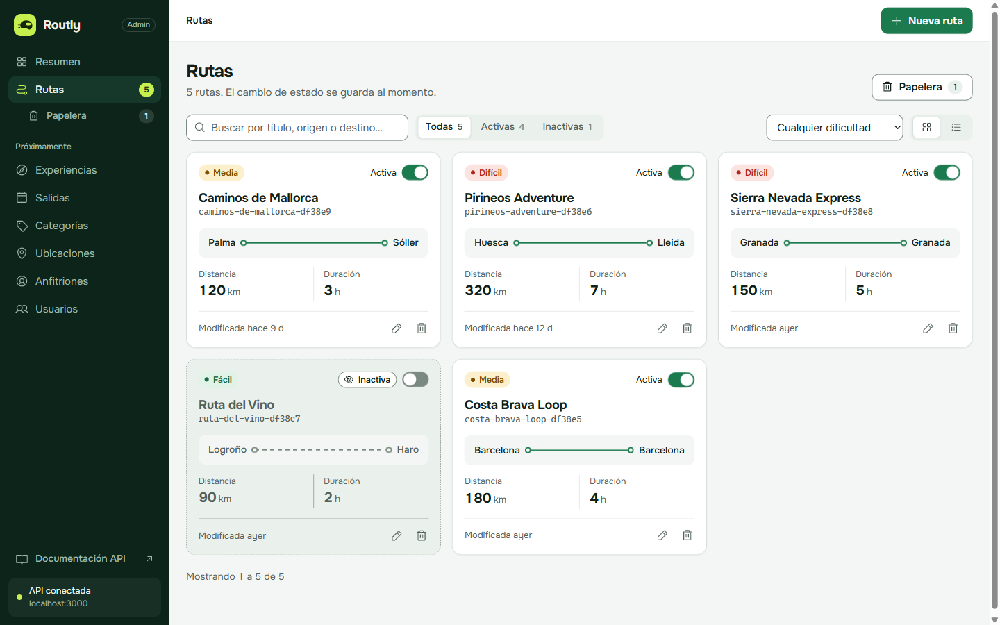
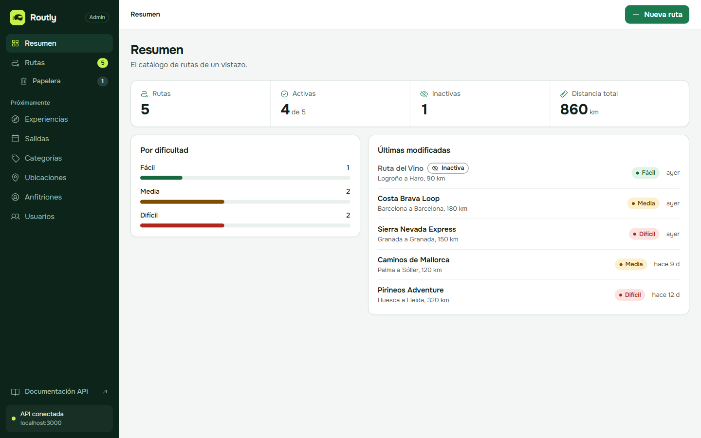
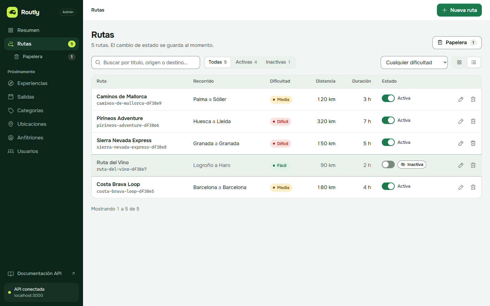
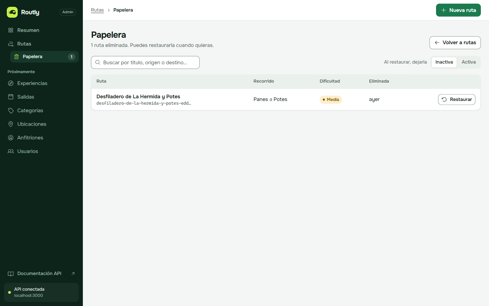
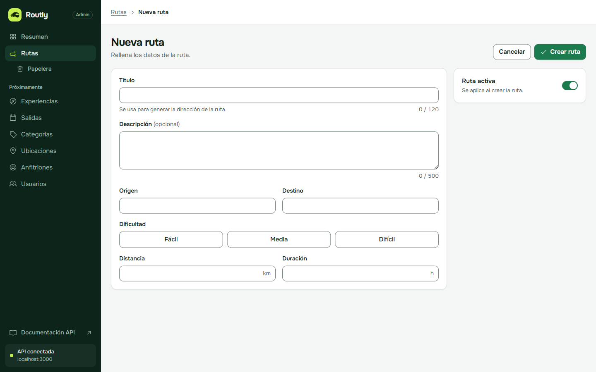
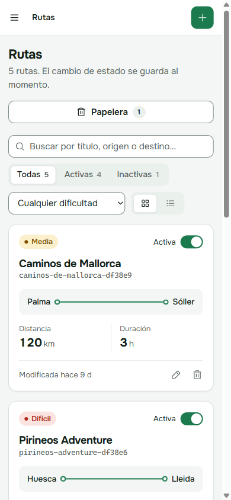
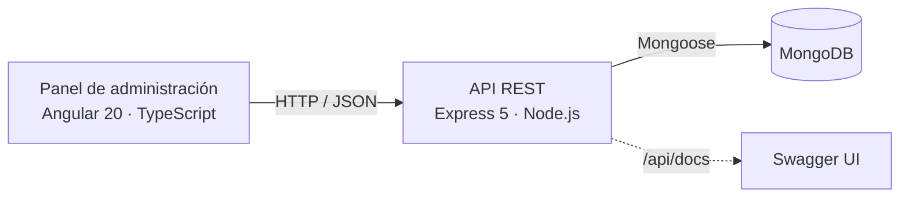

<div align="center">

# Routly

**Las mejores carreteras para ir en moto, reunidas y bien cuidadas en un solo sitio.**

Routly es una plataforma de rutas en moto. Reúne recorridos con su dificultad, su distancia y su duración, y crece hacia salidas en grupo organizadas por anfitriones locales.




</div>

## El problema

Las buenas rutas en moto están repartidas en foros, grupos de mensajería y tracks sueltos. Cuesta saber cuánto dura una ruta, si es para principiantes o dónde empieza. Las salidas en grupo, además, se organizan a mano.

Routly lo ordena en dos partes:

- **Un catálogo de rutas** con la misma información para todas: origen, destino, distancia, duración y dificultad.
- **Experiencias guiadas** sobre esas rutas, con fechas y plazas, organizadas por anfitriones. Esta parte está en desarrollo (ver [Hoja de ruta](#hoja-de-ruta)).

## Lo que ya funciona

Hoy Routly es el **panel de administración** del catálogo y la **API** que lo sirve.

| | |
|---|---|
| **Catálogo completo** | Crea, edita y elimina rutas. Cada una tiene su dirección propia, como `/routes/costa-brava-loop-df38e5/edit`. |
| **Activar y desactivar al instante** | Un interruptor oculta una ruta sin borrarla. El cambio se ve en el momento y, si el servidor falla, vuelve atrás solo. |
| **Papelera** | Nada se borra para siempre. Las rutas eliminadas se pueden revisar y restaurar, como activas o inactivas. También se puede deshacer justo después de eliminar. |
| **Encontrar rápido** | Búsqueda por título, origen o destino. Filtros por estado y dificultad. Vista en tarjetas o en tabla. |
| **Resumen** | Cuántas rutas hay, cuántas están activas, kilómetros totales, reparto por dificultad y últimos cambios. |
| **Errores claros** | Los datos no válidos se señalan junto al campo. Los fallos de red o del servidor se explican en un aviso, sin pantallas en blanco. |
| **Accesible y responsive** | Contraste AA, navegación con teclado y adaptado al móvil con menú lateral desplegable. |
| **API documentada** | Todos los endpoints se pueden probar desde Swagger, en `/api/docs`. |

## Capturas

| Resumen | Vista en tabla |
|---|---|
|  |  |
| **Papelera** | **Nueva ruta** |
|  |  |

<p align="center">
  
</p>

## Cómo está hecho

El proyecto es un monorepo con dos aplicaciones independientes, que se comunican por HTTP y JSON:



| Parte | Tecnología | Qué la hace especial |
|---|---|---|
| [**Panel**](moto-routes-frontend/README.md) | Angular 20 sin zone.js, signals, TypeScript estricto | Estado con signals, actualizaciones optimistas, carga diferida por secciones y un sistema de diseño propio en variables CSS |
| [**API**](moto-routes-api/README.md) | Express 5, Mongoose 9, Zod 4 | Arquitectura por capas, validación antes del controlador, borrado lógico reutilizable y un único formato de error |

## Estructura del repositorio

```
Routly/
├── moto-routes-api/        API REST (Node.js + Express + MongoDB)
├── moto-routes-frontend/   Panel de administración (Angular)
├── docs/screenshots/       Capturas de este README
└── DATABASE.md             Diseño de la base de datos completa
```

Cada parte tiene su README técnico:

- [`moto-routes-api/README.md`](moto-routes-api/README.md): arquitectura, modelo, endpoints, validación y errores.
- [`moto-routes-frontend/README.md`](moto-routes-frontend/README.md): arquitectura, flujo de datos, sistema de diseño y cómo añadir una entidad.

## Puesta en marcha

Necesitas **Node.js 20.19 o superior** y **MongoDB** en marcha en local.

**1. Clona el repositorio**

```bash
git clone https://github.com/Mauro-vs/Routly.git
```

**2. Arranca la API** (`http://localhost:3000`)

```bash
cd Routly/moto-routes-api
npm install
cp .env.example .env
npm run seed
npm run dev
```

`npm run seed` carga cinco rutas de ejemplo. Borra las que hubiera, así que úsalo solo en desarrollo.

**3. Arranca el panel** (`http://localhost:4200`), en otra terminal

```bash
cd Routly/moto-routes-frontend
npm install
npm start
```

## Hoja de ruta

El diseño completo de la base de datos está en [`DATABASE.md`](DATABASE.md). Las siguientes piezas siguen el mismo patrón que las rutas: papelera, estado activo y su sección en el panel.

| Fase | Colecciones | Para qué |
|---|---|---|
| Hecho | `routes` | Catálogo de rutas |
| Cuentas | `roles`, `users`, `hosts` | Administradores, riders y anfitriones con perfil público |
| Catálogo | `categories`, `locations` | Tipos de ruta y ubicaciones con coordenadas para buscar por cercanía |
| Experiencias | `experiences`, `departures` | Salidas guiadas sobre una ruta, con fechas, plazas y precio |
| Contenido | `images` | Galería de imágenes para cualquier elemento |
| Más adelante | `bookings`, `reviews` | Reservas y valoraciones |

El panel ya muestra estas secciones en su menú, bajo "Próximamente".

## Autor

**Mauro**. Proyecto del módulo de Desarrollo Web en Entorno Servidor, 2º de DAW.

## Licencia

[MIT](LICENSE). Puedes usar, copiar y modificar el código siempre que mantengas el aviso de copyright.
