<a id="top"></a>


<p align="center">
  
  
  
  
  
  
</p>

<p align="center">
  <a href="#míralo-en-marcha"><b>Demo</b></a>&nbsp;&nbsp;/&nbsp;&nbsp;<a href="#lo-que-ya-funciona"><b>Funciones</b></a>&nbsp;&nbsp;/&nbsp;&nbsp;<a href="#cómo-está-hecho"><b>Arquitectura</b></a>&nbsp;&nbsp;/&nbsp;&nbsp;<a href="#puesta-en-marcha"><b>Arrancar</b></a>&nbsp;&nbsp;/&nbsp;&nbsp;<a href="#hoja-de-ruta"><b>Hoja de ruta</b></a>
</p>

Routly reúne las mejores carreteras para ir en moto en un catálogo cuidado. Cada ruta tiene la misma información: origen, destino, distancia, duración y dificultad. El siguiente paso son las salidas en grupo organizadas por anfitriones locales.

Las buenas rutas suelen estar repartidas en foros, grupos de mensajería y tracks sueltos. Routly las ordena para que elegir una sea cuestión de segundos.

## Míralo en marcha

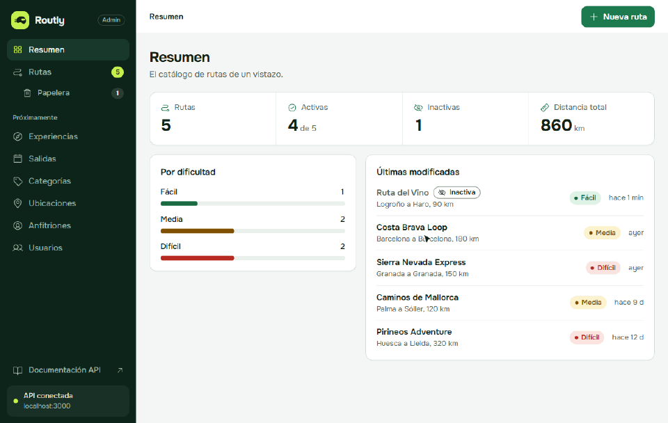

<sub>El panel funcionando contra la API real: activar una ruta, buscar, cambiar a la vista de tabla y abrir la papelera.</sub>

## Lo que ya funciona

Hoy Routly tiene tres partes:
- la **web pública**, donde un motero sin cuenta encuentra una salida guiada y elige fecha;
- el **panel de administración** del catálogo;
- la **API** que sirve a las dos.

La API tiene las diez colecciones de la plataforma (cuentas, anfitriones, catálogo, experiencias, salidas, imágenes y el garaje de motos de cada usuario) y una tienda pública, `/api/shop`. El panel gestiona las colecciones; la web pública solo lee de la tienda.

<table>
  <tr>
    <td width="50%" valign="top">
      <br>
      <b>Nueve colecciones, un mismo patrón</b><br>
      Rutas, categorías, ubicaciones, experiencias, salidas, usuarios, anfitriones, roles e imágenes: cada una con listado, detalle, formulario y papelera, y las relaciones enlazadas entre sí.
    </td>
    <td width="50%" valign="top">
      <br>
      <b>Activar y desactivar al instante</b><br>
      Un interruptor oculta cualquier registro sin borrarlo. El cambio se ve en el momento y, si el servidor falla, vuelve atrás solo.
    </td>
  </tr>
  <tr>
    <td valign="top">
      <br>
      <b>Papelera con vuelta atrás</b><br>
      Nada se borra para siempre. Lo eliminado se puede restaurar como activo o inactivo, o deshacer justo después.
    </td>
    <td valign="top">
      <br>
      <b>Galería de imágenes</b><br>
      Cada ruta, usuario, anfitrión, experiencia, categoría y ubicación tiene su galería: añadir por URL, elegir la principal, ordenar y desactivar.
    </td>
  </tr>
  <tr>
    <td valign="top">
      <br>
      <b>Dashboard</b><br>
      Kilómetros, rutas activas, próximas salidas con sus plazas y precio medio, salidas por mes y reparto por categoría y dificultad, de un vistazo.
    </td>
    <td valign="top">
      <br>
      <b>Errores que se entienden</b><br>
      Los datos no válidos se señalan junto al campo. Los fallos de red o del servidor se explican, sin pantallas en blanco.
    </td>
  </tr>
  <tr>
    <td valign="top">
      <br>
      <b>Accesible y responsive</b><br>
      Contraste AA, uso completo con teclado y menú lateral desplegable en el móvil.
    </td>
    <td valign="top">
      <br>
      <b>API completa y documentada</b><br>
      Nueve colecciones relacionadas, con papelera en todas. Sus 99 endpoints se pueden probar desde Swagger, en <code>/api/docs</code>.
    </td>
  </tr>
</table>

## Capturas

### La web pública

<table>
  <tr>
    <td width="50%">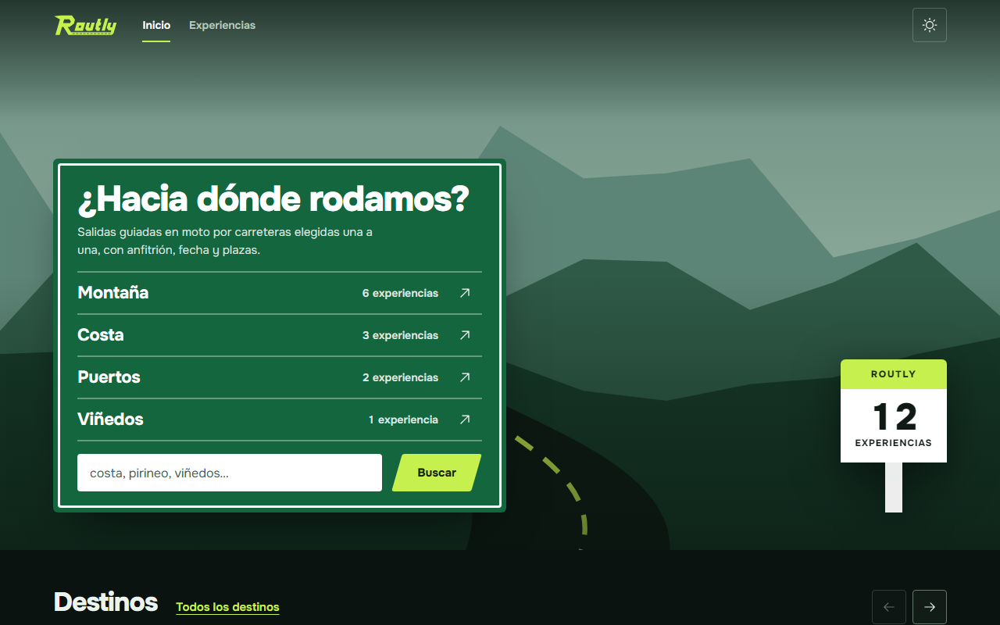</td>
    <td width="50%">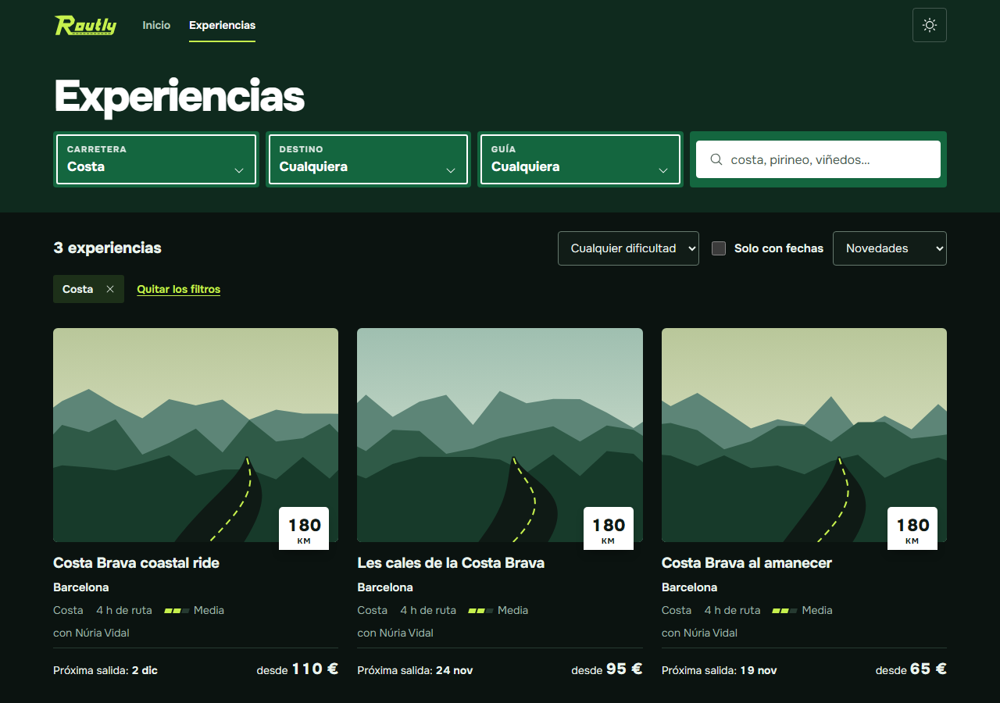</td>
  </tr>
  <tr>
    <td align="center"><sub><b>Home</b>: el panel de orientación es la navegación: cada tipo de carretera lleva al Shop filtrado</sub></td>
    <td align="center"><sub><b>Shop</b>: los filtros, la búsqueda y la página van en la URL</sub></td>
  </tr>
  <tr>
    <td>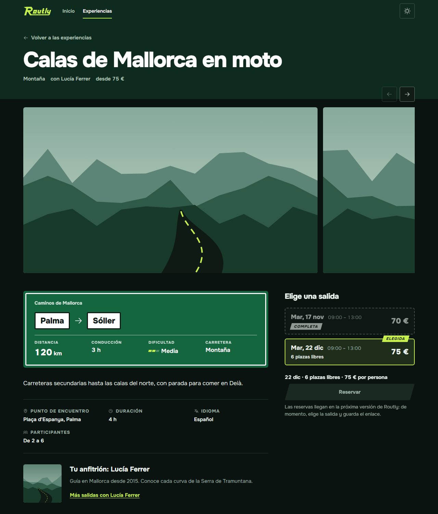</td>
    <td align="center">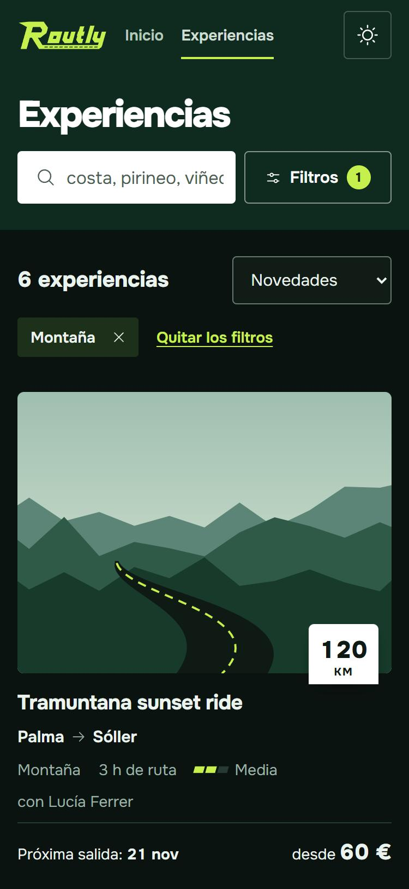</td>
  </tr>
  <tr>
    <td align="center"><sub><b>Detalle</b>: el cartel de la ruta y las salidas como billetes; la completa se ve, pero no se elige</sub></td>
    <td align="center"><sub><b>En el móvil</b>: los filtros, en una hoja que sube desde abajo</sub></td>
  </tr>
</table>

<sub>Las fotos del seed son de picsum; cuando no cargan, la web enseña el paisaje de la marca, que es lo que se ve en estas capturas.</sub>

### El panel

<table>
  <tr>
    <td width="50%">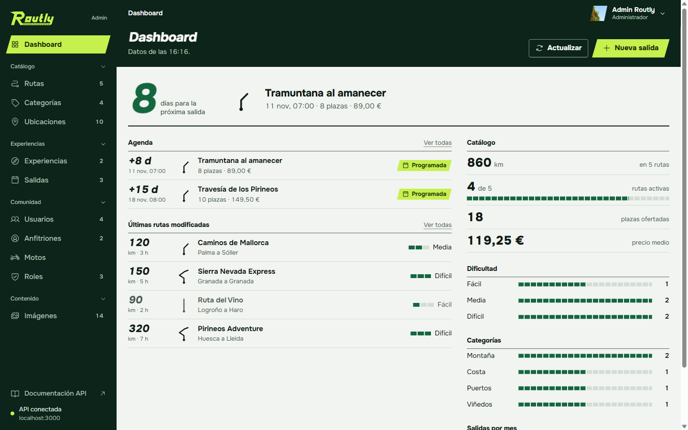</td>
    <td width="50%">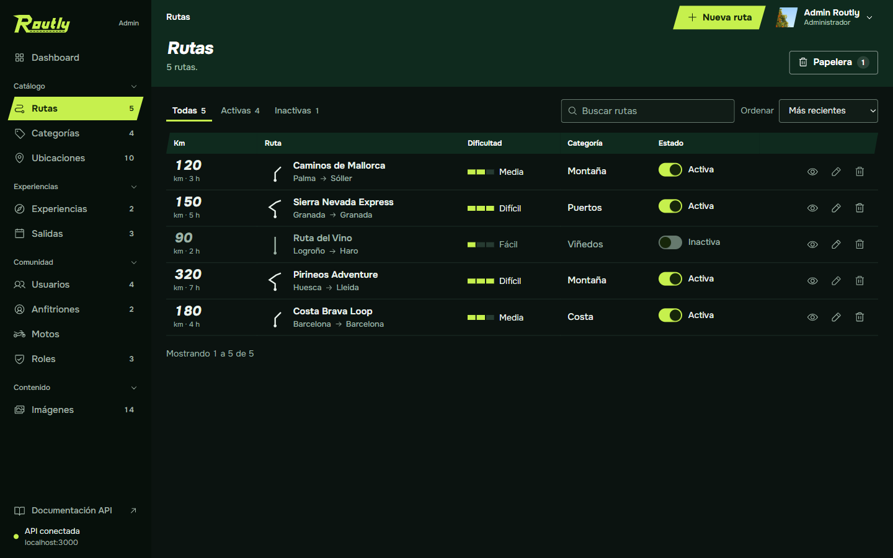</td>
  </tr>
  <tr>
    <td align="center"><sub><b>Dashboard</b>: la próxima salida, la agenda y el catálogo de un vistazo</sub></td>
    <td align="center"><sub><b>Rutas en oscuro</b>: km primero, como en un roadbook; la inactiva se distingue sin depender del color</sub></td>
  </tr>
  <tr>
    <td>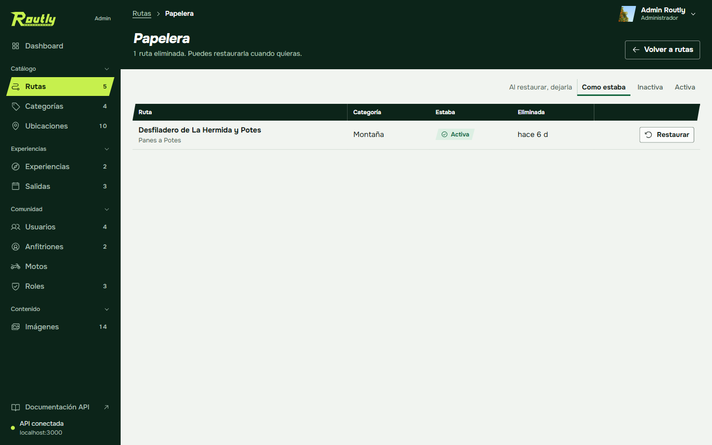</td>
    <td>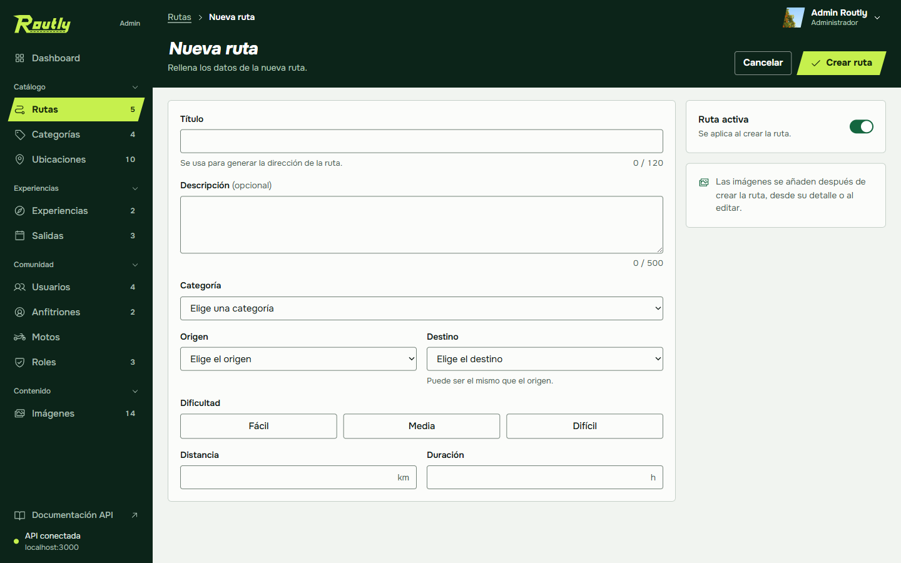</td>
  </tr>
  <tr>
    <td align="center"><sub><b>Papelera</b>: restaurar con un clic</sub></td>
    <td align="center"><sub><b>Nueva ruta</b>: validación en el momento, con los mismos límites que la API</sub></td>
  </tr>
  <tr>
    <td colspan="2">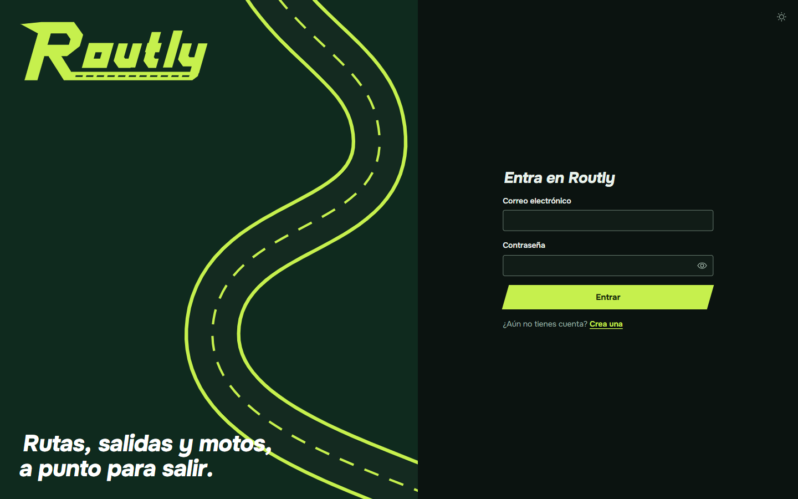</td>
  </tr>
  <tr>
    <td colspan="2" align="center"><sub><b>Inicio de sesión</b>: la carretera se dibuja al entrar</sub></td>
  </tr>
</table>

<details>
<summary><b>Ver la versión para móvil</b></summary>
<br>
<p align="center">
  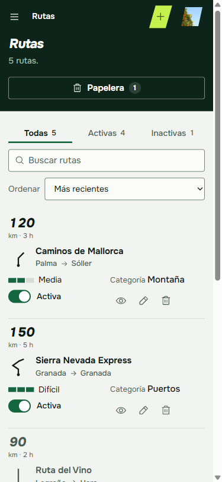
</p>
</details>

## Cómo está hecho

<p>
  
</p>

Un monorepo con tres aplicaciones independientes que se comunican por HTTP y JSON:

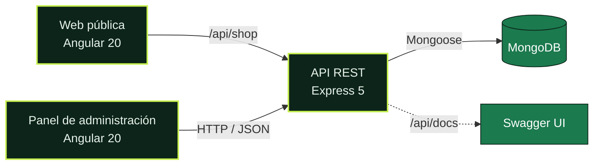

<table>
  <tr>
    <th align="left">Parte</th>
    <th align="left">Tecnología</th>
    <th align="left">Lo que la hace especial</th>
  </tr>
  <tr>
    <td><a href="moto-routes-web/README.md"><b>Web pública</b></a></td>
    <td>Angular 20 sin zone.js, signals, TypeScript estricto</td>
    <td>La URL como fuente de verdad, peticiones canceladas con <code>AbortController</code>, componentes reutilizables (carrusel, filtros, búsqueda, paginación) y la señalización de carretera como diseño</td>
  </tr>
  <tr>
    <td><a href="moto-routes-frontend/README.md"><b>Panel</b></a></td>
    <td>Angular 20 sin zone.js, signals, TypeScript estricto</td>
    <td>Actualizaciones optimistas, carga diferida por secciones y un sistema de diseño propio en variables CSS</td>
  </tr>
  <tr>
    <td><a href="moto-routes-api/README.md"><b>API</b></a></td>
    <td>Express 5, Mongoose 9 con relaciones y <code>populate</code>, Zod 4</td>
    <td>Arquitectura por capas, validación antes del controlador, borrado lógico reutilizable y un único formato de error</td>
  </tr>
</table>

```
Routly/
├── moto-routes-api/        API REST (Node.js + Express + MongoDB)
├── moto-routes-frontend/   Panel de administración (Angular)
├── moto-routes-web/        Web pública: Home, Shop y detalle (Angular)
├── design/                 Bocetos de la web pública y el script del peor caso
├── docs/                   Demo, capturas e imágenes de los README
└── DATABASE.md             Diseño de la base de datos completa
```

Cada parte tiene su README técnico, con la arquitectura explicada pieza a pieza:

- [`moto-routes-api/README.md`](moto-routes-api/README.md): capas, modelo, endpoints, validación y errores.
- [`moto-routes-frontend/README.md`](moto-routes-frontend/README.md): flujo de datos, patrones de Angular, sistema de diseño y cómo añadir una entidad.
- [`moto-routes-web/README.md`](moto-routes-web/README.md): la URL como estado, la cancelación de peticiones y cómo se usa cada componente reutilizable.

## Puesta en marcha

> [!NOTE]
> Necesitas **Node.js 20.19 o superior** y **MongoDB** en marcha en local.

**1. Clona el repositorio**

```bash
git clone https://github.com/Mauro-vs/Routly.git
```

**2. Arranca la API** en `http://localhost:3000`

```bash
cd Routly/moto-routes-api
npm install
cp .env.example .env
npm run seed
npm run dev
```

> [!WARNING]
> `npm run seed` vacía todas las colecciones y carga datos de ejemplo en todas. Úsalo solo en desarrollo.

**3. Arranca el panel** en `http://localhost:4200`, en otra terminal

```bash
cd Routly/moto-routes-frontend
npm install
npm start
```

**4. Arranca la web pública** en `http://localhost:4300`, en otra terminal

```bash
cd Routly/moto-routes-web
npm install
npm start
```

## Hoja de ruta

Las colecciones están hechas de punta a punta (API, panel y tests), y la web pública ya enseña el catálogo y deja elegir salida. Lo siguiente son las reservas: la API ya cuenta las plazas reservadas de cada salida y la web tiene preparado el botón y el servicio. El diseño completo, campo a campo, está en [`DATABASE.md`](DATABASE.md), y las mejoras propuestas para la API, en [`NOTES.md`](NOTES.md).

| Estado | Bloque | Colecciones | Para qué |
|:---:|---|---|---|
|  | Rutas | `routes` | Catálogo de rutas, con categoría, origen, destino y portada |
|  | Catálogo | `categories`, `locations` | Tipos de ruta y ubicaciones con coordenadas |
|  | Cuentas | `roles`, `users`, `hosts` | Administradores, riders y anfitriones con perfil público |
|  | Experiencias | `experiences`, `departures` | Salidas guiadas sobre una ruta, con fechas, plazas, precio y SKU |
|  | Contenido | `images` | Galería de imágenes para rutas, usuarios, anfitriones y el resto |
|  | Garaje | `bikes` | Las motos de cada usuario con su ficha, modificaciones y fotos, y la moto con la que guía cada anfitrión |
|  | Acceso | `users`, `roles` | Inicio de sesión con cookie de sesión; el panel solo para admin, y el perfil y el garaje para cada usuario |
|  | Web pública | `/api/shop` | Home, Shop y detalle con la elección de salida |
|  | Reservas | `bookings` | Plazas reservadas en cada salida y el botón "Reservar" listos; falta la colección (diseño en `DATABASE.md`, sección 14) |
|  | Comunidad | `reviews` | Valoraciones |

## Autor

Hecho por **Mauro** como proyecto del módulo de Desarrollo Web en Entorno Servidor, en 2º de DAW.

Se publica bajo licencia [MIT](LICENSE): puedes usar, copiar y modificar el código siempre que mantengas el aviso de copyright.

<p align="right"><a href="#top">Volver arriba</a></p>
