<a id="top"></a>


<p align="center">
  
  
  
  
  
  
  
  
</p>

<p align="center">
  <a href="#míralo-en-marcha"><b>Demo</b></a>&nbsp;&nbsp;/&nbsp;&nbsp;<a href="#lo-que-ya-funciona"><b>Funciones</b></a>&nbsp;&nbsp;/&nbsp;&nbsp;<a href="#cómo-está-hecho"><b>Arquitectura</b></a>&nbsp;&nbsp;/&nbsp;&nbsp;<a href="#la-api-gateway"><b>API gateway</b></a>&nbsp;&nbsp;/&nbsp;&nbsp;<a href="#puesta-en-marcha"><b>Arrancar</b></a>&nbsp;&nbsp;/&nbsp;&nbsp;<a href="#hoja-de-ruta"><b>Hoja de ruta</b></a>
</p>

Routly reúne las mejores carreteras para ir en moto en un catálogo cuidado y las convierte en **salidas guiadas** por anfitriones locales: eliges la ruta, la fecha y te apuntas. Cada ruta tiene la misma información (origen, destino, distancia, duración y dificultad) y cada salida, sus plazas, su precio y su moto guía.

Las buenas rutas suelen estar repartidas en foros, grupos de mensajería y tracks sueltos. Routly las ordena para que elegir una sea cuestión de segundos, y una IA que solo trabaja con datos reales te cuenta qué tiempo hará, dónde parar y qué llevar.

## Míralo en marcha

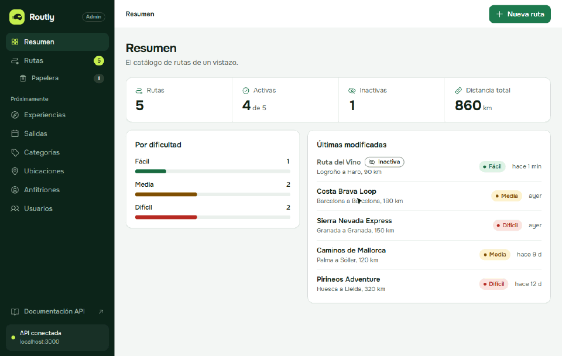

<sub>El panel funcionando contra la API real: activar una ruta, buscar, cambiar a la vista de tabla y abrir la papelera.</sub>

## Lo que ya funciona

Routly son **seis aplicaciones** que se hablan por HTTP y JSON. Cada una vive en su carpeta, con su puerto, su prefijo y sus tests. Se entra por una sola puerta, la **API gateway**: `https://routly.localhost:4000` para la web y `https://panel.routly.localhost:4000` para el panel.

| | Aplicación | Puerto | Prefijo | Para qué |
|:---:|---|:---:|---|---|
|  | [**Web pública**](moto-routes-web/README.md) | 4300 | | Un motero encuentra una salida guiada, ve el recorrido en el mapa y elige fecha; con su cuenta, entra y ve Mi cuenta |
|  | [**Panel**](moto-routes-dashboard/README.md) | 4200 | | Los administradores gestionan el catálogo, las salidas, los usuarios y las imágenes |
|  | [**API**](moto-routes-api/README.md) | 3000 | `/api` | Las diez colecciones, los permisos de cada rol y la tienda pública (`/api/shop`) |
|  | [**Auth**](moto-routes-auth/README.md) | 3002 | `/auth` | Inicia, renueva y cierra las sesiones, y es el único que firma los tokens |
|  | [**IA**](moto-routes-ai/README.md) | 3001 | `/ai` | El bloque Routly IA del detalle, el mapa del recorrido y el asistente |
|  | [**API gateway**](moto-routes-gateway/README.md) | 4000 | todo | La única puerta de entrada: HTTPS, reparte cada prefijo a su servicio, sirve la web y el panel, y comprueba el token en la puerta |

<table>
  <tr>
    <td width="50%" valign="top">
      <br>
      <b>Diez colecciones, un mismo patrón</b><br>
      Rutas, categorías, ubicaciones, experiencias, salidas, usuarios, anfitriones, roles, imágenes y el garaje de motos: cada una con listado, detalle, formulario y papelera, y las relaciones enlazadas entre sí.
    </td>
    <td width="50%" valign="top">
      <br>
      <b>Sesión segura en un servicio propio</b><br>
      Tokens RS256 de 15 minutos en cookies <code>httpOnly</code> y un refresh de 7 días que cambia en cada uso. Si alguien reutiliza uno copiado, se cierran todas las sesiones de ese usuario.
    </td>
  </tr>
  <tr>
    <td valign="top">
      <br>
      <b>Routly IA, con datos reales</b><br>
      Resumen y para quién es cada salida, el tiempo en sus fechas (Open-Meteo), qué llevar y preguntas frecuentes, y un asistente que responde en streaming. La IA solo redacta: no se inventa sitios ni datos.
    </td>
    <td valign="top">
      <br>
      <b>El recorrido en el mapa</b><br>
      La ruta por carretera de verdad (OSRM), con dónde comer, repostar y parar a mirar a lo largo del camino (OpenStreetMap), filtrable por tipo y kilómetro a kilómetro.
    </td>
  </tr>
  <tr>
    <td valign="top">
      <br>
      <b>Activar y desactivar al instante</b><br>
      Un interruptor oculta cualquier registro sin borrarlo. El cambio se ve en el momento y, si el servidor falla, vuelve atrás solo.
    </td>
    <td valign="top">
      <br>
      <b>Papelera con vuelta atrás</b><br>
      Nada se borra para siempre. Lo eliminado se puede restaurar como activo o inactivo, o deshacer justo después.
    </td>
  </tr>
  <tr>
    <td valign="top">
      <br>
      <b>Errores que se entienden</b><br>
      Los datos no válidos se señalan junto al campo. Los fallos de red o del servidor se explican, sin pantallas en blanco.
    </td>
    <td valign="top">
      <br>
      <b>Accesible y responsive</b><br>
      Contraste AA, uso completo con teclado, menú lateral desplegable en el móvil y filtros de la web en una hoja que sube desde abajo.
    </td>
  </tr>
  <tr>
    <td valign="top">
      <br>
      <b>API completa y documentada</b><br>
      Más de 120 endpoints, todos en Swagger (<code>/api/docs</code>, y los de la sesión en <code>/auth/docs</code>), con un mismo formato de error y la validación antes del controlador.
    </td>
    <td valign="top">
      <br>
      <b>Una sola puerta de entrada</b><br>
      Una API gateway propia con HTTPS: reparte cada prefijo a su servicio, da a la web y al panel su propio nombre (y su propia sesión) y corta en la puerta los tokens que no valen. <a href="#la-api-gateway">Cómo está montada</a>.
    </td>
  </tr>
</table>

## Capturas

### La web pública

<table>
  <tr>
    <td width="50%">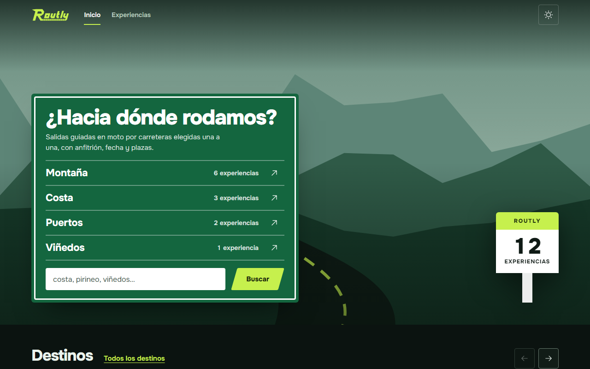</td>
    <td width="50%">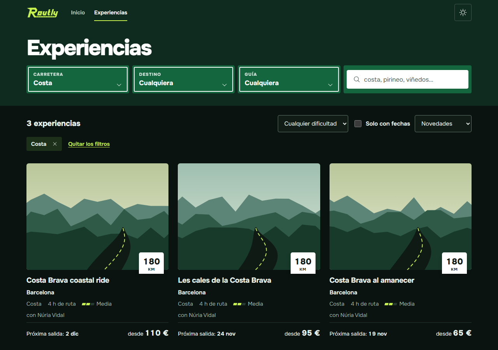</td>
  </tr>
  <tr>
    <td align="center"><sub><b>Home</b>: el panel de orientación es la navegación: cada tipo de carretera lleva al Shop filtrado</sub></td>
    <td align="center"><sub><b>Shop</b>: los filtros, la búsqueda y la página van en la URL</sub></td>
  </tr>
  <tr>
    <td>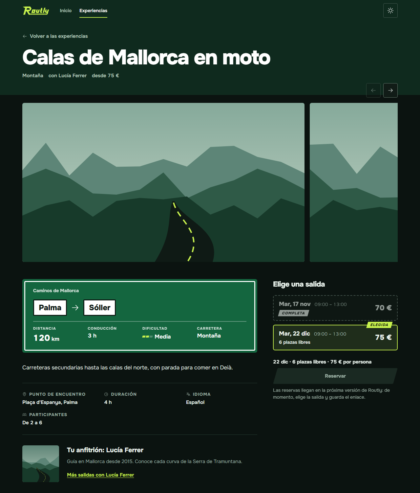</td>
    <td align="center">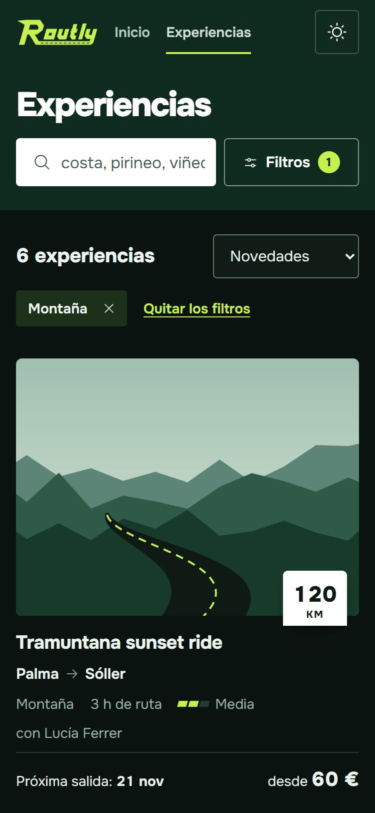</td>
  </tr>
  <tr>
    <td align="center"><sub><b>Detalle</b>: el cartel de la ruta y las salidas como billetes; la completa se ve, pero no se elige</sub></td>
    <td align="center"><sub><b>En el móvil</b>: los filtros, en una hoja que sube desde abajo</sub></td>
  </tr>
</table>

<sub>Las fotos del seed son de picsum; cuando no cargan, la web enseña el paisaje de la marca, que es lo que se ve en estas capturas.</sub>

### El panel

<table>
  <tr>
    <td width="50%">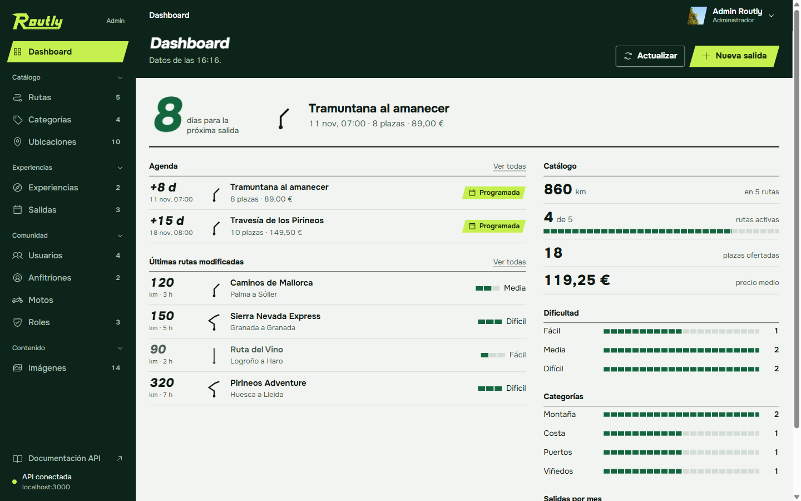</td>
    <td width="50%">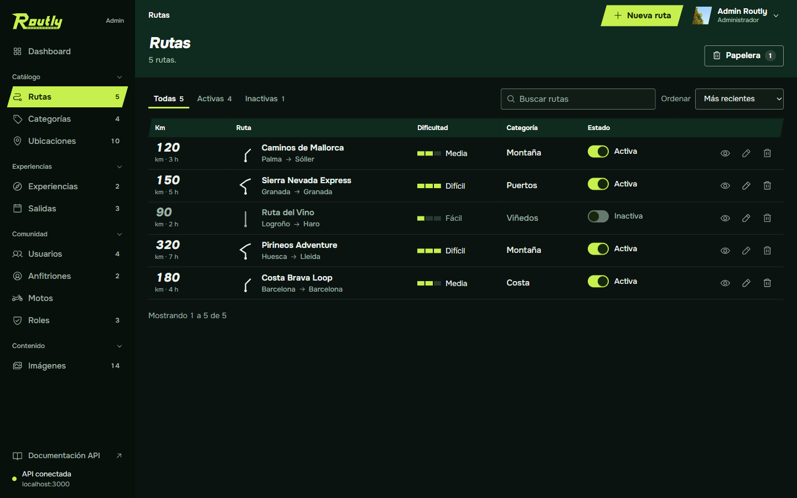</td>
  </tr>
  <tr>
    <td align="center"><sub><b>Dashboard</b>: la próxima salida, la agenda y el catálogo de un vistazo</sub></td>
    <td align="center"><sub><b>Rutas en oscuro</b>: km primero, como en un roadbook; la inactiva se distingue sin depender del color</sub></td>
  </tr>
  <tr>
    <td>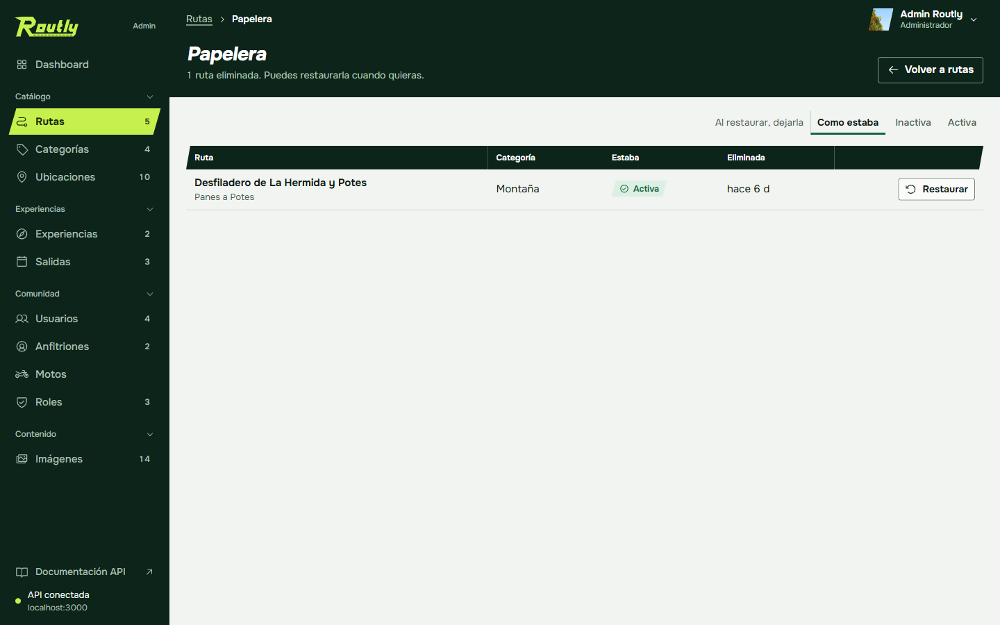</td>
    <td>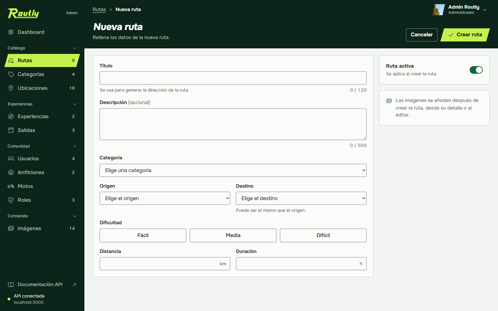</td>
  </tr>
  <tr>
    <td align="center"><sub><b>Papelera</b>: restaurar con un clic</sub></td>
    <td align="center"><sub><b>Nueva ruta</b>: validación en el momento, con los mismos límites que la API</sub></td>
  </tr>
  <tr>
    <td colspan="2">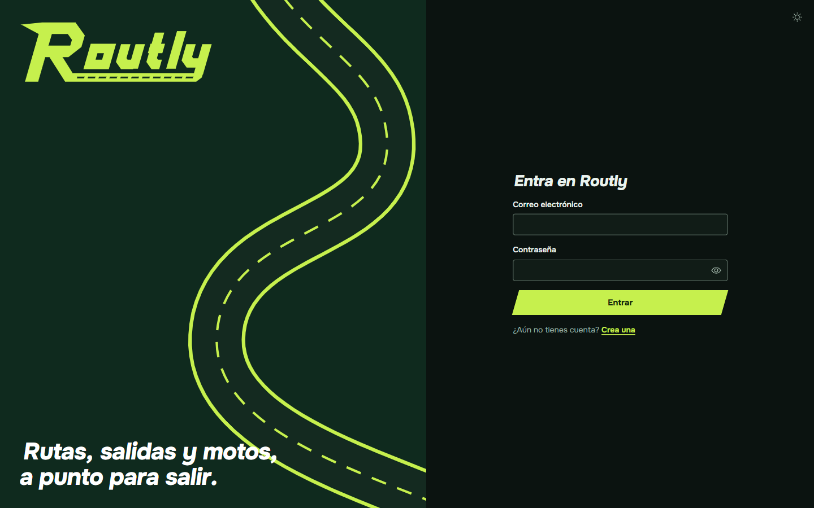</td>
  </tr>
  <tr>
    <td colspan="2" align="center"><sub><b>Inicio de sesión</b>: la carretera se dibuja al entrar</sub></td>
  </tr>
</table>

<details>
<summary><b>Ver la versión para móvil</b></summary>
<br>
<p align="center">
  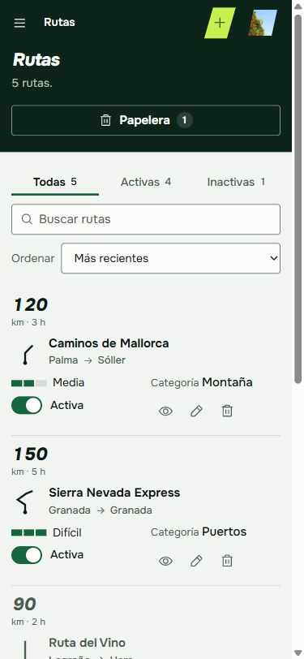
</p>
</details>

## Cómo está hecho

<p>
  
</p>

Un monorepo con seis aplicaciones independientes. Los dos frontales llaman siempre a su propio origen (`/api`, `/auth`, `/ai`), y la API gateway reparte cada prefijo a su servicio:

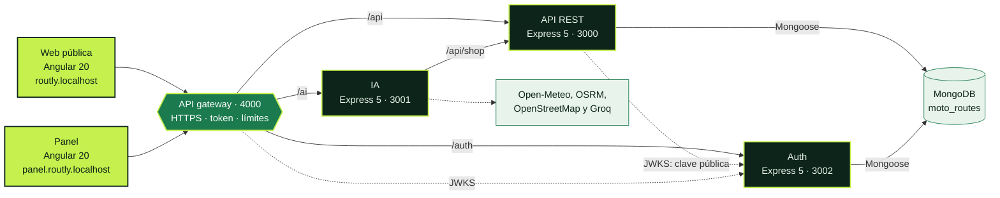

La [API gateway](#la-api-gateway) entró sin tocar una línea de Angular: los frontales siguen llamando a `/api`, `/auth` y `/ai` en su mismo origen. Por eso también se puede seguir entrando sin ella, por `http://localhost:4300` y `:4200`, donde el `proxy.conf.json` de `ng serve` hace el mismo reparto.

<table>
  <tr>
    <th align="left">Parte</th>
    <th align="left">Tecnología</th>
    <th align="left">Lo que la hace especial</th>
  </tr>
  <tr>
    <td><a href="moto-routes-web/README.md"><b>Web pública</b></a></td>
    <td>Angular 20 sin zone.js, signals, TypeScript estricto, Leaflet</td>
    <td>La URL como fuente de verdad, peticiones canceladas con <code>AbortController</code>, componentes reutilizables (carrusel, filtros, búsqueda, paginación) y la señalización de carretera como diseño</td>
  </tr>
  <tr>
    <td><a href="moto-routes-dashboard/README.md"><b>Panel</b></a></td>
    <td>Angular 20 sin zone.js, signals, TypeScript estricto</td>
    <td>Actualizaciones optimistas, carga diferida por secciones, un sistema de diseño propio en variables CSS y la sesión que se renueva sola sin que se note</td>
  </tr>
  <tr>
    <td><a href="moto-routes-api/README.md"><b>API</b></a></td>
    <td>Express 5, Mongoose 9 con relaciones y <code>populate</code>, Zod 4, <code>jose</code></td>
    <td>Arquitectura por capas, validación antes del controlador, borrado lógico reutilizable, permisos por rol y por propiedad, y un único formato de error</td>
  </tr>
  <tr>
    <td><a href="moto-routes-auth/README.md"><b>Auth</b></a></td>
    <td>Express 5, Zod 4, <code>jose</code> (JWT RS256 y JWKS), Argon2id</td>
    <td>Solo él tiene la clave privada: los demás comprueban los tokens con la pública. Refresh rotatorio con detección de reutilización, límite de intentos y protección CSRF</td>
  </tr>
  <tr>
    <td><a href="moto-routes-ai/README.md"><b>IA</b></a></td>
    <td>Express 5, Zod 4, IA gratuita con Groq (GPT-OSS 120B), cambiable a Gemini u OpenRouter desde el <code>.env</code></td>
    <td>Sin base de datos, respuestas de la IA validadas con Zod, agente con herramientas de solo lectura, streaming SSE y caché en memoria</td>
  </tr>
  <tr>
    <td><a href="moto-routes-gateway/README.md"><b>API gateway</b></a></td>
    <td>Express 5, <code>http-proxy-middleware</code>, <code>jose</code>, HTTPS de Node</td>
    <td>Reenvía en streaming (el chat de la IA llega evento a evento), comprueba el token con el JWKS de auth respondiendo igual que la API, y un test que compara su tabla de rutas protegidas con las rutas reales</td>
  </tr>
</table>

### Cómo viaja una sesión

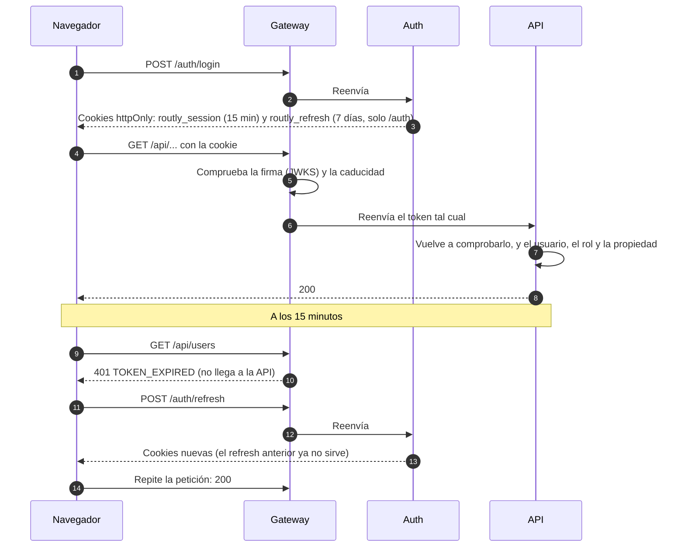

La API y la gateway nunca ven una clave con la que puedan fabricar tokens: solo los comprueban. El panel guarda en `localStorage` hasta cuándo dura la sesión, nunca el token.

### Cómo seguir una petición

Todas las partes siguen el mismo camino, así que para entender una petición basta con abrir un archivo por paso. En los frontales: **componente → store → `ApiService`**. En los servidores: **ruta → controller → service → repository → modelo**. Ningún componente llama a la API y ninguna ruta tiene lógica.

Ejemplo: un rider publica una opinión desde la ficha de una experiencia.

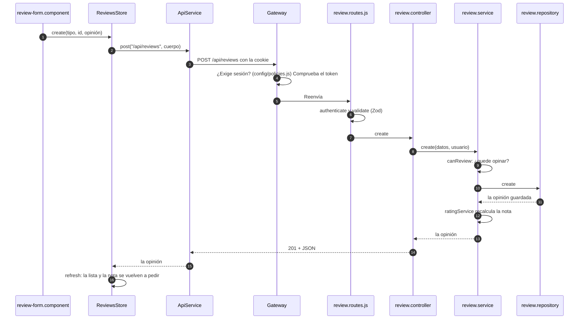

| Paso | Web | Panel | API | IA | Auth |
|---|---|---|---|---|---|
| Lo que ve el usuario | `features/*/…component.{ts,html,css}` | `features/*/pages/*` | | | |
| El estado | `*.store.ts` junto a la página | `features/*/…store.ts` (EntityStore) | | | |
| La petición | `core/api/api.service.ts` | `core/services/api.service.ts` | | | |
| La URL | | | `routes/*.routes.js` (montadas en `app.js`) | `routes/*.routes.js` | `routes/auth.routes.js` |
| Leer la petición y responder | | | `controllers/` | `controllers/` | `controllers/auth.controller.js` |
| Las reglas | | | `services/` | `services/` | `services/` |
| La base de datos | | | `repositories/` → `models/` | (no tiene) | `repositories/` |

Si algo falla, cada servidor lo manda a su `errorHandler` (Express 5 pasa solo los errores de las funciones `async`: no hay `try/catch` en controllers ni middlewares), y en los frontales el store traduce el error a un mensaje.

```
Routly/
├── moto-routes-web/        Web pública: Home, Shop y detalle con el mapa (Angular)
├── moto-routes-dashboard/  Panel de administración (Angular)
├── moto-routes-api/        API REST: colecciones, permisos y tienda (Node.js + Express + MongoDB)
├── moto-routes-auth/       Auth: login, refresh y JWKS (Node.js + Express + MongoDB)
├── moto-routes-ai/         IA: bloque Routly IA, mapa y asistente (Node.js + Express)
├── moto-routes-gateway/    API gateway: HTTPS, reparto, token en la puerta y límites (Node.js + Express)
├── design/                 Bocetos de la web pública y el script del peor caso
├── docs/                   Demo, capturas e imágenes de los README
├── scripts/                npm run dev, test, check y seed para todas las partes a la vez
└── package.json            Esos comandos (sin dependencias)
```

Cada parte tiene su README técnico, con la arquitectura explicada pieza a pieza:

- [`moto-routes-web/README.md`](moto-routes-web/README.md): la URL como estado, la cancelación de peticiones y cómo se usa cada componente reutilizable.
- [`moto-routes-dashboard/README.md`](moto-routes-dashboard/README.md): flujo de datos, patrones de Angular, la sesión, el sistema de diseño y cómo añadir una entidad.
- [`moto-routes-api/README.md`](moto-routes-api/README.md): capas, modelo, endpoints, permisos, validación y errores.
- [`moto-routes-auth/README.md`](moto-routes-auth/README.md): el flujo de la sesión, las claves y su rotación, y las medidas de seguridad.
- [`moto-routes-ai/README.md`](moto-routes-ai/README.md): endpoints de la IA, el mapa, el asistente y sus herramientas, y de dónde sale cada dato.
- [`moto-routes-gateway/README.md`](moto-routes-gateway/README.md): el reparto, el certificado, los dos nombres, la tabla de rutas con sesión y los límites.

## La API gateway

Todo el tráfico entra por una sola puerta, [`moto-routes-gateway`](moto-routes-gateway/README.md), en el puerto 4000: termina el HTTPS, reparte cada petición a su servicio y sirve la web y el panel.

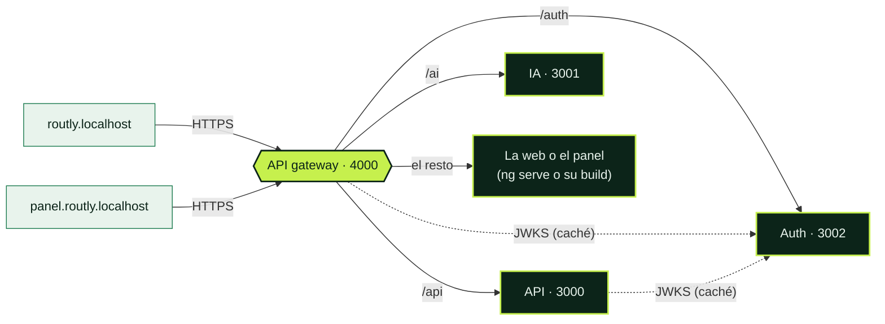

| Qué hace | Cómo |
|---|---|
| **HTTPS** | En el puerto 4000, con un certificado de desarrollo (`npm run certs`, lo crea `npm run dev` si falta) o uno de [mkcert](https://github.com/FiloSottile/mkcert) para que el navegador no avise |
| **Un nombre por frontal** | `routly.localhost` es la web y `panel.routly.localhost` el panel. Los `*.localhost` apuntan a tu equipo sin tocar nada, y como las cookies van por nombre, **cada uno tiene su propia sesión** |
| **Reparto por prefijo** | `/api` → 3000, `/auth` → 3002, `/ai` → 3001, sin reescribir rutas. Todo en streaming: el `Set-Cookie` de auth llega intacto y el chat de la IA, evento a evento |
| **El token en la puerta** | Comprueba la firma con el JWKS de auth en las rutas que exigen sesión y responde igual que la API (`401 TOKEN_EXPIRED` → el frontal renueva). Los permisos los sigue decidiendo la API, que no se fía de nadie |
| **Límites y registro** | Un límite por IP para todo y otro más estricto para el chat y los textos IA. Una línea JSON por petición con su `X-Request-Id`, sin cookies ni tokens |
| **Nadie se hace pasar por otro** | Borra los `X-Forwarded-*` y las cabeceras de identidad que mande el cliente |

Detrás de la gateway, auth, la API y la IA llevan `TRUST_PROXY=1` (ya viene así en sus `.env.example`): leen el protocolo, el nombre y la IP reales de la gateway. Sin eso, el login por la gateway da 403, porque el `Origin` no cuadra.

## Puesta en marcha

> [!NOTE]
> Necesitas **Node.js 20.19 o superior** y **MongoDB** en marcha en local. Nada más: los scripts de la raíz solo usan Node.

### Arrancar todo con un comando

```bash
git clone https://github.com/Mauro-vs/Routly.git
cd Routly
```

```bash
cp moto-routes-auth/.env.example moto-routes-auth/.env
cp moto-routes-api/.env.example moto-routes-api/.env
cp moto-routes-ai/.env.example moto-routes-ai/.env
```

La clave privada de auth (`moto-routes-auth/keys/private.pem`) y el certificado de la gateway (`moto-routes-gateway/certs/`), que no se suben, los crea `npm run dev` la primera vez.

En `moto-routes-ai/.env` va la clave de la IA (`AI_API_KEY`), que es gratis y sin tarjeta: se crea en [console.groq.com/keys](https://console.groq.com/keys). Sin clave todo arranca igual: el tiempo y las paradas salen, y los textos de la IA y el asistente esperan a que la pongas.

```bash
npm run seed
```

```bash
npm run dev
```

`npm run dev` arranca el **servicio de auth** (`http://localhost:3002`), la **API** (`http://localhost:3000`), el **servidor de IA** (`http://localhost:3001`), el **panel** (`http://localhost:4200`), la **web pública** (`http://localhost:4300`) y la **API gateway** en una sola terminal. Entra por la gateway:

- **Web**: `https://routly.localhost:4000`
- **Panel**: `https://panel.routly.localhost:4000` (`admin@routly.dev`, con la contraseña del seed)

La primera vez el navegador avisará en cada uno de que la conexión no es privada (el certificado es de desarrollo): *Configuración avanzada → Continuar*. Para que no avise, [créalo con mkcert](moto-routes-gateway/README.md#el-certificado).

- **Antes de arrancar comprueba** lo que suele fallar: la versión de Node, que MongoDB responde, que existe el `.env` de la API, que auth tiene su clave y la gateway su certificado (si no, los crea), que los servicios llevan `TRUST_PROXY=1` y que los puertos están libres. Si algo falla, dice qué y cómo arreglarlo, y no arranca nada.
- **Instala solo** las dependencias (`npm install`) de las aplicaciones que aún no las tienen.
- **Cada línea lleva su nombre** (`[auth]`, `[api]`, `[ai]`, `[panel]`, `[web]`, `[gateway]`) y **los errores salen en rojo**. Cuando todas responden, enseña sus URL.
- **Si una se cae**, sale un bloque rojo con su nombre y las últimas líneas del error, y las demás siguen.
- **`Ctrl+C` lo para todo**, sin dejar procesos colgados. Los cambios en el código se recargan solos.

`npm run seed` solo hace falta la primera vez, o para volver a los datos de ejemplo.

> [!WARNING]
> `npm run seed` vacía todas las colecciones de la base de datos del `.env` de la API y carga los datos de ejemplo. Por eso pregunta antes de seguir. Úsalo solo en desarrollo.

| Comando (desde la raíz) | Qué hace |
|---|---|
| `npm run dev` | Auth, la API, el servidor de IA, el panel, la web y la gateway a la vez |
| `npm run dev -- auth api panel` | Solo los que se digan (`auth`, `api`, `ai`, `panel`, `web`, `gateway`). El panel necesita auth y la API para iniciar sesión |
| `npm test` | Los tests de todas, uno detrás de otro, con una tabla al final. Solo enseña lo que falla |
| `npm test -- panel --verbose` | Los de una, con toda la salida |
| `npm run check` | Lo de antes de un commit: compila el panel y la web y pasa todos los tests |
| `npm run seed` | Los datos de ejemplo, después de confirmarlo (`-- --yes` para no preguntar) |

Los scripts están en [`scripts/`](scripts) y solo usan Node: no hace falta instalar nada en la raíz.

<details>
<summary><b>Arrancar cada parte por separado</b></summary>

**1. El servicio de auth** en `http://localhost:3002`

```bash
cd moto-routes-auth
npm install
npm run keys
npm run dev
```

**2. La API** en `http://localhost:3000`, en otra terminal

```bash
cd moto-routes-api
npm install
npm run dev
```

**3. El servidor de IA** en `http://localhost:3001`, en otra terminal

```bash
cd moto-routes-ai
npm install
npm run dev
```

**4. El panel** en `http://localhost:4200`, en otra terminal

```bash
cd moto-routes-dashboard
npm install
npm start
```

**5. La web pública** en `http://localhost:4300`, en otra terminal

```bash
cd moto-routes-web
npm install
npm start
```

**6. La API gateway** en `https://routly.localhost:4000` y `https://panel.routly.localhost:4000`, en otra terminal

```bash
cd moto-routes-gateway
npm install
npm run certs
npm run dev
```

</details>

## Hoja de ruta

El catálogo está hecho de punta a punta (API, panel y tests), la web pública ya enseña las salidas con su mapa y su IA, la sesión vive en su propio servicio y todo entra por una API gateway propia con HTTPS. Lo siguiente son las reservas: la API ya cuenta las plazas reservadas de cada salida y la web tiene preparado el botón y el servicio.

| Estado | Bloque | Dónde | Para qué |
|:---:|---|---|---|
|  | Rutas | `routes` | Catálogo de rutas, con categoría, origen, destino, puntos de paso y portada |
|  | Catálogo | `categories`, `locations` | Tipos de ruta y ubicaciones con coordenadas |
|  | Cuentas | `roles`, `users`, `profiles`, `hosts` | Administradores, riders y anfitriones con perfil público |
|  | Experiencias | `experiences`, `departures` | Salidas guiadas sobre una ruta, con fechas, plazas, precio y SKU |
|  | Contenido | `images` | Galería de imágenes para rutas, usuarios, anfitriones y el resto |
|  | Garaje | `bikes` | Las motos de cada usuario con su ficha, modificaciones y fotos, y la moto con la que guía cada anfitrión |
|  | Web pública | `/api/shop` | Home, Shop y detalle con la elección de salida |
|  | Routly IA | `/ai` | El bloque Routly IA del detalle, el mapa del recorrido y el asistente, en un servidor aparte sin base de datos |
|  | Auth | `/auth`, `sessions` | Servicio propio con RS256 + JWKS, cookies `httpOnly` y refresh rotatorio con `status` (active, used, revoked); el panel solo para admin, y en la web pública registro, login y Mi cuenta para los clientes |
|  | API gateway | `moto-routes-gateway` | Una sola entrada para todo, con HTTPS, la web y el panel en su propio nombre, el token comprobado en la puerta y límites ([cómo está montada](#la-api-gateway)) |
|  | Reservas | `bookings` | Plazas reservadas en cada salida y el botón "Reservar" listos; falta la colección |
|  | Comunidad | `reviews` | Valoraciones |

## Autor

Hecho por **Mauro** como proyecto del módulo de Desarrollo Web en Entorno Servidor, en 2º de DAW.

Se publica bajo licencia [MIT](LICENSE): puedes usar, copiar y modificar el código siempre que mantengas el aviso de copyright.

<p align="right"><a href="#top">Volver arriba</a></p>
