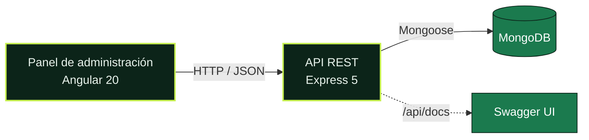

<a id="top"></a>



<p align="center">
  
  
  
  
  
  
</p>

<p align="center">
  <a href="#míralo-en-marcha"><b>Demo</b></a>&nbsp;&nbsp;/&nbsp;&nbsp;<a href="#lo-que-ya-funciona"><b>Funciones</b></a>&nbsp;&nbsp;/&nbsp;&nbsp;<a href="#cómo-está-hecho"><b>Arquitectura</b></a>&nbsp;&nbsp;/&nbsp;&nbsp;<a href="#puesta-en-marcha"><b>Arrancar</b></a>&nbsp;&nbsp;/&nbsp;&nbsp;<a href="#hoja-de-ruta"><b>Hoja de ruta</b></a>
</p>

Routly reúne las mejores carreteras para ir en moto en un catálogo cuidado. Cada ruta tiene la misma información: origen, destino, distancia, duración y dificultad. El siguiente paso son las salidas en grupo organizadas por anfitriones locales.

Las buenas rutas suelen estar repartidas en foros, grupos de mensajería y tracks sueltos. Routly las ordena para que elegir una sea cuestión de segundos.

## Míralo en marcha


<sub>El panel funcionando contra la API real: activar una ruta, buscar, cambiar a la vista de tabla y abrir la papelera.</sub>

## Lo que ya funciona

Hoy Routly es el **panel de administración** del catálogo y la **API** que lo sirve.

<table>
  <tr>
    <td width="50%" valign="top">
      <br>
      <b>Catálogo completo</b><br>
      Crea, edita y elimina rutas. Cada una tiene su propia dirección, como <code>/routes/costa-brava-loop-df38e5/edit</code>.
    </td>
    <td width="50%" valign="top">
      <br>
      <b>Activar y desactivar al instante</b><br>
      Un interruptor oculta una ruta sin borrarla. El cambio se ve en el momento y, si el servidor falla, vuelve atrás solo.
    </td>
  </tr>
  <tr>
    <td valign="top">
      <br>
      <b>Papelera con vuelta atrás</b><br>
      Nada se borra para siempre. Las rutas eliminadas se pueden restaurar como activas o inactivas, o deshacer justo después.
    </td>
    <td valign="top">
      <br>
      <b>Encontrar rápido</b><br>
      Búsqueda por título, origen o destino, filtros por estado y dificultad, y vista en tarjetas o en tabla.
    </td>
  </tr>
  <tr>
    <td valign="top">
      <br>
      <b>Resumen del catálogo</b><br>
      Rutas activas e inactivas, kilómetros totales, reparto por dificultad y últimos cambios, de un vistazo.
    </td>
    <td valign="top">
      <br>
      <b>Errores que se entienden</b><br>
      Los datos no válidos se señalan junto al campo. Los fallos de red o del servidor se explican, sin pantallas en blanco.
    </td>
  </tr>
  <tr>
    <td valign="top">
      <br>
      <b>Accesible y responsive</b><br>
      Contraste AA, uso completo con teclado y menú lateral desplegable en el móvil.
    </td>
    <td valign="top">
      <br>
      <b>API documentada</b><br>
      Todos los endpoints se pueden probar desde Swagger, en <code>/api/docs</code>.
    </td>
  </tr>
</table>

## Capturas

<table>
  <tr>
    <td width="50%"></td>
    <td width="50%"></td>
  </tr>
  <tr>
    <td align="center"><sub><b>Resumen</b>: el estado del catálogo de un vistazo</sub></td>
    <td align="center"><sub><b>Vista en tabla</b>: la ruta inactiva se distingue sin depender del color</sub></td>
  </tr>
  <tr>
    <td></td>
    <td></td>
  </tr>
  <tr>
    <td align="center"><sub><b>Papelera</b>: restaurar con un clic</sub></td>
    <td align="center"><sub><b>Nueva ruta</b>: validación en el momento, con los mismos límites que la API</sub></td>
  </tr>
</table>

<details>
<summary><b>Ver la versión para móvil</b></summary>
<br>
<p align="center">
  
</p>
</details>

## Cómo está hecho

<p>
  
</p>

Un monorepo con dos aplicaciones independientes que se comunican por HTTP y JSON:



<table>
  <tr>
    <th align="left">Parte</th>
    <th align="left">Tecnología</th>
    <th align="left">Lo que la hace especial</th>
  </tr>
  <tr>
    <td><a href="moto-routes-frontend/README.md"><b>Panel</b></a></td>
    <td>Angular 20 sin zone.js, signals, TypeScript estricto</td>
    <td>Actualizaciones optimistas, carga diferida por secciones y un sistema de diseño propio en variables CSS</td>
  </tr>
  <tr>
    <td><a href="moto-routes-api/README.md"><b>API</b></a></td>
    <td>Express 5, Mongoose 9, Zod 4</td>
    <td>Arquitectura por capas, validación antes del controlador, borrado lógico reutilizable y un único formato de error</td>
  </tr>
</table>

```
Routly/
├── moto-routes-api/        API REST (Node.js + Express + MongoDB)
├── moto-routes-frontend/   Panel de administración (Angular)
├── docs/                   Demo, capturas e imágenes de los README
└── DATABASE.md             Diseño de la base de datos completa
```

Cada parte tiene su README técnico, con la arquitectura explicada pieza a pieza:

- [`moto-routes-api/README.md`](moto-routes-api/README.md): capas, modelo, endpoints, validación y errores.
- [`moto-routes-frontend/README.md`](moto-routes-frontend/README.md): flujo de datos, patrones de Angular, sistema de diseño y cómo añadir una entidad.

## Puesta en marcha

> [!NOTE]
> Necesitas **Node.js 20.19 o superior** y **MongoDB** en marcha en local.

**1. Clona el repositorio**

```bash
git clone https://github.com/Mauro-vs/Routly.git
```

**2. Arranca la API** en `http://localhost:3000`

```bash
cd Routly/moto-routes-api
npm install
cp .env.example .env
npm run seed
npm run dev
```

> [!WARNING]
> `npm run seed` borra las rutas que haya y carga cinco de ejemplo. Úsalo solo en desarrollo.

**3. Arranca el panel** en `http://localhost:4200`, en otra terminal

```bash
cd Routly/moto-routes-frontend
npm install
npm start
```

## Hoja de ruta

Las siguientes piezas siguen el mismo patrón que las rutas: papelera, estado activo y su sección en el panel, que ya aparece en el menú como "Próximamente". El diseño completo, campo a campo, está en [`DATABASE.md`](DATABASE.md).

| Estado | Bloque | Colecciones | Para qué |
|:---:|---|---|---|
|  | Rutas | `routes` | Catálogo de rutas |
|  | Cuentas | `roles`, `users`, `hosts` | Administradores, riders y anfitriones con perfil público |
|  | Catálogo | `categories`, `locations` | Tipos de ruta y ubicaciones con coordenadas para buscar por cercanía |
|  | Experiencias | `experiences`, `departures` | Salidas guiadas sobre una ruta, con fechas, plazas y precio |
|  | Contenido | `images` | Galería de imágenes para cualquier elemento |
|  | Comunidad | `bookings`, `reviews` | Reservas y valoraciones |

## Autor

Hecho por **Mauro** como proyecto del módulo de Desarrollo Web en Entorno Servidor, en 2º de DAW.

Se publica bajo licencia [MIT](LICENSE): puedes usar, copiar y modificar el código siempre que mantengas el aviso de copyright.

<p align="right"><a href="#top">Volver arriba</a></p>
