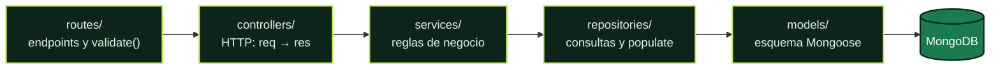
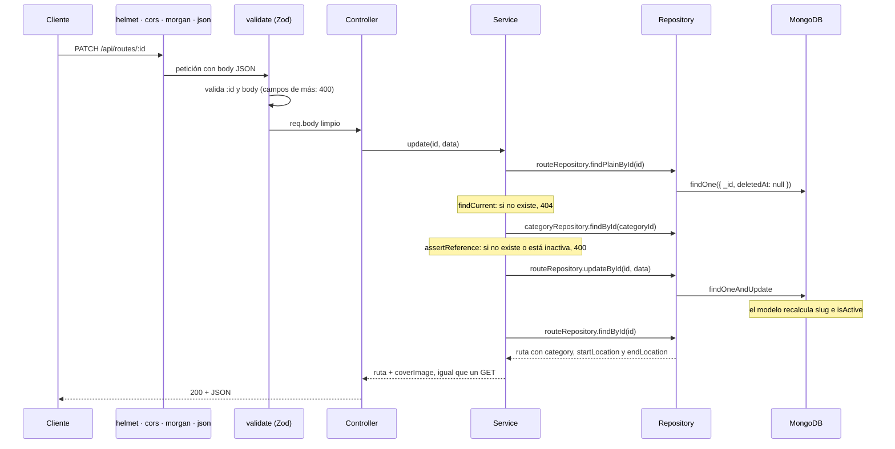
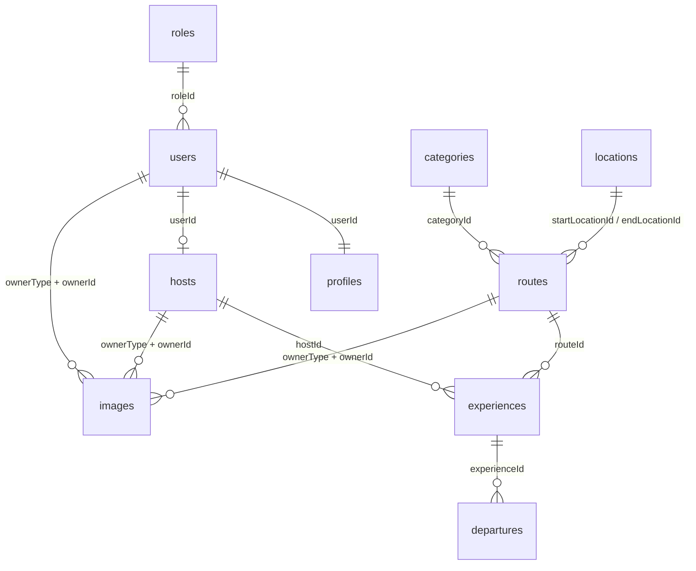
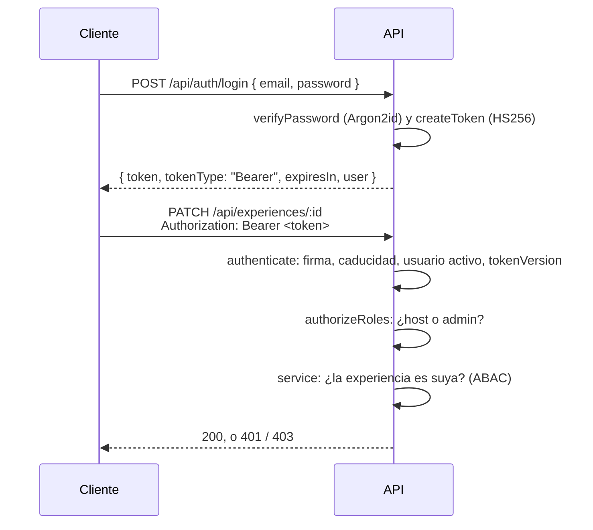

<a id="top"></a>


<p align="center">
  
  
  
  
  
</p>

API REST de Routly. Gestiona nueve colecciones relacionadas entre sí: roles, usuarios, anfitriones, categorías, ubicaciones, rutas, experiencias, salidas e imágenes. Todas se crean, se consultan (también por slug), se editan, se activan o desactivan, se eliminan con borrado lógico y se restauran.

Forma parte del monorepo de Routly. La visión general del proyecto está en el [README de la raíz](../README.md), el diseño campo a campo de la base de datos en [`DATABASE.md`](../DATABASE.md) y el panel que consume esta API en [`moto-routes-frontend`](../moto-routes-frontend/README.md).

## Contenido

- [Lenguaje y librerías](#lenguaje-y-librerías)
- [Instalación](#instalación) · [Configuración](#configuración) · [Ejecución](#ejecución) · [Seed](#seed)
- [Arquitectura](#arquitectura) · [Estructura del proyecto](#estructura-del-proyecto)
- [Colecciones y relaciones](#colecciones-y-relaciones) · [Endpoints](#endpoints)
- [Activo / inactivo frente a eliminado](#activo--inactivo-frente-a-eliminado) · [Soft delete y papelera](#soft-delete-y-papelera)
- [Imágenes](#imágenes) · [SKU de las salidas](#sku-de-las-salidas)
- [Validación (Zod)](#validación-zod) · [Manejo de errores](#manejo-de-errores)
- [Autenticación y autorización](#autenticación-y-autorización) · [Seguridad (Helmet)](#seguridad-helmet) · [Logs (Morgan)](#logs-morgan)
- [Cómo añadir un recurso](#cómo-añadir-un-recurso)

## Lenguaje y librerías

JavaScript moderno sobre **Node.js**, con módulos ES (`"type": "module"` en `package.json`, así que se usa `import`/`export` en lugar de `require`). No hay paso de compilación: el código de `src/` es el que se ejecuta.

| Librería | Versión | Para qué se usa |
|---|---|---|
| [Express](https://expressjs.com) | 5.2 | Servidor HTTP y enrutado |
| [Mongoose](https://mongoosejs.com) | 9.10 | Modelos sobre MongoDB, relaciones con `ref` y `populate`, validación de segundo nivel, hooks y plugins |
| [Zod](https://zod.dev) | 4.6 | Validación y limpieza de `params`, `query` y `body` antes del controlador. También genera los esquemas de Swagger |
| [argon2](https://github.com/ranisalt/node-argon2) | 0.45 | Hash de las contraseñas con Argon2id |
| [jsonwebtoken](https://github.com/auth0/node-jsonwebtoken) | 9.0 | Firma y verificación de los JWT (HS256) |
| [express-rate-limit](https://github.com/express-rate-limit/express-rate-limit) | 8.7 | Límite de intentos en el login y el registro |
| [Helmet](https://helmetjs.github.io) | 8.3 | Cabeceras de seguridad |
| [cors](https://github.com/expressjs/cors) | 2.8 | Orígenes y métodos permitidos |
| [Morgan](https://github.com/expressjs/morgan) | 1.12 | Logs HTTP en consola y en archivo |
| [swagger-jsdoc](https://github.com/Surnet/swagger-jsdoc) + [swagger-ui-express](https://github.com/scottie1984/swagger-ui-express) | 6.3 / 5.0 | Documentación OpenAPI en `/api/docs` |
| [dotenv](https://github.com/motdotla/dotenv) | 18.0 | Carga las variables de `.env` |
| [nodemon](https://nodemon.io) (desarrollo) | 3.1 | Reinicia el servidor al guardar |

Los tests usan el runner que trae Node (`node:test`), sin dependencias. Los de integración necesitan MongoDB en marcha (ver [Tests](#tests)).

## Instalación

Requisitos: **Node.js 20 o superior** (probado con 24.8) y **MongoDB** en marcha.

```bash
cd moto-routes-api
npm install
```

## Configuración

Copiar `.env.example` a `.env` y ajustar los valores:

```
NODE_ENV=development
PORT=3000
MONGODB_URI=mongodb://localhost:27017/moto_routes
CORS_ORIGIN=http://localhost:4200
JWT_SECRET=<secreto largo y aleatorio>
JWT_EXPIRES_IN=7d
```

`JWT_SECRET` es obligatorio: sin él el servidor no arranca. Firma los tokens (HS256) y en producción tiene que tener al menos 32 caracteres. Para generar uno:

```bash
node -e "console.log(require('crypto').randomBytes(48).toString('base64url'))"
```

`JWT_EXPIRES_IN` es la caducidad de los tokens: un texto como `1h` o `7d`, o un número de segundos. Si no se define, `1h`. En producción se recomienda `1h`.

`CORS_ORIGIN` solo se usa con `NODE_ENV=production`: es la lista de orígenes (separados por comas) que pueden llamar a la API. En desarrollo se acepta cualquier origen; en producción, si no se define, no se acepta ninguno.

`NODE_ENV` puede ser `development` o `production` y cambia el comportamiento de Helmet y Morgan (ver abajo).

## Ejecución

```bash
# Desarrollo (nodemon reinicia el servidor al guardar un cambio)
npm run dev

# Producción
npm start

# Reiniciar la base de datos con datos de ejemplo
npm run seed

# Crear el perfil de los usuarios que no lo tengan (bases de datos de antes de los perfiles)
npm run migrate:profiles

# Tests
npm test
```

En desarrollo, `nodemon` vigila la carpeta `src/` y el archivo `.env`, y reinicia al cambiar un `.js` o un `.json`. Se configura en `nodemonConfig`, dentro de `package.json`. Para reiniciar a mano, escribe `rs` y pulsa Intro en esa terminal.

### Tests

`npm test` ejecuta 104 tests con `node:test`:

| Archivo | Qué prueba |
|---|---|
| `src/utils/sku.test.js` | Formato del SKU, fecha del alta en hora de Madrid y alfabeto sin caracteres ambiguos |
| `src/utils/passwd.test.js` | Hash Argon2id con los parámetros de OWASP, contraseña correcta e incorrecta, hash mal formado y `needsRehash` |
| `src/utils/jwt.test.js` | Firma HS256 y payload, `jti` único, sin token, caducado, firma alterada, algoritmo `none`, otro secreto, HS512 y payload incompleto |
| `src/utils/access.test.js` | Las funciones de ABAC sin base de datos: dueño, otro usuario, admin, cadena host → experiencia → salida e imágenes |
| `src/testing/auth-errors.test.js` | Formato exacto de los 401 y 403, `WWW-Authenticate`, `authorizeRoles`, `authorizeOwnership` y el límite de intentos (429) |
| `src/testing/auth.test.js` | `authenticate` (sin token, otro formato, caducado, desactivado, eliminado, `tokenVersion`, rol leído al momento), cada fila de la matriz y ABAC con dos anfitriones |
| `src/testing/profile.test.js` | Registro, login, rehash, `me`, `logout` (lista negra), `logout-all`, `/api/profile`, cambio de contraseña, ciclo de vida del perfil y reglas de los admins |
| `src/testing/docs.test.js` | Que cada operación de Swagger con candado pide token y las demás no, y los mensajes documentados |
| `src/testing/slug.test.js` | Slug con sufijo del `_id`, que sigue al nombre, el de las salidas al renombrar su experiencia (también las eliminadas) y que no se puede cambiar a mano |
| `src/testing/departure.test.js` | SKU inmutable y buscable en minúsculas, fechas ISO, salida en el futuro, plazas entre el mínimo y el máximo, dos salidas a la misma hora, estados y precio |
| `src/testing/soft-delete.test.js` | Eliminar conserva el estado, listados y papelera, restaurar como estaba, cascada de imágenes, dependientes, referencias eliminadas, duplicados en la papelera y roles base |
| `src/testing/validation.test.js` | Campos de más, `status` en el PATCH, vaciar con `null`, región vacía, límites, contraseña, idioma, `https`, etiqueta de rol, 413, respuestas iguales al GET y 404 frente a 400 |

Los de `src/testing/` son de integración: levantan la API real (routers, services y modelos, con `src/testing/app.js`) sobre una base de datos temporal `routly_test_*` que se borra al terminar. Necesitan **MongoDB en marcha** en `mongodb://localhost:27017`, o en la URI de la variable `MONGODB_TEST_URI`. No tocan la base de datos de `MONGODB_URI`.

Con el servidor en marcha, la documentación interactiva está en `http://localhost:3000/api/docs` y la comprobación de estado en `http://localhost:3000/health`.

## Seed

`npm run seed` borra **todas** las colecciones y carga datos de ejemplo coherentes entre sí. Se puede ejecutar las veces que haga falta: siempre deja lo mismo.

| Colección | Datos |
|---|---|
| `roles` | `admin` (Administrador), `host` (Anfitrión) y `rider` (Motorista): los tres son roles base protegidos |
| `users` | Admin Routly (`admin@routly.dev`, admin), Lucía Ferrer (`lucia@routly.dev`, host), Pablo Ortega (`pablo@routly.dev`, host) y Marta Gil (`marta@routly.dev`, rider) |
| `profiles` | Uno por usuario. Lucía, Pablo y Marta con datos; el del admin, vacío |
| `hosts` | Los perfiles de Lucía y Pablo |
| `categories` | Costa, Montaña, Puertos y Viñedos |
| `locations` | Barcelona, Huesca, Lleida, Logroño, Haro, Granada, Palma, Sóller, Panes y Potes, con coordenadas reales |
| `routes` | Seis rutas. "Ruta del Vino" queda inactiva y "Desfiladero de La Hermida y Potes" en la papelera |
| `experiences` | "Tramuntana al amanecer" (Lucía, Caminos de Mallorca) y "Travesía de los Pirineos" (Pablo, Pirineos Adventure) |
| `departures` | Tres salidas futuras, calculadas desde el día en que se ejecuta. Una está cancelada |
| `images` | Fotos de las rutas, de los usuarios y de los anfitriones. Las de la ruta de la papelera están eliminadas con ella |

> [!WARNING]
> - El seed **borra físicamente** todas las colecciones. Es la única excepción al soft delete y solo debe usarse en desarrollo.
> - Todos los usuarios tienen la contraseña **`routly-dev-1234`**. Es solo para desarrollo.

Los datos se crean a través de los services, así que pasan por las mismas reglas que una petición a la API: hash de la contraseña, perfil de cada usuario, referencias, slug, SKU... El seed actúa como admin (`SYSTEM_ACTOR`, en `utils/access.js`).

Para probar los permisos: el admin puede con todo; Lucía y Pablo, cada uno con su experiencia ("Tramuntana al amanecer" y "Travesía de los Pirineos"), y Marta, rider, solo con su perfil.

## Arquitectura

Arquitectura por capas. Cada capa tiene una sola responsabilidad y solo llama a la inmediatamente inferior:



Cada colección tiene sus seis archivos, uno por capa. Por ejemplo, para `routes`:

| Capa | Archivo | Responsabilidad | Lo que no hace |
|---|---|---|---|
| Rutas | `routes/route.routes.js` | Asocia método y URL a un controlador, y aplica `validate()` con el esquema de Zod | Lógica |
| Controlador | `controllers/route.controller.js` | `async/await` con `try/catch`: lee `req`, llama al service y responde con el código adecuado (200, 201, 204). Si algo falla, pasa el error con `next(error)` | Consultar la base de datos |
| Service | `services/route.service.js` | Reglas de negocio: 404 si no existe, 400 si una referencia no es válida, 409 si hay dependientes o un dato único está repetido. Gestiona las relaciones y la cascada de imágenes | Conocer `req` o `res` |
| Repositorio | `repositories/route.repository.js` | Consultas a Mongoose con `populate` de las relaciones. Devuelven objetos planos (`.lean()`). Los eliminados los excluye el plugin `softDelete` | Decidir errores HTTP |
| Modelo | `models/route.model.js` | Esquema, relaciones (`ref`), índices y plugins | |
| Esquema | `schemas/route.schema.js` | Validación de Zod de la petición | |

### Piezas compartidas

Lo que es igual en todas las colecciones no se repite: está en un solo sitio.

| Archivo | Qué hace |
|---|---|
| `models/status.js` | Los estados (`active`, `inactive`) y el estado con el que vuelve un documento al restaurarlo |
| `models/plugins/status.plugin.js` | Añade `status` e `isActive` y mantiene `isActive` derivado de `status` |
| `models/plugins/slug.plugin.js` | Añade `slug` (único) y lo regenera cuando cambia el campo del que sale |
| `models/plugins/softDelete.plugin.js` | Borrado lógico: `deletedAt`, filtro automático, `softDeleteById` y `restoreById` |
| `models/imageOwners.js` | Las colecciones que pueden tener imágenes (`IMAGE_OWNERS`) |
| `models/validators.js` | Enteros, mayores que 0 y precios con dos decimales en el modelo, igual que en Zod |
| `models/<recurso>.model.js` | Además del modelo, sus límites (`ROUTE_LIMITS`...) y listas cerradas (`ROUTE_DIFFICULTIES`, `EXPERIENCE_LANGUAGES`...), que importa su esquema de Zod |
| `schemas/common.schema.js` | Validación de `:id`, `:slug`, `/active` y `/restore`; `cannotChange()` y `clearable()` para los PATCH |
| `services/references.js` | Comprobaciones que comparten todos los services: documento que existe, con sus relaciones (`findExisting`, lo que devuelve un GET) o tal como está guardado (`findCurrent`, lo que usan las reglas antes de escribir), escritura que no devuelve `null` (`ensureWritten`), PATCH con algún campo (`assertHasChanges`), valores únicos (`assertNotTaken`), referencias, dependientes y documento restaurable |
| `services/image.service.js` | Además de las imágenes, la imagen principal (`coverImage`) y la cascada con la papelera |
| `utils/errors.js` | `notFound`, `conflict`, `badRequest` y `fieldError` (400 con `details` en un campo) |
| `utils/slugify.js` y `utils/sku.js` | Generación del slug y del SKU |
| `utils/dates.js` | Fecha en hora de Madrid, para el SKU y el slug de las salidas |
| `utils/update.js` | `toUpdate()`: convierte los `null` de un PATCH en `$unset` |
| `utils/objectId.js` | El formato de un ObjectId, para Zod y para los services |
| `docs/openapi.js` | Documentación de los endpoints de todas las colecciones |

### El recorrido de una petición

Ejemplo: `PATCH /api/routes/:id` con una categoría nueva.



Si algo falla en cualquier punto (Zod, el service o Mongoose), el error llega a `errorHandler`, que responde con el formato común (ver [Manejo de errores](#manejo-de-errores)).

### Orden de los middlewares (`server.js`)

1. `helmet`: cabeceras de seguridad.
2. `cors`: orígenes permitidos y métodos `GET`, `POST` y `PATCH`.
3. `morgan`: logs.
4. `express.json({ limit: "50kb" })`: lee el body (más grande, 413).
5. `GET /health`, `/api/docs`, `/api/auth`, `/api/profile` y los routers de las nueve colecciones. Dentro de cada router, en cada ruta: `authenticate` y el rol (`adminOnly`, `hostOrAdmin`), después `validate()` y después el controlador. La propiedad la comprueba el service.
6. `notFoundHandler`: 404 para cualquier otra URL.
7. `errorHandler`: siempre el último.

Antes de nada, `loadAuthConfig()` comprueba `JWT_SECRET` y `JWT_EXPIRES_IN`: si falta el secreto o no es válido, el servidor no arranca. El servidor solo empieza a escuchar cuando la conexión con MongoDB está lista. Si falla, el proceso termina con un error.

## Estructura del proyecto

<details>
<summary><b>Ver el árbol de carpetas comentado</b></summary>

```
src/
├── config/
│   ├── auth.js                    JWT_SECRET y JWT_EXPIRES_IN (comprobados al arrancar)
│   ├── db.js                      Conexión a MongoDB
│   ├── cors.js                    Orígenes y métodos permitidos
│   ├── helmet.js                  Cabeceras de seguridad
│   ├── morgan.js                  Logs en consola y en logs/
│   └── swagger.js                 Definición OpenAPI
├── models/
│   ├── revokedToken.model.js      Lista negra del logout (jti, con índice TTL)
│   ├── <recurso>.model.js         Uno por colección: role, user, profile, host, category,
│   │                              location, route, experience, departure, image. Exporta sus límites
│   ├── imageOwners.js             Colecciones que pueden tener imágenes
│   ├── status.js                  Estados comunes
│   ├── validators.js              Validadores propios de Mongoose
│   └── plugins/
│       ├── softDelete.plugin.js   Borrado lógico reutilizable
│       ├── status.plugin.js       status e isActive
│       └── slug.plugin.js         slug único
├── schemas/
│   ├── <recurso>.schema.js        Esquemas de Zod de cada colección, y auth.schema.js (registro y login)
│   └── common.schema.js           Piezas comunes (:id, :slug, cannotChange, clearable...)
├── repositories/<recurso>.repository.js
├── services/
│   ├── <recurso>.service.js       También auth.service.js (login, registro, sesión) y
│   │                              profile.service.js (solo lo usa user.service.js)
│   └── references.js              Comprobaciones entre colecciones
├── controllers/<recurso>.controller.js   Más auth y profile
├── routes/<recurso>.routes.js           Más auth (/api/auth) y profile (/api/profile)
├── middlewares/
│   ├── authenticate.js            JWT → req.user (401)
│   ├── authorize.js               Roles (authorizeRoles, isAdmin) y propiedad (authorizeOwnership)
│   ├── rateLimit.js               Límite de intentos del login y el registro (429)
│   ├── validate.js                Aplica los esquemas de Zod (params, query y body)
│   └── errorHandler.js            404 y formato común de errores
├── docs/openapi.js                Documentación de todos los endpoints
├── utils/
│   ├── errors.js                  notFound, conflict, badRequest, fieldError, unauthorized, forbidden
│   ├── jwt.js                     createToken y verifyToken
│   ├── passwd.js                  Hash de contraseñas con Argon2id
│   ├── access.js                  Reglas de ABAC (funciones puras)
│   ├── *.test.js                  Tests unitarios de sku, jwt, passwd y access
│   ├── slugify.js                 Generación del slug
│   ├── sku.js                     Generación del SKU
│   ├── dates.js                   Fecha en hora de Madrid
│   ├── update.js                  null de un PATCH → $unset
│   └── objectId.js                Formato de un ObjectId
├── testing/
│   ├── app.js                     La API sobre una base de datos temporal, para los tests
│   └── *.test.js                  Tests de integración
├── seed.js                        Datos de ejemplo
├── migrate-profiles.js            Perfil vacío para los usuarios que no lo tengan
└── server.js                      Punto de entrada
```

Hay además un [`postman.md`](postman.md) con ejemplos de las peticiones para probarlas en Postman.

</details>

## Colecciones y relaciones



| Colección | Campos propios | Relaciones (`ref`) | Al leer trae (`populate`) |
|---|---|---|---|
| `roles` | `name` (clave: `admin`, `host`, `rider`), `label`, `description`, `isSystem` | | |
| `users` | `name`, `email`, `passwordHash` y `tokenVersion` (ocultos) | `roleId` → `roles` | `role`, `profile`, `coverImage` |
| `profiles` | `bio`, `phone`, `city`, `birthDate`, `bikeModel`, `experienceLevel`, `emergencyContact` | `userId` → `users` (uno por usuario), `updatedBy` → `users` | (se lee dentro del usuario) |
| `revokedtokens` | `jti`, `expiresAt` (índice TTL: se borra sola al caducar el token) | `userId` → `users` | (interna: la lista negra del logout) |
| `hosts` | `name`, `biography` | `userId` → `users` (uno por usuario) | `user`, `coverImage` |
| `categories` | `name`, `description` | | |
| `locations` | `city`, `region`, `country`, `latitude`, `longitude` | | |
| `routes` | `title`, `description`, `difficulty`, `distance`, `duration` | `categoryId` → `categories`, `startLocationId` y `endLocationId` → `locations` | `category`, `startLocation`, `endLocation`, `coverImage` |
| `experiences` | `title`, `description`, `meetingPoint`, `language`, `duration`, `minParticipants`, `maxParticipants` | `hostId` → `hosts`, `routeId` → `routes` | `host`, `route` |
| `departures` | `startAt`, `endAt`, `capacity`, `price`, `state`, `sku` | `experienceId` → `experiences` | `experience` |
| `images` | `url`, `alt`, `position`, `isCover` | `ownerType` + `ownerId` → cualquiera de `IMAGE_OWNERS` | |

Además, **todas** (menos `profiles`, que sigue a su usuario) tienen `_id`, `slug` (menos `images`), `status`, `isActive`, `deletedAt`, `createdAt` y `updatedAt`, que gestiona el servidor: si el cliente los envía, la API responde 400 (`<campo> is not allowed` o `<campo> cannot be changed`).

El detalle de cada campo (tipos, límites, valores por defecto, índices y reglas) está en [`DATABASE.md`](../DATABASE.md).

### Reglas entre colecciones

MongoDB no tiene claves foráneas, así que las relaciones las vigilan los services:

1. **Referencias al guardar.** Al crear, o al editar una referencia, el documento al que apunta tiene que existir, no estar eliminado y estar activo. Si no, 400 con `details` en ese campo, por ejemplo `categoryId must reference an active category`. Excepción: el dueño de una imagen puede estar inactivo.
2. **Desactivar no se propaga.** Una categoría inactiva no desactiva sus rutas; solo impide usarla en rutas nuevas.
3. **No se elimina nada con dependientes no eliminados** (409):

| Para eliminar... | No puede tener... | Mensaje |
|---|---|---|
| un rol | usuarios | `Cannot delete a role that has users` |
| un usuario | perfil de anfitrión | `Cannot delete a user that has a host profile` |
| un anfitrión | experiencias | `Cannot delete a host that has experiences` |
| una categoría | rutas | `Cannot delete a category that has routes` |
| una ubicación | rutas (como origen o destino) | `Cannot delete a location that is used by routes` |
| una ruta | experiencias | `Cannot delete a route that has experiences` |
| una experiencia | salidas | `Cannot delete an experience that has departures` |

4. **Restaurar comprueba las referencias.** Si una ruta se restaura y su categoría está en la papelera: 409 `Cannot restore: categoryId references a deleted category`.

Reglas propias de cada colección:

- Los roles base (`isSystem`) no se pueden desactivar, eliminar ni renombrar. La etiqueta (`label`) de un rol es única sin distinguir mayúsculas ni tildes.
- Un usuario sin `roleId` es `rider`. El correo es único, también entre los eliminados.
- Solo un usuario con el rol `host` puede tener perfil de anfitrión, y no se le puede quitar ese rol mientras lo tenga.
- Los nombres de categoría y los lugares (ciudad, región y país) son únicos sin distinguir mayúsculas ni tildes. La `ñ` cuenta como letra propia, como en español.
- Una experiencia no puede tener `minParticipants` mayor que `maxParticipants`, ni bajar el máximo por debajo de las plazas de una salida ni subir el mínimo por encima.
- Si cambia el título de una experiencia, se rehacen los slugs de todas sus salidas (también las de la papelera).
- Una salida empieza en el futuro (al crearla y al cambiar su fecha), termina después de empezar, tiene sus plazas entre el mínimo y el máximo de su experiencia y no coincide en hora con otra salida de la misma experiencia.
- `completed` solo se puede marcar cuando la salida ya ha terminado, y una salida `cancelled` no se reabre.

## Endpoints

Las nueve colecciones exponen los mismos endpoints. `<colección>` es `roles`, `users`, `hosts`, `categories`, `locations`, `routes`, `experiences`, `departures` o `images`.

| Método | Ruta | Descripción | Éxito |
|--------|------|-------------|-------|
| GET | `/api/<colección>` | Listado (sin eliminados) | 200 |
| GET | `/api/<colección>/actives` | Solo activos | 200 |
| GET | `/api/<colección>/inactives` | Solo inactivos (no eliminados) | 200 |
| GET | `/api/<colección>/deleted` | Papelera | 200 |
| GET | `/api/<colección>/slug/:slug` | Por slug (todas menos `images`) | 200 |
| GET | `/api/<colección>/:id` | Por ID | 200 |
| POST | `/api/<colección>` | Crear | 201 |
| PATCH | `/api/<colección>/:id` | Editar parcialmente | 200 |
| PATCH | `/api/<colección>/:id/active` | Activar o desactivar | 200 |
| PATCH | `/api/<colección>/:id/delete` | Eliminar (soft delete) | 204 |
| PATCH | `/api/<colección>/:id/restore` | Restaurar | 200 |

Además:

| Método | Ruta | Descripción | Éxito |
|--------|------|-------------|-------|
| GET | `/health` | Health check | 200 |
| GET | `/api/docs` | Documentación Swagger | 200 |
| GET | `/api/images?ownerType=route&ownerId=<id>` | Imágenes de un dueño, por posición | 200 |
| GET | `/api/departures/sku/:sku` | Una salida por su SKU (también en minúsculas) | 200 |

Autenticación y perfil (quién puede usar cada endpoint: [matriz de permisos](#roles-y-matriz-de-permisos)):

| Método | Ruta | Descripción | Éxito |
|--------|------|-------------|-------|
| POST | `/api/auth/register` | Alta pública (rider), con la sesión iniciada | 201 |
| POST | `/api/auth/login` | Iniciar sesión: `{ token, tokenType, expiresIn, user }` | 200 |
| GET | `/api/auth/me` | El usuario de la sesión, con su rol y su perfil | 200 |
| POST | `/api/auth/logout` | Cerrar esta sesión: el token va a la lista negra | 204 |
| POST | `/api/auth/logout-all` | Cerrar todas las sesiones | 204 |
| GET | `/api/profile/me` | Mi usuario con mi perfil | 200 |
| PATCH | `/api/profile/me` | Editar `name`, `email` y `profile` | 200 |
| PATCH | `/api/profile/me/password` | Cambiar la contraseña (devuelve una sesión nueva) | 200 |
| GET | `/api/profile/:userId` | Usuario con su perfil (el propio usuario o el admin) | 200 |
| PATCH | `/api/profile/:userId` | Editar un usuario y su perfil (el propio usuario o el admin) | 200 |

El `PATCH /:id` no acepta `status`: activar y desactivar solo se hace con `PATCH /:id/active`. Eliminar no es un estado: lo marca `deletedAt`.

## Activo / inactivo frente a eliminado

Son dos cosas distintas y se gestionan con operaciones independientes, en todas las colecciones:

| Campo | Qué indica | Cómo se cambia |
|-------|------------|----------------|
| `isActive` | Si el documento está activo o inactivo | `PATCH /:id/active` con `{ "isActive": true }` o `{ "isActive": false }` |
| `deletedAt` | Si está eliminado (soft delete) | `PATCH /:id/delete` |

- Un documento inactivo sigue apareciendo en el listado, en `/inactives` y por ID o slug, y se puede editar. Lo que no se puede es usarlo en documentos nuevos.
- Desactivar nunca elimina: `deletedAt` no se toca.
- Eliminar no cambia el estado: el documento conserva `status` e `isActive`, y lo que lo marca como eliminado es `deletedAt`. Así se puede restaurar como estaba.
- Un documento eliminado no se puede activar con `/active` (404). La única forma de recuperarlo es restaurarlo.
- `status` es `active` o `inactive`, e `isActive` se deriva de él en el modelo (también en los `updateOne` y `updateMany`), por eso siempre coinciden.
- Activar algo que ya está activo (o desactivar algo inactivo) devuelve el documento tal cual: no se escribe y `updatedAt` no cambia.

## Soft delete y papelera

Nada se borra físicamente desde la API.

- `PATCH /:id/delete` fija `deletedAt` a la fecha actual. No toca `status` ni `isActive`.
- Un documento eliminado no aparece en ningún listado y devuelve **404** en GET (por ID, slug o SKU), en el PATCH y si se intenta eliminar otra vez.
- La única consulta que devuelve eliminados es `GET /deleted` (la papelera), del eliminado más reciente al más antiguo.
- No existe ningún endpoint `DELETE`: como el documento se modifica y no se borra, se usa `PATCH`.
- El plugin `softDelete` añade `deletedAt: null` a todas las consultas con filtro (búsquedas, recuentos, `distinct`, actualizaciones, reemplazos y borrados), salvo que la consulta ya indique `deletedAt` o pida incluirlos con `.setOptions({ withDeleted: true })` (lo usan las comprobaciones de duplicados y el rehacer los slugs de las salidas). Es la única fuente de ese filtro: los repositorios no lo repiten. No cubre `aggregate`: un pipeline tiene que empezar con `{ $match: { deletedAt: null } }`.
- Si un dato único (nombre, email, lugar, usuario de un anfitrión) lo tiene un documento de la papelera, el 409 lo dice: `A category with this name already exists in the trash`. Lo que toca es restaurarlo, no crear otro.

### Restaurar

`PATCH /:id/restore` deshace el soft delete: pone `deletedAt` a `null`.

| Body | Resultado |
|------|-----------|
| `{ "isActive": true }` | Restaurado y activo (`status: "active"`) |
| `{ "isActive": false }` | Restaurado pero inactivo (`status: "inactive"`) |
| Sin body | Restaurado con el estado que tenía al eliminarlo |

- Solo actúa sobre documentos eliminados. Si no lo está responde **409** (`Route is not deleted`); si no existe, **404**.
- Si alguna de sus referencias está en la papelera, **409** (ver [Reglas entre colecciones](#reglas-entre-colecciones)).
- `deletedAt` y `status` cambian en la misma operación.

## Imágenes

Todas las imágenes van en una sola colección. Cada una apunta a su dueño con `ownerType` (la colección) y `ownerId` (el documento). Solo se guarda la URL: no hay subida de archivos.

- **Quién puede tener imágenes** sale de un único registro, `IMAGE_OWNERS` en `models/imageOwners.js`: `route`, `user`, `host`, `experience`, `category` y `location`. Para que otra colección tenga imágenes basta con añadir una línea.
- **Imagen principal.** La primera imagen de cada dueño es la principal (`isCover: true`): portada de la ruta, foto de perfil del usuario o del anfitrión. Al marcar otra, la anterior se desmarca. Una imagen inactiva o eliminada no puede ser la principal: si se desactiva o se elimina, pasa a serlo la siguiente por `position`.
- **`coverImage`.** Rutas, usuarios y anfitriones devuelven su imagen principal en `coverImage: { _id, url, alt }`, o `null`. La galería completa se pide con `GET /api/images?ownerType=route&ownerId=<id>`.
- **Cascada con la papelera.** Al eliminar un documento, sus imágenes se eliminan con el mismo `deletedAt`. Al restaurarlo vuelven esas, tal como estaban (activas o inactivas, y la principal sigue siéndolo), pero no las que se habían eliminado antes a mano. Son dos escrituras sin transacción: ver `NOTES.md`.
- El dueño puede estar inactivo (así se preparan las imágenes de una ruta antes de activarla), pero no eliminado.

## SKU de las salidas

Cada salida tiene un `sku`: su código comercial, el que verán reservas, facturas y soporte. Por ejemplo, **`RTL-DEP-261108-7QX2M`**.

| Segmento | Qué es |
|---|---|
| `RTL` | Prefijo de Routly |
| `DEP` | Tipo de producto (*departure*) |
| `261108` | Día del alta (`AAMMDD`) en hora de Madrid |
| `7QX2M` | 5 caracteres aleatorios en Crockford Base32: sin `I`, `L`, `O` ni `U`, para que no se confundan al leerlos |

- Es obligatorio, único (también en la papelera) y lo genera el servidor: el cliente no lo envía.
- **No cambia nunca**, aunque se cambie la fecha de la salida: por eso lleva la fecha del alta. El slug, en cambio, sí sigue a la fecha de salida y al título de la experiencia.
- Es un identificador público: las relaciones internas siguen usando `_id`.
- Se genera en `utils/sku.js` y tiene tests en `utils/sku.test.js` (`npm test`).

## Validación (Zod)

Todo lo que envía el cliente se valida con esquemas de Zod **antes de llegar al controlador**.

- Cada colección tiene sus esquemas en `src/schemas/<recurso>.schema.js`: `create<Recurso>Schema` para el POST y `update<Recurso>Schema` para el PATCH (los mismos campos, opcionales). Son `z.strictObject`: un campo que no está en el esquema es un 400 en ese campo (`color is not allowed`), no se descarta sin avisar. Algunas tienen además reglas entre campos con `.refine()`: `latitude` y `longitude` juntas, `endAt` después de `startAt`, `minParticipants` no mayor que `maxParticipants`.
- Los comunes están en `src/schemas/common.schema.js`:

| Esquema | Valida |
|---------|--------|
| `idParamSchema` | `:id` con formato de ObjectId (24 caracteres hexadecimales) |
| `slugParamSchema` | `:slug` en minúsculas, números y guiones |
| `objectIdSchema` | Las referencias (`roleId`, `categoryId`...) |
| `setActiveSchema` | Body de `/active`: `isActive` obligatorio y booleano |
| `restoreSchema` | Body de `/restore`: `isActive` opcional |
| `cannotChange(...campos)` | Campos que existen pero no se pueden cambiar en un PATCH: 400 `<campo> cannot be changed` |
| `clearable(campos, ...nombres)` | Campos opcionales que en un PATCH se vacían enviando `null` (el repositorio lo convierte en `$unset`) |

- Se aplican en las rutas con el middleware `validate` (`src/middlewares/validate.js`), que valida `params`, `query` y `body`:

```js
router.post("/", validate({ body: createRouteSchema }), routeController.create);
router.patch("/:id", validate({ params: idParamSchema, body: updateRouteSchema }), routeController.update);
router.get("/", validate({ query: imageQuerySchema }), imageController.list);
```

- Si los datos son válidos, `req.params`, `req.body` y `req.query` se sustituyen por la versión limpia: textos sin espacios sobrantes, el SKU en mayúsculas y las fechas como `Date`.
- El cliente no puede fijar `slug`, `sku`, `status`, `isActive`, `deletedAt`, `isSystem` ni `passwordHash`: no están en los esquemas y se rechazan.
- El body admite como mucho 50 kB (`express.json({ limit: "50kb" })`); si es mayor, 413.

**Reglas de los campos que no son solo longitud o formato**

| Campo | Regla |
|---|---|
| `routes.distance`, `routes.duration` | Mayor que 0; como mucho 5.000 km y 240 h |
| `routes.title`, `experiences.title` | Entre 2 y 120 caracteres |
| `experiences.duration` | Mayor que 0; como mucho 720 h (30 días) |
| `experiences.language` | `es`, `en`, `fr`, `de`, `it`, `pt`, `ca`, `eu` o `gl` (los mismos que ofrece el panel) |
| `departures.price` | Entre 0 y 100.000 €, con dos decimales como mucho |
| `departures.startAt`, `endAt` | ISO 8601 con hora y zona; `startAt` en el futuro al crear y al cambiarla, y sin otra salida de la misma experiencia a esa hora |
| `departures.capacity` | Entre el mínimo y el máximo de participantes de su experiencia |
| `departures.state` | `completed` solo si la salida ya terminó; una `cancelled` no se reabre |
| `users.password` | Entre 8 y 128 caracteres, con al menos una letra y un número |
| `images.url` | Solo `https` |
| `roles.label` | Única, sin distinguir mayúsculas ni tildes |
| `locations.region` | Vacía es "sin región": no se guarda, y al editar se borra |

Se pueden vaciar con `null` en el PATCH: `description` (rutas, categorías, roles y experiencias), `meetingPoint`, `biography`, `alt`, `region`, y `latitude` con `longitude` (las dos a la vez).
- Si no lo son, Zod lanza un error y el `errorHandler` responde 400 con un `details` por campo. No se llega a consultar la base de datos.
- El modelo de Mongoose mantiene sus propias reglas como segunda barrera. Los límites y las listas cerradas están una sola vez, en constantes del modelo (`ROUTE_LIMITS`, `ROUTE_DIFFICULTIES`, `EXPERIENCE_LANGUAGES`...), y el esquema de Zod las importa: un límite se cambia en un solo sitio.
- Swagger genera los cuerpos de las peticiones a partir de estos mismos esquemas (`z.toJSONSchema`), así que la documentación siempre coincide con la validación.

## Manejo de errores

En tres capas:

1. **Rutas:** `validate()` con Zod rechaza la petición antes de llegar al controlador. En los `PATCH`, además, los campos que no se pueden cambiar (`cannotChange()` en `schemas/common.schema.js`).
2. **Services:** antes de escribir, cada operación lee el documento sin relaciones (una consulta) y comprueba que existe y está en un estado que la permite (funciones de `services/references.js`). Después de editar, activar o restaurar, la respuesta es la misma que la de un GET. Lanzan errores controlados con `utils/errors.js` (`notFound`, `conflict`, `badRequest`, `fieldError`).
3. **Server:** un único middleware global, `src/middlewares/errorHandler.js`, convierte cualquier error en la respuesta. Los controladores lo capturan con `try/catch` y se lo pasan con `next(error)`.

Todas las respuestas de error tienen el mismo formato:

```json
{
  "statusCode": 400,
  "error": "Bad Request",
  "message": "Validation failed",
  "details": [
    { "field": "categoryId", "message": "categoryId must reference an active category" }
  ]
}
```

`details` solo aparece en errores de validación (de Zod, de Mongoose o de una referencia), y `code` en algunos 401 (`TOKEN_EXPIRED`, `TOKEN_INVALID`).

| Caso | Código |
|------|--------|
| Validación de Zod (campo requerido, vacío, enum, mín./máx., tipo, formato) | 400 |
| `id`, `slug` o `sku` con formato no válido | 400 |
| Referencia que no existe, está eliminada o inactiva | 400 |
| Regla de un campo (fecha pasada, plazas de más...) | 400 |
| `PATCH /:id` sin ningún campo que cambiar: `No fields to update` | 400 |
| Campo que no está en el esquema: `<campo> is not allowed`, con `details` | 400 |
| Campo que no se puede cambiar en un `PATCH` (`_id`, `slug`, `sku`, `userId`...): `<campo> cannot be changed`, con `details` | 400 |
| JSON mal formado | 400 |
| Validación del modelo de Mongoose (segunda barrera) | 400 |
| Sin token, o con un token caducado, manipulado o de un usuario desactivado o eliminado: `Authentication required` | 401 |
| Login con credenciales no válidas: `Invalid email or password` | 401 |
| Con sesión, pero sin el rol o sin ser el dueño: `You do not have permission to access this resource` | 403 |
| Body de más de 50 kB | 413 |
| Documento no encontrado o eliminado, también si se elimina mientras se edita | 404 |
| Endpoint inexistente | 404 |
| Eliminar con dependientes, tocar un rol base, o cambiar el mínimo o el máximo de participantes de una experiencia por debajo o por encima de sus salidas | 409 |
| Restaurar algo que no está eliminado, o con una referencia eliminada | 409 |
| Valor único repetido (email, nombre, etiqueta de rol, lugar, slug...). Si lo tiene un documento de la papelera, el mensaje acaba en `in the trash` | 409 |
| Un admin que se quita el rol, se desactiva o se elimina a sí mismo, o el último admin activo | 409 |
| Demasiados intentos de login o de registro: `Too many attempts, please try again later` | 429 |
| Error inesperado | 500 |

> [!NOTE]
> En los errores 500 el cliente solo recibe `"Internal server error"`. La traza completa se muestra en la consola del servidor y nunca en la respuesta.

## Autenticación y autorización

La API usa **JWT** para saber quién llama (autenticación), **roles** para saber qué puede hacer (RBAC) y la **propiedad del recurso** para saber sobre qué (ABAC).

### El flujo



1. `POST /api/auth/login` (o `/register`) devuelve el token y el usuario con su rol y su perfil.
2. El cliente envía el token en cada petición: `Authorization: Bearer <token>`. No hay cookies.
3. Al caducar (`JWT_EXPIRES_IN`) se vuelve a iniciar sesión: no hay refresh token. `POST /api/auth/logout` cierra esta sesión (lista negra) y `POST /api/auth/logout-all`, todas.

| Pieza | Archivo | Qué hace |
|---|---|---|
| Contraseñas | `utils/passwd.js` | `hashPassword`, `verifyPassword` y `needsRehash` con Argon2id |
| Token | `utils/jwt.js` | `createToken({ sub, email, role, tv })` y `verifyToken` (solo HS256) |
| Configuración | `config/auth.js` | `JWT_SECRET` y `JWT_EXPIRES_IN`: sin secreto, el servidor no arranca |
| Autenticación | `middlewares/authenticate.js` | Lee el Bearer, verifica el token y comprueba que el usuario existe, está activo y conserva su `tokenVersion`. Deja `req.user = { id, email, role, name }`, con el rol leído de la base de datos |
| RBAC | `middlewares/authorize.js` | `authorizeRoles(...roles)`, `isAdmin`, `adminOnly`, `hostOrAdmin` y `authorizeOwnership(load, check)` |
| ABAC | `utils/access.js` | Funciones puras: `isOwnerOrAdmin`, `canAccessUserResource`, `canModifyHost`, `canModifyExperience`, `canModifyDeparture` y `canModifyImageOwner`. Los services cargan la cadena de dueños y lanzan `forbidden()` |
| Lista negra | `models/revokedToken.model.js` | Los tokens cerrados con `logout`: solo su `jti`, de quién eran y cuándo caducan. `authenticate` la consulta en cada petición |
| Intentos | `middlewares/rateLimit.js` | Login: 10 intentos **fallidos** cada 15 min por IP. Registro: 10 altas cada 15 min. Después, 429 |

**El token** lleva `sub` (id del usuario), `email`, `role` (su `name`), `tv` (su `tokenVersion`) y `jti` (un UUID propio de cada token), además de `iat` y `exp`. Nunca la contraseña ni el hash.

**Cerrar sesión: dos niveles.**

| | `POST /api/auth/logout` | `POST /api/auth/logout-all` |
|---|---|---|
| Qué cierra | Solo esta sesión | Todas las sesiones del usuario |
| Cómo | El `jti` del token va a la **lista negra** (`revokedtokens`) | Sube su `tokenVersion` |
| Qué se guarda | `jti`, `userId` y `expiresAt`. Nunca el token, que es un dato sensible | Nada nuevo: un número del usuario |
| Cuánto dura | Hasta que el token habría caducado: el índice TTL de `expiresAt` borra la entrada sola, así la lista no crece | Siempre |

Desde ese momento, el token responde `401 TOKEN_INVALID` aunque no haya caducado. `authenticate` consulta la lista negra en cada petición, en paralelo con el usuario y sobre un índice único: es una consulta muy barata.

**`tokenVersion`** es un número del usuario (oculto, como `passwordHash`) que va dentro del token. Sube al cambiar la contraseña, al desactivar o eliminar al usuario y con `logout-all`: desde ese momento, todos sus tokens anteriores responden 401 aunque no hayan caducado. Reactivar o restaurar al usuario no les devuelve la vida.

**Por qué Argon2id y no bcrypt.** Es el algoritmo que recomienda OWASP para contraseñas: además de lento, necesita memoria (19 MiB por hash), lo que encarece mucho los ataques con GPU. No tiene el límite de 72 bytes de bcrypt (la contraseña llega a 128 caracteres) y guarda en el propio hash sus parámetros: si se suben, `needsRehash` lo detecta y el login rehace el hash sin que el usuario note nada.

**El login no da pistas.** Si el correo no existe, la contraseña no coincide o la cuenta está inactiva, la respuesta es la misma: `401 Invalid email or password`. Si el correo no existe, se compara igualmente contra un hash ficticio, así el tiempo de respuesta tampoco delata qué correos están registrados.

### Roles y matriz de permisos

| Rol | Puede |
|---|---|
| `admin` | Todo el panel y cualquier recurso |
| `host` | Lo de un rider, y gestionar **sus** experiencias, sus salidas, sus imágenes y su perfil de anfitrión |
| `rider` | Su cuenta, su perfil y su foto (las reservas llegarán más adelante) |

| Endpoint | Anónimo | rider | host | admin |
|---|---|---|---|---|
| `GET` del catálogo (`/`, `/actives`, `/:id`, `/slug`, `/sku`) | ✔ | ✔ | ✔ | ✔ |
| `/inactives` y `/deleted` de cualquier colección | 401 | 403 | 403 | ✔ |
| Escrituras de rutas, categorías y ubicaciones | 401 | 403 | 403 | ✔ |
| Escrituras de experiencias y salidas | 401 | 403 | solo las suyas | ✔ |
| Escrituras de imágenes | 401 | solo su foto | su foto, su perfil de anfitrión y sus experiencias | ✔ |
| `PATCH /api/hosts/:id` | 401 | 403 | solo el suyo | ✔ |
| Crear, activar, eliminar y restaurar hosts | 401 | 403 | 403 | ✔ |
| Todo `/api/users` y `/api/roles`, también leer | 401 | 403 | 403 | ✔ |
| `/api/auth/register` y `/api/auth/login` | ✔ | ✔ | ✔ | ✔ |
| `/api/auth/me`, `/api/auth/logout`, `/api/auth/logout-all` y `/api/profile/me*` | 401 | ✔ | ✔ | ✔ |
| `/api/profile/:userId` | 401 | solo el suyo | solo el suyo | ✔ |

"Las suyas" sigue la cadena de propiedad: `Host.userId` → `Experience.hostId` → `Departure.experienceId`. Un anfitrión no puede crear una experiencia en el perfil de otro, ni pasarle la suya. Si el recurso no existe, 404; si existe pero no es suyo, 403.

El orden es siempre el mismo: **autenticación → rol → validación → propiedad**. Sin token, un 401 antes que cualquier 400.

Los dos mensajes son fijos:

```json
401 → { "statusCode": 401, "error": "Unauthorized", "message": "Authentication required" }
403 → { "statusCode": 403, "error": "Forbidden", "message": "You do not have permission to access this resource" }
```

Un 401 lleva la cabecera `WWW-Authenticate: Bearer`. Si había token pero no sirve, además `error="invalid_token"` y un `code` en el body: `TOKEN_EXPIRED` o `TOKEN_INVALID` (el front puede decir "tu sesión ha caducado").

### El perfil pertenece al usuario

`users` es el núcleo de la autenticación (nombre, correo, hash, rol y estado) y `profiles` guarda los datos extendidos: `bio`, `phone`, `city`, `birthDate`, `bikeModel`, `experienceLevel`, `emergencyContact` y `updatedBy`. La relación es **User 1 → 1 Profile**: el perfil guarda el `userId` y el usuario no sabe nada del perfil. La foto es la `coverImage` del usuario.

El perfil no tiene vida propia: **todo pasa por `userService`**, que es el único que llama a `profileService`.

- **Nace con el usuario.** El registro, el alta del admin y el seed crean usuario y perfil a la vez. Si el perfil falla, se borra el usuario recién creado (MongoDB en standalone no tiene transacciones).
- **Se edita a través del usuario:** `PATCH /api/profile/me`, `PATCH /api/profile/:userId` o `PATCH /api/users/:id`, con un objeto `profile`. Cada cambio guarda `updatedBy` (el propio usuario o un admin) y actualiza el `updatedAt` del usuario.
- **Se elimina y se restaura con el usuario,** con el mismo `deletedAt`. No tiene estado ni papelera propios, ni endpoints para crearlo o eliminarlo.
- **Sale siempre dentro del usuario,** como `profile`.

Para una base de datos de antes de los perfiles: `npm run migrate:profiles` crea el perfil vacío de cada usuario que no lo tenga y avisa de cada uno.

### Reglas de los admins

- Un admin no puede quitarse el rol, desactivarse ni eliminarse a sí mismo (409).
- La plataforma nunca se queda sin un admin activo: quitar el rol, desactivar o eliminar al último da 409 `There must be at least one active admin`.

## Seguridad (Helmet)

<details>
<summary><b>Ver las cabeceras que se añaden</b></summary>

Configurado en `src/config/helmet.js`. Añade cabeceras de seguridad a todas las respuestas.

**Protección contra clickjacking** (doble capa):

| Cabecera                                          | Para qué                                            |
|---------------------------------------------------|-----------------------------------------------------|
| `Content-Security-Policy: frame-ancestors 'none'` | Impide incrustar la API en un `<iframe>` (navegadores modernos) |
| `X-Frame-Options: DENY`                           | Lo mismo para navegadores antiguos                  |

Además Helmet oculta `X-Powered-By` y añade `X-Content-Type-Options: nosniff`, `Referrer-Policy`, etc.

Solo en `production`: se activan `Strict-Transport-Security` (HSTS) y `upgrade-insecure-requests`, que requieren HTTPS.

Las contraseñas se guardan con Argon2id (19 MiB, 2 pasadas, 1 hilo: los mínimos de OWASP). `passwordHash` y `tokenVersion` están marcados con `select: false` en el modelo: no salen en ninguna consulta. Ver [Autenticación y autorización](#autenticación-y-autorización).

</details>

## Logs (Morgan)

<details>
<summary><b>Ver dónde y cómo se registran las peticiones</b></summary>

Configurado en `src/config/morgan.js`. Cada petición se registra en:

| Destino           | Contenido                 | Formato                                               |
|-------------------|---------------------------|-------------------------------------------------------|
| Consola           | Todas las peticiones      | `dev` (con color) en desarrollo, `combined` en producción |
| `logs/access.log` | Todas las peticiones      | `combined` + tiempo de respuesta                      |
| `logs/error.log`  | Solo respuestas 4xx y 5xx | `combined` + tiempo de respuesta                      |

- La carpeta `logs/` se crea automáticamente al arrancar y está en `.gitignore`.
- Los archivos se abren en modo *append*: no se pierden al reiniciar el servidor.
- En producción no se registran las peticiones a `/health`.

</details>

## Cómo añadir un recurso

Por ejemplo, `reviews`. Cada paso copia el patrón de una colección que ya existe:

1. **Modelo** en `models/review.model.js`, con `statusPlugin`, `slugPlugin` y `softDeletePlugin` (ver `category.model.js`). Las relaciones, con `ref` y un virtual para el `populate`.
2. **Esquemas de Zod** en `schemas/review.schema.js`, con `z.strictObject` y los límites que exporta el modelo (`REVIEW_LIMITS`). En el PATCH, `cannotChange()` para los campos fijos y `clearable()` para los opcionales que se pueden vaciar.
3. **Repositorio**, **service** y **controlador**, uno por archivo y con las mismas funciones que los de `routes`. Si el modelo tiene relaciones, el repositorio añade `findPlainById` (sin `populate`) y su `updateById` usa `toUpdate(data)`. En el service: `findCurrent` antes de escribir, `getById` para responder, `assertReference` para las referencias, `assertNoDependents` para los dependientes y `assertNotTaken` para los valores únicos (`services/references.js`).
4. **Rutas** en `routes/review.routes.js`. Las fijas (`/actives`, `/inactives`, `/deleted`, `/slug/:slug`) van antes de `/:id`. **Permisos:** `adminOnly` en `/inactives`, `/deleted` y las escrituras de admin; si un usuario puede tocar las suyas, `authenticate` o `hostOrAdmin` en la ruta y, en el service, la comprobación de propiedad con un helper de `utils/access.js` (las escrituras reciben el `actor`, `req.user`).
5. **Registro** en `server.js`: `app.use("/api/reviews", reviewRoutes)`, antes de `notFoundHandler`.
6. **Documentación:** una entrada más en `RESOURCES`, en `docs/openapi.js`, con su `access` (quién lee y quién escribe). Los endpoints, los cuerpos, los candados y los 401/403 se generan solos, y `docs.test.js` comprueba que coinciden con las rutas.
7. **Imágenes:** si tiene, `review: Review` en `IMAGE_OWNERS`, y la cascada en su service (`imageService.removeByOwner` y `restoreByOwner`).
8. Si el panel va a llamar con métodos nuevos, revisa `methods` en `config/cors.js`.

<p align="right"><a href="#top">Volver arriba</a></p>
