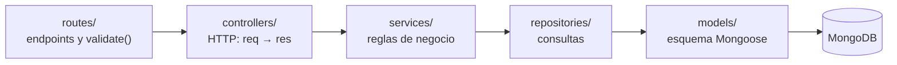
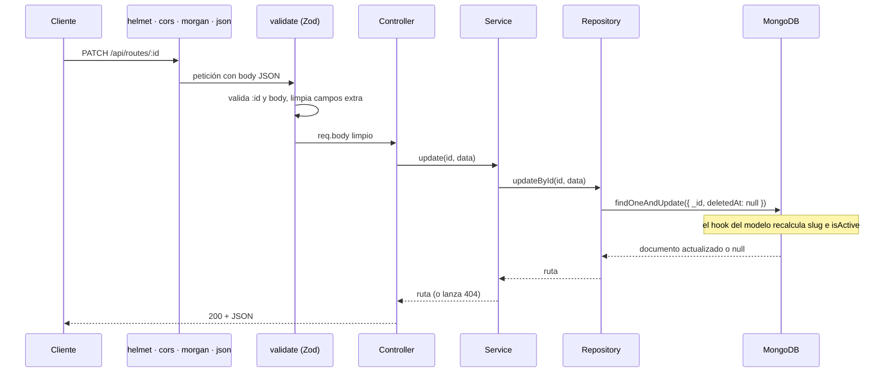

# Routly API

API REST de Routly. Gestiona el catálogo de rutas en moto: crear, consultar, editar, activar o desactivar, eliminar con borrado lógico y restaurar.


Forma parte del monorepo de Routly. La visión general del proyecto está en el [README de la raíz](../README.md) y el panel que consume esta API, en [`moto-routes-frontend`](../moto-routes-frontend/README.md).

## Contenido

- [Lenguaje y librerías](#lenguaje-y-librerías)
- [Instalación](#instalación) · [Configuración](#configuración) · [Ejecución](#ejecución)
- [Arquitectura](#arquitectura) · [Estructura del proyecto](#estructura-del-proyecto)
- [Modelo: Route](#modelo-route) · [Endpoints](#endpoints)
- [Activa / inactiva frente a eliminada](#activa--inactiva-frente-a-eliminada) · [Soft delete](#soft-delete)
- [Validación (Zod)](#validación-zod) · [Manejo de errores](#manejo-de-errores)
- [Seguridad (Helmet)](#seguridad-helmet) · [Logs (Morgan)](#logs-morgan)
- [Cómo añadir un recurso](#cómo-añadir-un-recurso)

## Lenguaje y librerías

JavaScript moderno sobre **Node.js**, con módulos ES (`"type": "module"` en `package.json`, así que se usa `import`/`export` en lugar de `require`). No hay paso de compilación: el código de `src/` es el que se ejecuta.

| Librería | Versión | Para qué se usa |
|---|---|---|
| [Express](https://expressjs.com) | 5.2 | Servidor HTTP y enrutado. La versión 5 envía al middleware de errores lo que lance un handler `async`, sin `try/catch` |
| [Mongoose](https://mongoosejs.com) | 9.10 | Modelos sobre MongoDB, validación de segundo nivel, hooks y plugins |
| [Zod](https://zod.dev) | 4.6 | Validación y limpieza de `params` y `body` antes del controlador |
| [Helmet](https://helmetjs.github.io) | 8.3 | Cabeceras de seguridad |
| [cors](https://github.com/expressjs/cors) | 2.8 | Orígenes y métodos permitidos |
| [Morgan](https://github.com/expressjs/morgan) | 1.12 | Logs HTTP en consola y en archivo |
| [swagger-jsdoc](https://github.com/Surnet/swagger-jsdoc) + [swagger-ui-express](https://github.com/scottie1984/swagger-ui-express) | 6.3 / 5.0 | Documentación OpenAPI en `/api/docs`, escrita en YAML |
| [dotenv](https://github.com/motdotla/dotenv) | 18.0 | Carga las variables de `.env` |
| [nodemon](https://nodemon.io) (desarrollo) | 3.1 | Reinicia el servidor al guardar |

## Instalación

Requisitos: **Node.js 20 o superior** (probado con 24.8) y **MongoDB** en marcha.

```bash
cd moto-routes-api
npm install
```

## Configuración

Copiar `.env.example` a `.env` y ajustar los valores:

```
NODE_ENV=development
PORT=3000
MONGODB_URI=mongodb://localhost:27017/moto_routes
CORS_ORIGIN=http://localhost:4200
```

`CORS_ORIGIN` solo se usa con `NODE_ENV=production`: es la lista de orígenes (separados por comas) que pueden llamar a la API. En desarrollo se acepta cualquier origen; en producción, si no se define, no se acepta ninguno.

`NODE_ENV` puede ser `development` o `production` y cambia el comportamiento de Helmet y Morgan (ver abajo).

## Ejecución

```bash
# Desarrollo (nodemon reinicia el servidor al guardar un cambio)
npm run dev

# Producción
npm start

# Reiniciar la base de datos con datos de ejemplo
npm run seed
```

En desarrollo, `nodemon` vigila la carpeta `src/` y el archivo `.env`, y reinicia al cambiar un `.js`, `.json` o `.yaml` (así también se recarga la documentación de Swagger). Se configura en `nodemonConfig`, dentro de `package.json`. Para reiniciar a mano, escribe `rs` y pulsa Intro en esa terminal.

> El seed **borra físicamente** toda la colección antes de insertar los datos de ejemplo. Es la única excepción al soft delete y solo debe usarse en desarrollo.

Con el servidor en marcha, la documentación interactiva está en `http://localhost:3000/api/docs` y la comprobación de estado en `http://localhost:3000/health`.

## Arquitectura

Arquitectura por capas. Cada capa tiene una sola responsabilidad y solo llama a la inmediatamente inferior:



| Capa | Archivo | Responsabilidad | Lo que no hace |
|---|---|---|---|
| Rutas | `routes/route.routes.js` | Asocia método y URL a un controlador, y aplica `validate()` con el esquema de Zod | Lógica |
| Controlador | `controllers/route.controller.js` | Lee `req`, llama al service y responde con el código adecuado (200, 201, 204) | Consultar la base de datos |
| Service | `services/route.service.js` | Reglas de negocio: 404 si no existe, 409 si el slug está repetido o la ruta no está eliminada | Conocer `req` o `res` |
| Repositorio | `repositories/route.repository.js` | Consultas a Mongoose: devuelven objetos planos (`.lean()`) y filtran `deletedAt` | Decidir errores HTTP |
| Modelo | `models/route.model.js` | Esquema, índices, campos derivados (`slug`, `isActive`) y plugin de soft delete | |

Los errores de cualquier capa se lanzan con los helpers de `utils/errors.js` (`notFound`, `conflict`, `badRequest`) y los recoge un único middleware, `errorHandler`.

### El recorrido de una petición

Ejemplo: `PATCH /api/routes/:id` con un título nuevo.



Si algo falla en cualquier punto (Zod, el service o Mongoose), el error salta directamente a `errorHandler`, que responde con el formato común (ver [Manejo de errores](#manejo-de-errores)).

### Orden de los middlewares (`server.js`)

1. `helmet`: cabeceras de seguridad.
2. `cors`: orígenes permitidos y métodos `GET`, `POST` y `PATCH`.
3. `morgan`: logs.
4. `express.json()`: lee el body.
5. `GET /health`, `/api/docs` y `/api/routes`.
6. `notFoundHandler`: 404 para cualquier otra URL.
7. `errorHandler`: siempre el último.

El servidor solo empieza a escuchar cuando la conexión con MongoDB está lista. Si falla, el proceso termina con un error.

## Estructura del proyecto

```
src/
├── config/
│   ├── db.js                      Conexión a MongoDB
│   ├── cors.js                    Orígenes y métodos permitidos
│   ├── helmet.js                  Cabeceras de seguridad
│   ├── morgan.js                  Logs en consola y en logs/
│   └── swagger.js                 Definición OpenAPI y esquemas comunes
├── models/
│   ├── route.model.js             Esquema Route y campos derivados
│   └── plugins/
│       └── softDelete.plugin.js   Borrado lógico reutilizable
├── repositories/route.repository.js
├── services/route.service.js
├── controllers/route.controller.js
├── routes/route.routes.js
├── schemas/route.schema.js        Esquemas de Zod
├── middlewares/
│   ├── validate.js                Aplica los esquemas de Zod
│   └── errorHandler.js            404 y formato común de errores
├── docs/route.docs.yaml           Documentación de cada endpoint
├── utils/
│   ├── errors.js                  notFound, conflict, badRequest
│   └── slugify.js                 Generación del slug
├── seed.js                        Datos de ejemplo
└── server.js                      Punto de entrada
```

Hay además un [`postman.md`](postman.md) con ejemplos de cada petición para probarlas en Postman.

## Modelo: Route

| Campo       | Tipo     | Requerido | Descripción                                        |
|-------------|----------|-----------|----------------------------------------------------|
| _id         | ObjectId | Auto      | Identificador de MongoDB                           |
| title       | String   | Sí        | Nombre de la ruta (máx. 120 chars)                 |
| slug        | String   | Auto      | Único. Generado desde el título (`costa-brava-loop-8b9c0d`) |
| description | String   | No        | Descripción de la ruta (máx. 500)                  |
| difficulty  | String   | Sí        | `easy`, `medium` o `hard`                          |
| distance    | Number   | Sí        | Distancia en km (mín. 0)                           |
| duration    | Number   | Sí        | Duración estimada en horas (mín. 0)                |
| startPoint  | String   | Sí        | Punto de inicio (máx. 100 chars)                   |
| endPoint    | String   | Sí        | Punto de llegada (máx. 100 chars)                  |
| status      | String   | Auto      | `active` (defecto), `inactive` o `deleted`         |
| isActive    | Boolean  | Auto      | `true` solo si `status` es `active`                |
| deletedAt   | Date     | Auto      | `null` salvo que la ruta esté eliminada            |
| createdAt   | Date     | Auto      | Fecha de creación                                  |
| updatedAt   | Date     | Auto      | Fecha de última actualización                      |

Los campos automáticos los gestiona el servidor. Si el cliente los envía en el body, se ignoran (excepto `status`, ver abajo).

- El `slug` se regenera si cambia el título. El sufijo del `_id` hace que dos rutas con el mismo título tengan slugs distintos.
- El `slug` es único, con dos barreras:
  - Antes de crear una ruta, el service comprueba que el slug no exista ya (también entre las rutas eliminadas, que lo conservan para poder restaurarse). Si existe, responde **409** sin llegar a crear nada.
  - El campo tiene un índice único en MongoDB (`unique: true` en el modelo). Es la garantía final: cubre también los cambios de título y dos altas simultáneas, y un duplicado se rechaza igualmente con **409**.
- `isActive` se sincroniza siempre con `status` desde el propio modelo.

## Endpoints

| Método | Ruta             | Descripción                         | Éxito |
|--------|------------------|-------------------------------------|-------|
| GET    | /health          | Health check                        | 200   |
| GET    | /api/routes      | Listar rutas (excluye eliminadas)   | 200   |
| GET    | /api/routes/actives | Listar solo las rutas activas    | 200   |
| GET    | /api/routes/inactives | Listar solo las rutas inactivas (no eliminadas) | 200 |
| GET    | /api/routes/deleted | Listar solo las rutas eliminadas (papelera) | 200 |
| GET    | /api/routes/:id  | Obtener ruta por ID                 | 200   |
| GET    | /api/routes/slug/:slug | Obtener ruta por slug         | 200   |
| POST   | /api/routes      | Crear nueva ruta                    | 201   |
| PATCH  | /api/routes/:id  | Actualizar ruta parcialmente        | 200   |
| PATCH  | /api/routes/:id/active | Activar o desactivar una ruta | 200   |
| PATCH  | /api/routes/:id/delete | Eliminar ruta (soft delete)   | 204   |
| PATCH  | /api/routes/:id/restore | Restaurar una ruta eliminada | 200   |
| GET    | /api/docs        | Documentación Swagger               | 200   |

En el `PATCH` se puede enviar `status` con `active` o `inactive`. El valor `deleted` solo se alcanza con `PATCH /api/routes/:id/delete`.

## Activa / inactiva frente a eliminada

Son dos cosas distintas y se gestionan con operaciones independientes:

| Campo       | Qué indica                              | Cómo se cambia                    |
|-------------|-----------------------------------------|-----------------------------------|
| `isActive`  | Si la ruta está activa o inactiva       | `PATCH /api/routes/:id/active` con `{ "isActive": true }` o `{ "isActive": false }` |
| `deletedAt` | Si la ruta está eliminada (soft delete) | `PATCH /api/routes/:id/delete`    |

- Una ruta puede estar inactiva (`isActive: false`) sin estar eliminada (`deletedAt: null`). Sigue apareciendo en `GET /api/routes`, en `GET /api/routes/inactives` y por ID o slug.
- Desactivar una ruta nunca la elimina: `deletedAt` no se toca.
- Una ruta eliminada queda siempre inactiva: el soft delete fija `isActive: false`.
- Una ruta eliminada no se puede activar con `/active`: las actualizaciones solo actúan sobre rutas con `deletedAt: null`, así que el intento responde **404** y el documento no cambia. La única forma de volver a activarla es restaurarla (ver *Restaurar*).
- Las rutas eliminadas no aparecen en `/inactives` aunque tengan `isActive: false`: no aparecen en ninguna consulta.
- `status` resume ambos campos (`active`, `inactive` o `deleted`) e `isActive` se deriva de él en el modelo, por eso siempre coinciden.

## Soft delete

Las rutas **nunca se borran físicamente** desde la API.

- `PATCH /api/routes/:id/delete` fija `deletedAt` a la fecha actual, `status: "deleted"` e `isActive: false`.
- Una ruta eliminada no aparece en el listado y devuelve **404** en GET (por ID y por slug), en el PATCH de actualización y si se intenta eliminar otra vez.
- La única consulta que devuelve rutas eliminadas es `GET /api/routes/deleted` (la papelera): solo las eliminadas, de la eliminada más reciente a la más antigua. Sirve para verlas y restaurarlas.
- No existe ningún endpoint `DELETE`: como el documento se modifica y no se borra, se usa `PATCH`.
- El repositorio filtra `deletedAt: null` de forma explícita en todas sus consultas (`findAll`, `findById`, `findBySlug`, `updateById`). Las únicas excepciones son `findDeleted` y `restoreById`, que buscan justo lo contrario: rutas eliminadas.
- Además, como red de seguridad, la lógica está centralizada en el plugin `src/models/plugins/softDelete.plugin.js`:
  - Un middleware de consultas de Mongoose añade `deletedAt: null` a todas las búsquedas y actualizaciones (`find`, `findOne`, `findOneAndUpdate`, `countDocuments`, `updateOne`, `updateMany`), salvo que la consulta ya indique `deletedAt` o pida incluir las eliminadas con `.setOptions({ withDeleted: true })` (solo lo usa la comprobación del slug). Ningún endpoint tiene que acordarse de filtrar.
  - `Model.softDeleteById(id)` marca el documento como eliminado.
  - `Model.restoreById(id, campos)` restaura un documento eliminado.
  - Es reutilizable: cualquier modelo nuevo solo necesita `schema.plugin(softDeletePlugin)`.

### Restaurar

`PATCH /api/routes/:id/restore` deshace el soft delete: pone `deletedAt` a `null`.

| Body | Resultado |
|------|-----------|
| `{ "isActive": true }` | Restaurada y activa (`status: "active"`) |
| `{ "isActive": false }` o sin body | Restaurada pero inactiva (`status: "inactive"`) |

- Solo actúa sobre rutas eliminadas. Si la ruta no está eliminada responde **409 Conflict** (`Route is not deleted`); si no existe, **404**.
- `deletedAt` y `status` cambian en la misma operación, así que una ruta nunca queda activa mientras sigue eliminada.

## Validación (Zod)

Todo lo que envía el cliente se valida con esquemas de Zod **antes de llegar al controlador**.

- Los esquemas están en `src/schemas/route.schema.js`:

| Esquema             | Valida                                                          |
|---------------------|-----------------------------------------------------------------|
| `createRouteSchema` | Body del POST: campos obligatorios, tipos, longitudes y mínimos |
| `updateRouteSchema` | Body del PATCH: los mismos campos pero opcionales, más `status` (`active` / `inactive`) |
| `setActiveSchema`   | Body de `/active`: `isActive` obligatorio y booleano            |
| `restoreRouteSchema` | Body de `/restore`: `isActive` opcional                        |
| `idParamSchema`     | `:id` con formato de ObjectId (24 caracteres hexadecimales)     |
| `slugParamSchema`   | `:slug` en minúsculas, números y guiones                        |

- Se aplican en las rutas con el middleware `validate` (`src/middlewares/validate.js`):

```js
router.post("/", validate({ body: createRouteSchema }), routeController.create);
router.patch("/:id", validate({ params: idParamSchema, body: updateRouteSchema }), routeController.update);
```

- Si los datos son válidos, `req.body` se sustituye por la versión limpia: textos sin espacios sobrantes y **sin los campos que no están en el esquema** (por eso el cliente no puede fijar `slug`, `isActive` o `deletedAt`).
- Si no lo son, Zod lanza un error y el `errorHandler` responde 400 con un `details` por campo. No se llega a consultar la base de datos.
- El modelo de Mongoose mantiene sus propias reglas como segunda barrera. Si cambia un límite (por ejemplo la longitud del título), hay que cambiarlo en el esquema de Zod **y** en el modelo.

## Manejo de errores

Centralizado en `src/middlewares/errorHandler.js`. Los controladores no usan `try/catch`: Express 5 envía automáticamente al middleware cualquier error lanzado en un handler `async`.

Todas las respuestas de error tienen el mismo formato:

```json
{
  "statusCode": 400,
  "error": "Bad Request",
  "message": "Validation failed",
  "details": [
    { "field": "distance", "message": "distance must be greater than or equal to 0" }
  ]
}
```

`details` solo aparece en errores de validación.

| Caso                                        | Código |
|---------------------------------------------|--------|
| Validación de Zod (campo requerido, vacío, enum, mín./máx., tipo) | 400 |
| `id` o `slug` con formato no válido         | 400    |
| `status` no permitido en el PATCH           | 400    |
| JSON mal formado                            | 400    |
| Validación del modelo de Mongoose (segunda barrera) | 400 |
| Ruta no encontrada o eliminada              | 404    |
| Endpoint inexistente                        | 404    |
| Restaurar una ruta que no está eliminada    | 409    |
| Slug ya existente al crear (comprobación previa del service) | 409 |
| Valor duplicado (índice único)              | 409    |
| Error inesperado                            | 500    |

- En los errores 500 el cliente solo recibe `"Internal server error"`. La traza completa se muestra en la consola del servidor y nunca en la respuesta.

## Seguridad (Helmet)

Configurado en `src/config/helmet.js`. Añade cabeceras de seguridad a todas las respuestas.

**Protección contra clickjacking** (doble capa):

| Cabecera                                          | Para qué                                            |
|---------------------------------------------------|-----------------------------------------------------|
| `Content-Security-Policy: frame-ancestors 'none'` | Impide incrustar la API en un `<iframe>` (navegadores modernos) |
| `X-Frame-Options: DENY`                           | Lo mismo para navegadores antiguos                  |

Además Helmet oculta `X-Powered-By` y añade `X-Content-Type-Options: nosniff`, `Referrer-Policy`, etc.

Solo en `production`: se activan `Strict-Transport-Security` (HSTS) y `upgrade-insecure-requests`, que requieren HTTPS.

## Logs (Morgan)

Configurado en `src/config/morgan.js`. Cada petición se registra en:

| Destino           | Contenido                 | Formato                                               |
|-------------------|---------------------------|-------------------------------------------------------|
| Consola           | Todas las peticiones      | `dev` (con color) en desarrollo, `combined` en producción |
| `logs/access.log` | Todas las peticiones      | `combined` + tiempo de respuesta                      |
| `logs/error.log`  | Solo respuestas 4xx y 5xx | `combined` + tiempo de respuesta                      |

- La carpeta `logs/` se crea automáticamente al arrancar y está en `.gitignore`.
- Los archivos se abren en modo *append*: no se pierden al reiniciar el servidor.
- En producción no se registran las peticiones a `/health`.

## Cómo añadir un recurso

El diseño de las próximas colecciones está en [`DATABASE.md`](../DATABASE.md). Cada una se añade copiando el patrón de `routes`:

1. **Modelo** en `models/<recurso>.model.js`, con `schema.plugin(softDeletePlugin)` para heredar el borrado lógico.
2. **Esquemas de Zod** en `schemas/<recurso>.schema.js`, con los mismos límites que el modelo.
3. **Repositorio**, **service** y **controlador**, uno por archivo y con las mismas funciones que los de `routes`.
4. **Rutas** en `routes/<recurso>.routes.js`. Las rutas fijas (`/actives`, `/inactives`, `/deleted`) van antes de `/:id`.
5. **Registro** en `server.js`: `app.use("/api/<recurso>", <recurso>Routes)`, antes de `notFoundHandler`.
6. **Documentación** en `docs/<recurso>.docs.yaml` y sus esquemas en `config/swagger.js`.
7. Si el panel va a llamar con métodos nuevos, revisa `methods` en `config/cors.js`.
