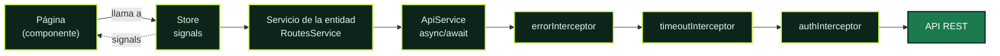

<a id="top"></a>


<p align="center">
  
  
  
  
  
</p>

Panel de administración de Routly, la plataforma de rutas en moto. Está hecho con Angular 20 y consume la API REST de [`moto-routes-api`](../moto-routes-api/README.md).

La API tiene nueve colecciones relacionadas entre sí. El panel ya tiene la **base de todas** (modelos, servicios y stores) y las **páginas de las rutas**: listado, formulario con sus categorías y ubicaciones, y papelera. Las páginas del resto de entidades irán después. La visión general del proyecto está en el [README de la raíz](../README.md).


## Contenido

- [Lenguajes y librerías](#lenguajes-y-librerías)
- [Requisitos](#requisitos) · [Arrancar el proyecto](#arrancar-el-proyecto) · [Comandos](#comandos) · [Variables de entorno](#variables-de-entorno)
- [Arquitectura](#arquitectura): flujo de datos, interruptor de activa, errores, endpoints, papelera, auth y rendimiento
- [Patrones de Angular](#patrones-de-angular)
- [Cómo añadir una feature](#cómo-añadir-una-feature)
- [Iconos](#iconos) · [Sistema de diseño](#sistema-de-diseño) · [Tests](#tests)
- [Limitaciones conocidas](#limitaciones-conocidas)

## Lenguajes y librerías

**TypeScript** en modo estricto (sin `any`), plantillas **HTML** de Angular y **CSS** puro con variables, sin preprocesadores ni frameworks de estilos.

| Librería | Versión | Para qué se usa |
|---|---|---|
| [Angular](https://angular.dev) | 20.3 | Framework. Componentes standalone, signals y sin zone.js |
| [RxJS](https://rxjs.dev) | 7.8 | Solo donde Angular lo exige: `HttpClient`, interceptores y eventos del router. El resto usa `async/await` con `firstValueFrom` |
| [SweetAlert2](https://sweetalert2.github.io) | 11.26 | Diálogos de confirmación y de error, siempre a través de `NotificationService` |
| [Phosphor Icons](https://phosphoricons.com) | 2.1 | Iconos. Solo se empaquetan los que se usan (ver [Iconos](#iconos)) |
| [Onest](https://fontsource.org/fonts/onest) (Fontsource) | 5.3 | Tipografía variable, servida desde el propio panel |
| Karma + Jasmine | 6.4 / 5.9 | Tests unitarios |

## Requisitos

- Node.js 20.19 o superior (probado con 24.8)
- MongoDB en marcha, para la API

## Arrancar el proyecto

Hacen falta dos terminales: una para la API y otra para el panel.

**1. API** (`http://localhost:3000`)

```bash
cd moto-routes-api
npm install
```

Copia `.env.example` a `.env` y ajusta los valores si hace falta. Después:

```bash
npm run seed
```

```bash
npm run dev
```

`npm run seed` borra las rutas y carga cinco de ejemplo. Solo hace falta la primera vez o para empezar de cero.

**2. Panel** (`http://localhost:4200`)

```bash
cd moto-routes-frontend
npm install
```

```bash
npm start
```

## Comandos

| Comando | Qué hace |
|---|---|
| `npm start` | Servidor de desarrollo con recarga automática |
| `npm run build` | Compilación de producción en `dist/` |
| `npm test` | Tests con Karma y Jasmine |
| `npm run icons` | Regenera el registro de iconos (ver [Iconos](#iconos)) |

Para ejecutar los tests una sola vez, sin abrir navegador:

```bash
npx ng test --watch=false --browsers=ChromeHeadless
```

## Variables de entorno

El panel se configura en `src/environments/`:

| Archivo | Cuándo se usa |
|---|---|
| `environment.development.ts` | `npm start` |
| `environment.ts` | `npm run build` (producción) |

| Variable | Valor por defecto | Para qué |
|---|---|---|
| `apiUrl` | `http://localhost:3000/api` | URL base de la API, sin barra final |
| `apiTimeout` | `10000` | Milisegundos que se espera una respuesta antes de cortar la petición |

La API se configura con su propio `.env` (ver `moto-routes-api/README.md`):

| Variable | Ejemplo | Para qué |
|---|---|---|
| `PORT` | `3000` | Puerto de la API. Si lo cambias, cambia también `apiUrl` |
| `MONGODB_URI` | `mongodb://localhost:27017/moto_routes` | Base de datos |
| `NODE_ENV` | `development` | En `production` la API solo acepta los orígenes de `CORS_ORIGIN` |
| `CORS_ORIGIN` | `http://localhost:4200` | Origen del panel, necesario en producción |

## Arquitectura

Organización por features. Cada carpeta tiene una responsabilidad y unas reglas de quién puede importar de quién.

```
src/app/
├── core/                  Lo que existe una sola vez en la aplicación
│   ├── services/          ApiService, NotificationService, ErrorHandlerService,
│   │                      EntityStore, EntityApiService, AuthService (vacío)...
│   ├── interceptors/      timeout, errores y auth
│   ├── guards/            authGuard y aviso de cambios sin guardar
│   ├── models/            Interfaces de las 9 entidades, con sus relaciones, y ApiError
│   └── utils/             Traducción de los errores de la API
├── shared/                Piezas reutilizables, sin lógica de negocio
│   ├── components/        toggle, skeleton, error-state, tabla, campo de formulario...
│   └── utils/             Formato, búsqueda, validadores, errores de formulario
├── layouts/
│   └── admin-layout/      Sidebar, barra superior y el menú (navigation.ts)
├── features/
│   ├── dashboard/         Resumen
│   ├── routes/            Rutas
│   │   ├── pages/         Listado, página del formulario (crear y editar) y papelera
│   │   ├── components/    Tarjeta de ruta y formulario (route-form)
│   │   ├── services/      routes.service.ts (API) y routes.store.ts (estado)
│   │   └── routes.routes.ts
│   └── roles/, users/, hosts/, categories/, locations/,
│       experiences/, departures/, images/
│       └── services/      Servicio y store de cada entidad (todavía sin páginas)
├── app.routes.ts
├── app.config.ts
└── app.component.ts
```

Reglas:

- `core` son servicios únicos (singletons).
- `shared` no sabe nada del negocio ni importa de `core`.
- Una feature no importa de otra. Lo que comparten va a `core/models` o a `shared`.

### Cómo viajan los datos



La página nunca llama a la API: pide al store, y el store expone el resultado como signals que la plantilla lee directamente.

- **`ApiService`** es la única puerta hacia la API. Sus métodos `get`, `post`, `put`, `patch` y `delete` devuelven promesas, para usarlas con `async/await`.
- **Interceptores**, en este orden:
  1. `errorInterceptor` convierte cualquier fallo en un `ApiError` con `status`, `type` (`network`, `timeout`, `validation`, `client` o `server`), `message` y, si los hay, `fieldErrors`.
  2. `timeoutInterceptor` corta la petición a los `apiTimeout` milisegundos.
  3. `authInterceptor` añade el token de sesión si existe. Hoy no hay ninguno.
- **`EntityApiService`** (`core/services/entity-api.service.ts`) tiene los 11 endpoints comunes a todas las colecciones. El servicio de cada entidad hereda de él y solo declara su ruta (`path`). Las imágenes, que no tienen slug, heredan de `RecordApiService`, que es lo mismo sin `getBySlug`.
- **`EntityStore`** guarda el estado de una entidad con signals y hace las operaciones comunes: cargar, crear, editar, eliminar, deshacer, cambiar el estado activo y la papelera.

### Modelos y relaciones

Cada entidad tiene su modelo en `core/models/` con los mismos campos que la API. Las relaciones llegan de dos formas: el id (`categoryId`) y el documento relacionado que añade el `populate` de la API (`category`), con un resumen de sus campos:

```ts
export interface Route extends BaseEntity {
  categoryId: string;
  category: CategorySummary | null;
  startLocationId: string;
  startLocation: LocationSummary | null;
  // ...
  coverImage?: ImageSummary | null;
}
```

El documento relacionado es `null` si ya no existe. Pasa en la papelera: si después de eliminar una ruta se elimina su categoría, la API ya no la encuentra. Por eso las plantillas no leen `route.startLocation.city` directamente, sino con `routeTrip(route)` y `categoryName(route)`, que ponen "Ubicación eliminada" o "Categoría eliminada".

`BaseRecord` tiene los campos comunes (`_id`, `status`, `isActive`, `deletedAt` y las fechas) y `BaseEntity` le añade el `slug`. Las imágenes usan `BaseRecord`.

### El interruptor de activa

El cambio es optimista: `EntityStore.setActive` actualiza el signal antes de llamar a la API, así se ve al instante. Si la API falla, el registro vuelve a como estaba y se muestra el error. Si el fallo fue un tiempo de espera o un 5xx, además se vuelve a pedir ese registro por su `_id`, por si la API sí llegó a aplicar el cambio.

### Errores

Todas las llamadas de los stores van en `try/catch` y pasan por `ErrorHandlerService`:

| Fallo | Qué ve el usuario |
|---|---|
| Sin red, tiempo de espera o 5xx | Diálogo de SweetAlert2, y en la página `ui-error-state` con "Reintentar" |
| 404 | Aviso breve y vuelta al listado |
| 400 o 422 (validación) | Mensaje junto al campo del formulario |
| 409 | Su motivo concreto: junto al formulario, o en un aviso si no hay formulario |

Los formularios validan también en el cliente, con los mismos criterios que la API. Los mensajes de la API llegan en inglés y se traducen en `core/utils/api-error.mapper.ts`.

Un 409 no siempre es un duplicado. El mapper reconoce cada motivo de la API y lo cuenta tal cual:

| La API dice | El panel muestra |
|---|---|
| `Cannot delete a route that has experiences` | No se puede eliminar: tiene experiencias. |
| `Cannot restore: categoryId references a deleted category` | No se puede restaurar mientras su categoría siga en la papelera. |
| `Route is not deleted` | Ese registro ya estaba restaurado. |
| `System roles cannot be deleted` | Los roles base no se pueden eliminar. |
| `categoryId must reference an active category` (400) | Elige una categoría activa. |

SweetAlert2 solo se usa a través de `NotificationService`. Ningún componente lo importa directamente.

### Endpoints de la API

<details>
<summary><b>Ver qué método del panel usa cada endpoint</b></summary>

Todos los endpoints de la API están en el panel:

| Endpoint | Método del panel | Dónde se usa |
|---|---|---|
| `GET /health` | `ApiStatusService.check` | Indicador de conexión del sidebar |
| `GET /api/docs` | Enlace | "Documentación API" en el sidebar |
| `GET /api/routes` | `RoutesService.getAll` | Listado y Resumen |
| `GET /api/routes/actives` | `RoutesService.getActives` | Filtro "Activas" del listado |
| `GET /api/routes/inactives` | `RoutesService.getInactives` | Filtro "Inactivas" del listado |
| `GET /api/routes/deleted` | `RoutesService.getDeleted` | Papelera y su contador |
| `GET /api/routes/:id` | `RoutesService.getById` | Comprobar una ruta tras un cambio de estado fallido |
| `GET /api/routes/slug/:slug` | `RoutesService.getBySlug` | Abrir el formulario de edición |
| `POST /api/routes` | `RoutesService.create` | Crear |
| `PATCH /api/routes/:id` | `RoutesService.update` | Guardar cambios |
| `PATCH /api/routes/:id/active` | `RoutesService.setActive` | Interruptor de activa |
| `PATCH /api/routes/:id/delete` | `RoutesService.remove` | Eliminar (borrado lógico) |
| `PATCH /api/routes/:id/restore` | `RoutesService.restore` | "Deshacer" después de eliminar y "Restaurar" en la papelera |
| `GET /api/categories/actives` | `RoutesService.getCategoryOptions` | Select de categoría del formulario |
| `GET /api/locations/actives` | `RoutesService.getLocationOptions` | Selects de origen y destino |

Las demás colecciones (`roles`, `users`, `hosts`, `categories`, `locations`, `experiences`, `departures` e `images`) tienen ya su servicio con los mismos endpoints, más `DeparturesService.getBySku` y `ImagesService.getByOwner`. Todavía no los usa ninguna página.

Las URL del panel identifican cada ruta por su `slug` (`/routes/:slug/edit`). La API solo admite `slug` para leer, así que guardar, activar y eliminar van por `_id`.

Al elegir "Activas" o "Inactivas", el listado se filtra al instante con lo que ya hay en memoria y, a la vez, pide ese grupo a su endpoint para ponerlo al día.

</details>

### Papelera

Eliminar una ruta es un borrado lógico: sigue en la base de datos, marcada como eliminada. La página `/routes/trash` las lista y permite restaurarlas cuando se quiera.

- Se llega desde el botón "Papelera" del listado y desde el sidebar. Los dos muestran cuántas hay.
- "Restaurar" es optimista: la ruta sale de la papelera al instante y vuelve al listado. Si la API falla, vuelve a la papelera y se muestra el error.
- El selector "Al restaurar, dejarla" decide si vuelve inactiva (por defecto) o activa.
- El aviso "Deshacer" que aparece justo después de eliminar sigue funcionando.
- Si a una ruta le falta su categoría o una de sus ubicaciones (se eliminaron después que ella), la API no deja restaurarla. La papelera lo avisa en la fila ("No se puede restaurar mientras su categoría siga en la papelera") y desactiva su botón, enlazado con el aviso para los lectores de pantalla. Si aun así llega ese 409, la ruta vuelve a su sitio en la papelera, en vez de darse por restaurada.

La lógica está en `EntityStore` (`loadDeleted`, `restoreFromTrash`), así que cualquier entidad nueva la hereda.

### Formulario de rutas

El formulario es un componente (`features/routes/components/route-form/`) separado de la página (`pages/route-form/`):

- **El componente** tiene los campos, con Reactive Forms y las mismas validaciones que la API. Cuando es válido, emite `save` con los datos listos. Si la API los rechaza, la página se los devuelve con `showServerError()` y se pintan junto a su campo.
- **La página** carga la ruta y las opciones de los selects, guarda, y tiene el interruptor de activa, los detalles y el botón de eliminar.

Los selects de categoría, origen y destino ofrecen solo las **activas** (la API rechaza las inactivas). Si la ruta que se edita usa una categoría o ubicación que se desactivó después, también aparece, como "Costa (inactiva)": la API la acepta mientras no se cambie.

### Rutas inactivas

Una ruta inactiva se distingue sin depender solo del color:

- En tarjetas: fondo gris sin relieve, borde discontinuo, portada en gris, etiqueta "Inactiva" con icono y texto atenuado.
- En la lista: fila con fondo gris y la misma etiqueta junto al interruptor.
- En el Resumen: la etiqueta junto al título.

### Autenticación

> [!IMPORTANT]
> No está implementada. Está preparado lo necesario para añadirla sin tocar el resto:

- `core/services/auth.service.ts`: `currentUser`, `token` e `isAuthenticated` como signals, sin métodos.
- `core/interceptors/auth.interceptor.ts`: añade `Authorization: Bearer <token>` cuando haya token.
- `core/guards/auth.guard.ts`: conectado a las rutas del panel. Hoy deja pasar siempre.

### Rendimiento

- Cada feature se descarga cuando se visita (lazy loading en `app.routes.ts`).
- La tabla del listado va en un bloque `@defer`: su código solo se descarga al elegir la vista de lista.
- SweetAlert2 se descarga la primera vez que hace falta un aviso.
- Los skeletons tienen la forma del contenido que sustituyen.

## Cómo añadir una feature

<details>
<summary><b>Ver los seis pasos, con el ejemplo de categories</b></summary>

Ejemplo con `categories`. La API tiene que exponer la entidad con los mismos endpoints que `routes`.

Los pasos 1 a 3 ya están hechos para las nueve entidades. Para una entidad nueva (por ejemplo, `reviews`) serían así:

**1. Modelo**, en `core/models/<entidad>.model.ts`, con los campos de la API. Mira `category.model.ts`: el modelo, su resumen para los `populate` y el payload.

**2. Servicio**, en `features/<entidad>/services/<entidad>.service.ts`. Hereda los 11 endpoints:

```ts
@Injectable({ providedIn: 'root' })
export class CategoriesService extends EntityApiService<Category, CategoryPayload> {
  protected readonly path = '/categories';
}
```

**3. Store**, en `features/<entidad>/services/<entidad>.store.ts`:

```ts
@Injectable({ providedIn: 'root' })
export class CategoriesStore extends EntityStore<Category, CategoryPayload> {
  protected readonly api = inject(CategoriesService);
  protected readonly listPath = '/categories';
  protected override readonly notFoundMessage = 'Esa categoría ya no existe.';
}
```

Con esto ya tiene carga, creación, edición, borrado, deshacer, papelera y el cambio de estado optimista.

**4. Páginas**, en `features/categories/pages/`: un listado y un formulario. Usa los componentes de `shared`:

| Componente | Para qué |
|---|---|
| `ui-page-header` | Título de la página y acciones |
| `ui-search-input`, `ui-segmented` | Búsqueda y filtro activas/inactivas/todas |
| `ui-data-table` con `uiCell` | Tabla del listado, con filas de espera incluidas |
| `ui-toggle` | Interruptor de `isActive` |
| `ui-form-field` con `uiInput` | Campo con etiqueta, ayuda y error en línea |
| `ui-skeleton`, `ui-empty-state`, `ui-pagination` | Carga, estado vacío y paginación |
| `ui-error-state` | Carga fallida, con "Reintentar" |

**5. Rutas**, en `features/categories/categories.routes.ts`, con `''`, `'new'` y `':slug/edit'`, como en `routes.routes.ts`. Regístralas en `app.routes.ts`:

```ts
{
  path: 'categories',
  loadChildren: () =>
    import('./features/categories/categories.routes').then((m) => m.CATEGORIES_ROUTES),
},
```

**6. Menú**, en `layouts/admin-layout/navigation.ts`: mueve la entrada de `UPCOMING_ITEMS` a `NAV_ITEMS` y dale `path` y `create`.

```ts
{
  id: 'categories',
  label: 'Categorías',
  icon: 'tag',
  path: '/categories',
  create: { label: 'Nueva categoría', path: '/categories/new' },
},
```

Si la entidad se relaciona con otra, pide los registros activos de la otra desde tu propio servicio, como hace `RoutesService.getCategoryOptions()`. No importes el servicio ni el store de la otra feature.

</details>

## Iconos

<details>
<summary><b>Ver cómo añadir un icono</b></summary>

Los iconos son de [Phosphor](https://phosphoricons.com). Para no empaquetar la librería entera, solo se incluyen los que aparecen en `tools/generate-icons.mjs`.

Para usar uno nuevo, añade su nombre a esa lista y ejecuta:

```bash
npm run icons
```

Después ya se puede usar con `<ui-icon name="nombre" />`. El nombre está tipado: uno que no esté en la lista no compila.

</details>

## Patrones de Angular

| Patrón | Dónde | Por qué |
|---|---|---|
| Sin zone.js (`provideZonelessChangeDetection`) | `app.config.ts` | La vista se actualiza cuando cambia un signal, no tras cada evento |
| Componentes standalone y `OnPush` | Todos | Sin `NgModule`; cada componente declara lo que importa |
| `signal`, `computed`, `linkedSignal` | Stores y páginas | Estado reactivo sin suscripciones manuales |
| `input()`, `model()`, `output()` | Componentes de `shared` | API de componentes basada en signals |
| `inject()` | Todos | Sin inyección por constructor |
| `withComponentInputBinding` | Router | El `:slug` de la URL llega a la página como `input()` |
| Control flow `@if`, `@for`, `@defer` | Plantillas | Sintaxis nativa; `@defer` carga la tabla solo cuando hace falta |
| Reactive Forms con selects | `components/route-form` | Validación en el cliente con los mismos límites que la API |
| `viewChild()` | Página del formulario | Devolver al formulario los errores de la API |
| Interceptores y guards funcionales | `core/` | Funciones en lugar de clases |
| `canDeactivate` | `unsaved-changes.guard.ts` | Avisa antes de salir de un formulario con cambios |

## Sistema de diseño

Todo el aspecto sale de variables CSS en `src/styles/`:

| Archivo | Contenido |
|---|---|
| `tokens.css` | Colores, tipografía, espacios, radios, sombras, duraciones y medidas del layout |
| `base.css` | Estilos de partida del documento, foco visible y movimiento reducido |
| `primitives.css` | Piezas comunes: botones, badges, tarjetas, paneles y selects |
| `sweetalert.css` | SweetAlert2 adaptado a la paleta |

**Paleta.** Verdes: principal para las acciones (`--color-primary: #1b7a4e`), verde muy oscuro para el sidebar (`#0c2419`) y un acento lima (`#c6f04d`) para lo destacado. Los neutros están teñidos de verde, y cada estado (éxito, aviso y peligro) tiene su color de texto y su fondo. Todas las parejas de texto y fondo que usa el panel cumplen contraste **WCAG AA**.

    

**Tipografía.** Onest Variable, en una escala de seis tamaños (de `--text-xs` a `--text-2xl`). Las cifras usan números tabulares (clase `.num`) para que se alineen en columna.

**Espacios y formas.** Escala de 4 a 48 px (`--space-1` a `--space-7`) y tres radios: 6, 10 y 14 px.

**Movimiento.** Tres duraciones (120, 200 y 300 ms) con una misma curva. Con `prefers-reduced-motion` se desactivan las animaciones.

**Estado inactivo.** No depende solo del color: combina fondo gris, borde discontinuo, texto atenuado y una etiqueta con icono.

**Responsive.** Por debajo de 900 px el sidebar pasa a ser un cajón que se abre desde la barra superior. La tabla se desplaza en horizontal si no cabe.

## Tests

```bash
npx ng test --watch=false --browsers=ChromeHeadless
```

Cubren la lógica, no la presentación:

| Spec | Qué prueba |
|---|---|
| `api-error.mapper.spec.ts` | Conversión de cualquier fallo HTTP a `ApiError` y traducción de los mensajes, incluido el motivo de cada 409 |
| `api.service.spec.ts` | URLs, métodos y cuerpo de cada petición |
| `entity.store.spec.ts` | Carga, CRUD, actualización optimista con vuelta atrás y papelera (también el 409 por una referencia eliminada) |
| `route.model.spec.ts` | Recorrido y categoría cuando una relación ya no existe |
| `error-handler.service.spec.ts` | Qué se muestra para cada tipo de error |
| `routes.service.spec.ts`, `routes.store.spec.ts` | Endpoints de rutas, opciones de los selects, búsqueda, filtros y contadores |
| `<entidad>.service.spec.ts` (8) | Que cada servicio llama a sus endpoints, también `getBySku` y `getByOwner` |
| `navigation.spec.ts` | Menú y secciones padre |
| `utils.spec.ts` | Formato, búsqueda y validadores |

## Limitaciones conocidas

- Solo las rutas tienen páginas. El resto de entidades tienen su modelo, servicio y store, pero todavía no aparecen en el panel (siguen en "Próximamente").
- Las imágenes se ven (portadas en tarjetas y tabla), pero aún no se pueden añadir ni ordenar desde el panel.
- Los filtros, la página y la vista del listado no se guardan en la URL. Se conservan al volver del formulario, pero no al recargar (salvo la vista, que se recuerda).
- La papelera no permite borrar una ruta definitivamente: la API no tiene borrado físico.
- No hay modo oscuro: el panel solo tiene tema claro.

<p align="right"><a href="#top">Volver arriba</a></p>
