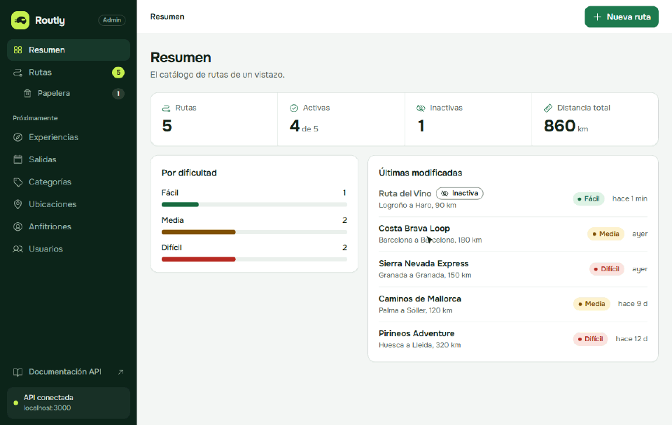
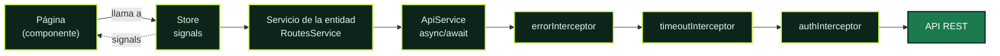

<a id="top"></a>


<p align="center">
  
  
  
  
  
</p>

Panel de administración de Routly, la plataforma de rutas en moto. Está hecho con Angular 20 y consume la API REST de [`moto-routes-api`](../moto-routes-api/README.md).

La API tiene nueve colecciones relacionadas entre sí. El panel ya tiene la **base de todas** (modelos, servicios y stores) y las **páginas de las rutas**: listado, formulario con sus categorías y ubicaciones, y papelera. Las páginas del resto de entidades irán después. La visión general del proyecto está en el [README de la raíz](../README.md).



## Contenido

- [Lenguajes y librerías](#lenguajes-y-librerías)
- [Requisitos](#requisitos) · [Arrancar el proyecto](#arrancar-el-proyecto) · [Comandos](#comandos) · [Variables de entorno](#variables-de-entorno)
- [Arquitectura](#arquitectura): flujo de datos, interruptor de activa, errores, endpoints, papelera, auth y rendimiento
- [Patrones de Angular](#patrones-de-angular)
- [Cómo añadir una feature](#cómo-añadir-una-feature)
- [Iconos](#iconos) · [Sistema de diseño](#sistema-de-diseño) · [Tests](#tests)
- [Limitaciones conocidas](#limitaciones-conocidas)

## Lenguajes y librerías

**TypeScript** en modo estricto (sin `any`), plantillas **HTML** de Angular y **CSS** puro con variables, sin preprocesadores ni frameworks de estilos.

| Librería | Versión | Para qué se usa |
|---|---|---|
| [Angular](https://angular.dev) | 20.3 | Framework. Componentes standalone, signals y sin zone.js |
| [RxJS](https://rxjs.dev) | 7.8 | Solo donde Angular lo exige: `HttpClient`, interceptores y eventos del router. El resto usa `async/await` con `firstValueFrom` |
| [SweetAlert2](https://sweetalert2.github.io) | 11.26 | Diálogos de confirmación y de error, siempre a través de `NotificationService` |
| [Phosphor Icons](https://phosphoricons.com) | 2.1 | Iconos. Solo se empaquetan los que se usan (ver [Iconos](#iconos)) |
| [Onest](https://fontsource.org/fonts/onest) (Fontsource) | 5.3 | Tipografía variable, servida desde el propio panel |
| Karma + Jasmine | 6.4 / 5.9 | Tests unitarios |

## Requisitos

- Node.js 20.19 o superior (probado con 24.8)
- MongoDB en marcha, para la API

## Arrancar el proyecto

Hacen falta dos terminales: una para la API y otra para el panel.

**1. API** (`http://localhost:3000`)

```bash
cd moto-routes-api
npm install
```

Copia `.env.example` a `.env` y ajusta los valores si hace falta. Después:

```bash
npm run seed
```

```bash
npm run dev
```

`npm run seed` borra las rutas y carga cinco de ejemplo. Solo hace falta la primera vez o para empezar de cero.

**2. Panel** (`http://localhost:4200`)

```bash
cd moto-routes-frontend
npm install
```

```bash
npm start
```

## Comandos

| Comando | Qué hace |
|---|---|
| `npm start` | Servidor de desarrollo con recarga automática |
| `npm run build` | Compilación de producción en `dist/` |
| `npm test` | Tests con Karma y Jasmine |
| `npm run icons` | Regenera el registro de iconos (ver [Iconos](#iconos)) |

Para ejecutar los tests una sola vez, sin abrir navegador:

```bash
npx ng test --watch=false --browsers=ChromeHeadless
```

## Variables de entorno

El panel se configura en `src/environments/`:

| Archivo | Cuándo se usa |
|---|---|
| `environment.development.ts` | `npm start` |
| `environment.ts` | `npm run build` (producción) |

| Variable | Valor por defecto | Para qué |
|---|---|---|
| `apiUrl` | `http://localhost:3000/api` | URL base de la API, sin barra final |
| `apiTimeout` | `10000` | Milisegundos que se espera una respuesta antes de cortar la petición |

La API se configura con su propio `.env` (ver `moto-routes-api/README.md`):

| Variable | Ejemplo | Para qué |
|---|---|---|
| `PORT` | `3000` | Puerto de la API. Si lo cambias, cambia también `apiUrl` |
| `MONGODB_URI` | `mongodb://localhost:27017/moto_routes` | Base de datos |
| `NODE_ENV` | `development` | En `production` la API solo acepta los orígenes de `CORS_ORIGIN` |
| `CORS_ORIGIN` | `http://localhost:4200` | Origen del panel, necesario en producción |

## Arquitectura

Organización por features. Cada carpeta tiene una responsabilidad y unas reglas de quién puede importar de quién.

```
src/app/
├── core/                  Lo que existe una sola vez en la aplicación
│   ├── services/          ApiService, NotificationService, ErrorHandlerService, EntityStore,
│   │                      EntityApiService, OptionList, CollectionCountsService...
│   ├── interceptors/      timeout, errores y auth
│   ├── guards/            authGuard y aviso de cambios sin guardar
│   ├── models/            Interfaces de las 9 entidades, con sus relaciones, y ApiError
│   └── utils/             Traducción de los errores de la API
├── shared/                Piezas reutilizables, sin lógica de negocio
│   ├── components/        Plantillas de listado, detalle, formulario y papelera, tabla,
│   │                      galería de imágenes, insignias, interruptor, campos...
│   ├── forms/             EntityForm (base de los formularios) y opciones de los selects
│   ├── pages/             Bases de las páginas y collectionRoutes()
│   └── utils/             Formato, fechas, textos de cada colección, paginación, validadores
├── layouts/
│   └── admin-layout/      Sidebar con grupos y contadores, barra superior y navigation.ts
├── features/
│   ├── dashboard/         Resumen
│   └── routes/, categories/, locations/, experiences/, departures/,
│       users/, hosts/, roles/, images/
│       ├── components/    El formulario de la colección (<x>-form)
│       ├── pages/         Listado, detalle, formulario (crear y editar) y papelera
│       ├── services/      Servicio (API) y store (estado)
│       └── <x>.routes.ts
├── app.routes.ts
├── app.config.ts
└── app.component.ts
```

Reglas:

- `core` son servicios únicos (singletons).
- `shared` no sabe nada del negocio de una colección concreta.
- Una feature no importa de otra. Lo que comparten va a `core/models` o a `shared`; las opciones de un select (por ejemplo, los roles de un usuario) las pide el servicio de la propia feature.

### Pantallas

Cada colección tiene las mismas cinco páginas:

| Ruta | Página |
|---|---|
| `/<colección>` | Listado con filtro por estado (en la URL: `?estado=active&pagina=2`), interruptor, ver, editar y eliminar |
| `/<colección>/new` | Crear |
| `/<colección>/:slug` | Detalle: datos por secciones, relaciones enlazadas, estado, registro, eliminar y galería |
| `/<colección>/:slug/edit` | Editar, con la galería debajo del formulario |
| `/<colección>/trash` | Papelera: restaurar activo o inactivo |
| `/<colección>/id/:id` | Lleva al detalle de un registro del que solo se sabe el `_id` (relaciones sin slug) |

Las imágenes no tienen slug ni página de crear: su detalle es `/images/:id` y se añaden desde la galería de su dueño. El Resumen (`/`) muestra cuántos registros hay en cada colección y las cifras de las rutas.

### Cómo viajan los datos



La página nunca llama a la API: pide al store, y el store expone el resultado como signals que la plantilla lee directamente.

- **`ApiService`** es la única puerta hacia la API. Sus métodos `get`, `post`, `put`, `patch` y `delete` devuelven promesas, para usarlas con `async/await`.
- **Interceptores**, en este orden:
  1. `errorInterceptor` convierte cualquier fallo en un `ApiError` con `status`, `type` (`network`, `timeout`, `validation`, `client` o `server`), `message` y, si los hay, `fieldErrors`.
  2. `timeoutInterceptor` corta la petición a los `apiTimeout` milisegundos.
  3. `authInterceptor` añade el token de sesión si existe. Hoy no hay ninguno.
- **`EntityApiService`** (`core/services/entity-api.service.ts`) tiene los 11 endpoints comunes a todas las colecciones. El servicio de cada entidad hereda de él y solo declara su ruta (`path`). Las imágenes, que no tienen slug, heredan de `RecordApiService`, que es lo mismo sin `getBySlug`.
- **`EntityStore`** guarda el estado de una entidad con signals y hace las operaciones comunes: cargar, crear, editar, eliminar, deshacer, cambiar el estado activo y la papelera.

### Modelos y relaciones

Cada entidad tiene su modelo en `core/models/` con los mismos campos que la API. Las relaciones llegan de dos formas: el id (`categoryId`) y el documento relacionado que añade el `populate` de la API (`category`), con un resumen de sus campos:

```ts
export interface Route extends BaseEntity {
  categoryId: string;
  category: CategorySummary | null;
  startLocationId: string;
  startLocation: LocationSummary | null;
  // ...
  coverImage?: ImageSummary | null;
}
```

El documento relacionado es `null` si ya no existe. Pasa en la papelera: si después de eliminar una ruta se elimina su categoría, la API ya no la encuentra. Por eso las plantillas no leen `route.startLocation.city` directamente, sino con `routeTrip(route)` y `categoryName(route)`, que ponen "Ubicación eliminada" o "Categoría eliminada".

`BaseRecord` tiene los campos comunes (`_id`, `status`, `isActive`, `deletedAt` y las fechas) y `BaseEntity` le añade el `slug`. Las imágenes usan `BaseRecord`.

### El interruptor de activa

El cambio es optimista: `EntityStore.setActive` actualiza el signal antes de llamar a la API, así se ve al instante. Si la API falla, el registro vuelve a como estaba y se muestra el error. Si el fallo fue un tiempo de espera o un 5xx, además se vuelve a pedir ese registro por su `_id`, por si la API sí llegó a aplicar el cambio.

### Errores

Todas las llamadas de los stores van en `try/catch` y pasan por `ErrorHandlerService`:

| Fallo | Qué ve el usuario |
|---|---|
| Sin red, tiempo de espera o 5xx | Diálogo de SweetAlert2, y en la página `ui-error-state` con "Reintentar" |
| 404 | Aviso breve y vuelta al listado |
| 400 o 422 (validación) | Mensaje junto al campo del formulario |
| 409 | Su motivo concreto: junto al formulario, o en un aviso si no hay formulario |

Los formularios validan también en el cliente, con los mismos criterios que la API. Los mensajes de la API llegan en inglés y se traducen en `core/utils/api-error.mapper.ts`.

Un 409 no siempre es un duplicado. El mapper reconoce cada motivo de la API y lo cuenta tal cual:

| La API dice | El panel muestra |
|---|---|
| `Cannot delete a route that has experiences` | No se puede eliminar: tiene experiencias. |
| `Cannot restore: categoryId references a deleted category` | No se puede restaurar mientras su categoría siga en la papelera. |
| `Route is not deleted` | Ese registro ya estaba restaurado. |
| `System roles cannot be deleted` | Los roles base no se pueden eliminar. |
| `categoryId must reference an active category` (400) | Elige una categoría activa. |

SweetAlert2 solo se usa a través de `NotificationService`. Ningún componente lo importa directamente.

### Endpoints de la API

<details>
<summary><b>Ver qué método del panel usa cada endpoint</b></summary>

Todos los endpoints de la API están en el panel:

| Endpoint | Método del panel | Dónde se usa |
|---|---|---|
| `GET /health` | `ApiStatusService.check` | Indicador de conexión del sidebar |
| `GET /api/docs` | Enlace | "Documentación API" en el sidebar |
| `GET /api/routes` | `RoutesService.getAll` | Listado y Resumen |
| `GET /api/routes/actives` | `RoutesService.getActives` | Filtro "Activas" del listado |
| `GET /api/routes/inactives` | `RoutesService.getInactives` | Filtro "Inactivas" del listado |
| `GET /api/routes/deleted` | `RoutesService.getDeleted` | Papelera y su contador |
| `GET /api/routes/:id` | `RoutesService.getById` | Comprobar una ruta tras un cambio de estado fallido |
| `GET /api/routes/slug/:slug` | `RoutesService.getBySlug` | Abrir el formulario de edición |
| `POST /api/routes` | `RoutesService.create` | Crear |
| `PATCH /api/routes/:id` | `RoutesService.update` | Guardar cambios |
| `PATCH /api/routes/:id/active` | `RoutesService.setActive` | Interruptor de activa |
| `PATCH /api/routes/:id/delete` | `RoutesService.remove` | Eliminar (borrado lógico) |
| `PATCH /api/routes/:id/restore` | `RoutesService.restore` | "Deshacer" después de eliminar y "Restaurar" en la papelera |
| `GET /api/categories/actives` | `RoutesService.getCategoryOptions` | Select de categoría del formulario |
| `GET /api/locations/actives` | `RoutesService.getLocationOptions` | Selects de origen y destino |

Las demás colecciones (`roles`, `users`, `hosts`, `categories`, `locations`, `experiences`, `departures` e `images`) tienen ya su servicio con los mismos endpoints, más `DeparturesService.getBySku` y `ImagesService.getByOwner`. Todavía no los usa ninguna página.

Las URL del panel identifican cada ruta por su `slug` (`/routes/:slug/edit`). La API solo admite `slug` para leer, así que guardar, activar y eliminar van por `_id`.

Al elegir "Activas" o "Inactivas", el listado se filtra al instante con lo que ya hay en memoria y, a la vez, pide ese grupo a su endpoint para ponerlo al día.

</details>

### Papelera

Eliminar es un borrado lógico: el registro sigue en la base de datos, marcado como eliminado.

- Se llega desde el botón "Papelera" de cada listado, que muestra cuántos hay.
- "Restaurar" es optimista: sale de la papelera al instante. Si la API falla, vuelve a su sitio y se muestra el error.
- El selector "Al restaurar, dejarla" decide si vuelve inactiva (por defecto) o activa.
- Si una referencia sigue eliminada (la categoría de una ruta, el usuario de un anfitrión...), la API no deja restaurar: el botón se desactiva con el motivo a la vista.

### Formularios

Cada colección tiene su formulario en `components/<x>-form/`, que hereda de `shared/forms/entity-form.ts`:

- Reactive Forms con las mismas validaciones que la API, y los errores de la API pintados junto a su campo (un 409 por duplicado va al campo repetido).
- Al editar solo se envía lo que se puede cambiar: el SKU de una salida, el usuario de un anfitrión o el nombre interno de un rol base se muestran bloqueados con su motivo.
- Los selects de relaciones ofrecen solo las opciones activas; si el registro usa una que se desactivó después, aparece marcada "(inactiva)".
- La contraseña de un usuario es de solo escritura: al editar, solo se envía si se marca "Cambiar la contraseña".

Las acciones que la API va a rechazar (desactivar o eliminar un rol base, marcar como principal una imagen inactiva) se desactivan con una explicación visible al pasar el ratón o al llegar con el teclado.

### Imágenes

`app-image-gallery` (en `shared/components/image-gallery/`) va en el detalle y en la edición de rutas, usuarios, anfitriones, experiencias, categorías y ubicaciones. Permite añadir por URL, marcar la principal, subir y bajar, activar o desactivar y eliminar con deshacer. Cuando cambia la principal, la miniatura del detalle se pone al día.

### Autenticación

> [!IMPORTANT]
> No está implementada. Está preparado lo necesario para añadirla sin tocar el resto:

- `core/services/auth.service.ts`: `currentUser`, `token` e `isAuthenticated` como signals, sin métodos.
- `core/interceptors/auth.interceptor.ts`: añade `Authorization: Bearer <token>` cuando haya token.
- `core/guards/auth.guard.ts`: conectado a las rutas del panel. Hoy deja pasar siempre.

### Rendimiento

- Cada página se descarga cuando se visita (`loadChildren` y `loadComponent`).
- SweetAlert2 se descarga la primera vez que hace falta un aviso.
- Los listados se paginan de 12 en 12 y los skeletons tienen la forma del contenido que sustituyen.

## Cómo añadir una colección

<details>
<summary><b>Ver los pasos, con el ejemplo de categories</b></summary>

La API tiene que exponer la colección con los 11 endpoints comunes.

**1. Modelo** en `core/models/<x>.model.ts`: la entidad, su resumen para los `populate` y el payload.

**2. Servicio** en `features/<x>/services/<x>.service.ts`: hereda los 11 endpoints.

```ts
@Injectable({ providedIn: 'root' })
export class CategoriesService extends EntityApiService<Category, CategoryPayload> {
  protected readonly path = '/categories';
}
```

**3. Store** en `features/<x>/services/<x>.store.ts`, con los textos de la colección y el nombre que se muestra de cada registro:

```ts
export const CATEGORY_LABELS: CollectionLabels = { singular: 'categoría', plural: 'categorías', gender: 'f' };

@Injectable({ providedIn: 'root' })
export class CategoriesStore extends EntityStore<Category, CategoryPayload> {
  protected readonly api = inject(CategoriesService);
  protected readonly listPath = '/categories';
  readonly labels = CATEGORY_LABELS;

  displayName(category: Category): string {
    return category.name;
  }
}
```

Con esto ya tiene carga, filtro por estado, cambio de estado optimista, eliminar con confirmación y deshacer, papelera y su contador en el menú.

**4. Formulario** en `components/<x>-form/`: hereda de `EntityForm`, crea su `FormGroup` y define `fill()` y `toPayload()` (y `toUpdatePayload()` si al editar no se envía todo). Copia `category-form.component.ts`.

**5. Páginas** en `pages/`. Cada una hereda su base y usa su plantilla de `shared`:

| Página | Base | Plantilla |
|---|---|---|
| Listado | `EntityListPage` | `ui-list-page` con `ui-data-table`, `ui-status-toggle` y `ui-row-actions` |
| Detalle | `EntityDetailPage` | `ui-detail-page` con `ui-detail-section` y `ui-field-list` |
| Formulario | `EntityFormPage` | `ui-form-page` con el formulario |
| Papelera | `EntityTrashPage` | `ui-trash-page` con `ui-restore-button` |

**6. Rutas** en `<x>.routes.ts` con `collectionRoutes({ labels, title, list, detail, form, trash })`, y regístralas en `app.routes.ts` con `loadChildren`.

**7. Menú**: añade la entrada a su grupo en `layouts/admin-layout/navigation.ts`, con su `id` igual a la ruta de la API.

</details>

## Iconos

<details>
<summary><b>Ver cómo añadir un icono</b></summary>

Los iconos son de [Phosphor](https://phosphoricons.com). Para no empaquetar la librería entera, solo se incluyen los que aparecen en `tools/generate-icons.mjs`.

Para usar uno nuevo, añade su nombre a esa lista y ejecuta:

```bash
npm run icons
```

Después ya se puede usar con `<ui-icon name="nombre" />`. El nombre está tipado: uno que no esté en la lista no compila.

</details>

## Patrones de Angular

| Patrón | Dónde | Por qué |
|---|---|---|
| Sin zone.js (`provideZonelessChangeDetection`) | `app.config.ts` | La vista se actualiza cuando cambia un signal, no tras cada evento |
| Componentes standalone y `OnPush` | Todos | Sin `NgModule`; cada componente declara lo que importa |
| `signal`, `computed`, `linkedSignal` | Stores y páginas | Estado reactivo sin suscripciones manuales |
| `input()`, `model()`, `output()` | Componentes de `shared` | API de componentes basada en signals |
| `inject()` | Todos | Sin inyección por constructor |
| `withComponentInputBinding` | Router | El `:slug` de la URL llega a la página como `input()` |
| Control flow `@if`, `@for` | Plantillas | Sintaxis nativa, sin directivas estructurales |
| Reactive Forms con selects | `components/route-form` | Validación en el cliente con los mismos límites que la API |
| `viewChild()` | Página del formulario | Devolver al formulario los errores de la API |
| Interceptores y guards funcionales | `core/` | Funciones en lugar de clases |
| `canDeactivate` | `unsaved-changes.guard.ts` | Avisa antes de salir de un formulario con cambios |

## Sistema de diseño

Todo el aspecto sale de variables CSS en `src/styles/`:

| Archivo | Contenido |
|---|---|
| `tokens.css` | Colores, tipografía, espacios, radios, sombras, duraciones y medidas del layout |
| `base.css` | Estilos de partida del documento, foco visible y movimiento reducido |
| `primitives.css` | Piezas comunes: botones, badges, tarjetas, paneles y selects |
| `sweetalert.css` | SweetAlert2 adaptado a la paleta |

**Paleta.** Verdes: principal para las acciones (`--color-primary: #1b7a4e`), verde muy oscuro para el sidebar (`#0c2419`) y un acento lima (`#c6f04d`) para lo destacado. Los neutros están teñidos de verde, y cada estado (éxito, aviso y peligro) tiene su color de texto y su fondo. Todas las parejas de texto y fondo que usa el panel cumplen contraste **WCAG AA**.

    

**Tipografía.** Onest Variable, en una escala de seis tamaños (de `--text-xs` a `--text-2xl`). Las cifras usan números tabulares (clase `.num`) para que se alineen en columna.

**Espacios y formas.** Escala de 4 a 48 px (`--space-1` a `--space-7`) y tres radios: 6, 10 y 14 px.

**Movimiento.** Tres duraciones (120, 200 y 300 ms) con una misma curva. Con `prefers-reduced-motion` se desactivan las animaciones.

**Estado inactivo.** No depende solo del color: combina fondo gris, borde discontinuo, texto atenuado y una etiqueta con icono.

**Responsive.** Por debajo de 900 px el sidebar pasa a ser un cajón que se abre desde la barra superior. La tabla se desplaza en horizontal si no cabe.

## Tests

```bash
npx ng test --watch=false --browsers=ChromeHeadless
```

263 tests. Cubren la lógica y los formularios:

| Spec | Qué prueba |
|---|---|
| `api-error.mapper.spec.ts` | Conversión de cualquier fallo HTTP a `ApiError` y traducción de los mensajes (409 por duplicado, campos que no se pueden cambiar...) |
| `api.service.spec.ts`, `<x>.service.spec.ts` | URLs, métodos y cuerpo de cada petición |
| `entity.store.spec.ts`, `routes.store.spec.ts` | Carga, CRUD, actualización optimista, filtro por estado, papelera, deshacer y contador del menú |
| `<x>-form.component.spec.ts` (9) | Validaciones, lo que se envía al crear y al editar, y dónde se pinta cada error de la API |
| `image-gallery.component.spec.ts` | Principal, orden, regla de la imagen inactiva y añadir por URL |
| Componentes compartidos | Insignia de estado, lista de datos, acciones de fila, interruptor, plantillas de listado y papelera |
| `navigation.spec.ts`, `utils.spec.ts` | Menú, formato, fechas, textos, paginación y validadores |

## Limitaciones conocidas

- El detalle no lista lo que cuelga de un registro (las salidas de una experiencia, las rutas de una categoría): la API no filtra por relación. Está propuesto en `NOTES.md`.
- El listado global de imágenes muestra el tipo de dueño y enlaza a él, pero no su nombre: la API solo devuelve `ownerType` y `ownerId`.
- Los contadores del menú y del Resumen piden cada listado completo: la API no tiene un endpoint de totales.
- No hay borrado definitivo: la API no tiene borrado físico.
- No hay modo oscuro: el panel solo tiene tema claro.

<p align="right"><a href="#top">Volver arriba</a></p>
