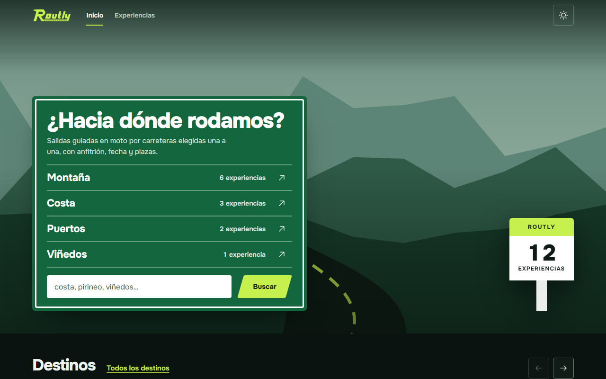
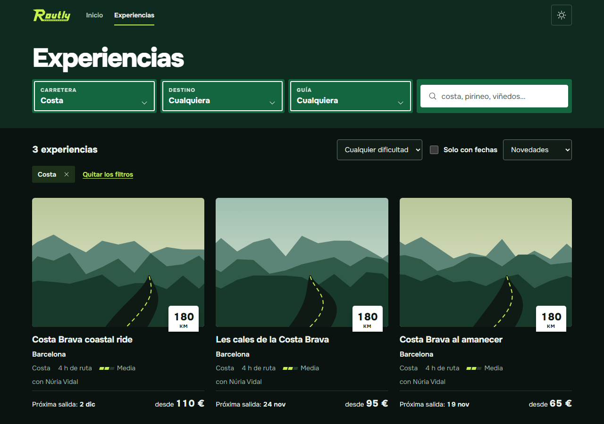
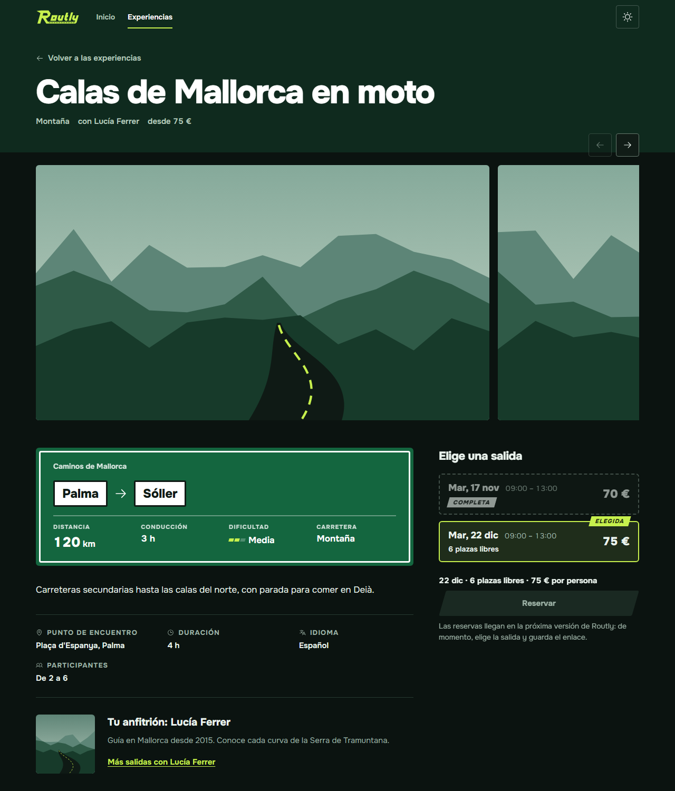
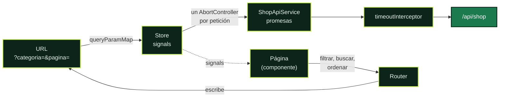
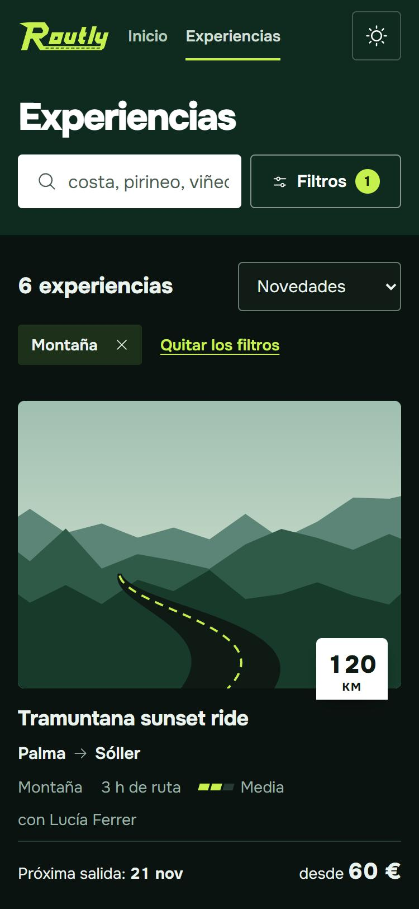

<a id="top"></a>


<p align="center">
  
  
  
  
  
</p>

La cara pública de Routly, la plataforma de rutas en moto. Aquí un motero sin cuenta encuentra una salida guiada que le encaje (zona, tipo de carretera, anfitrión, fecha y precio) y la elige. Tiene tres pantallas: el **Home**, el **Shop** y el **detalle de una experiencia**.

Está hecha con Angular 20 y lee solo de **`/api/shop`**, la tienda pública de [`moto-routes-api`](../moto-routes-api/README.md), que no pide sesión. El panel de administración es otra aplicación, [`moto-routes-dashboard`](../moto-routes-dashboard/README.md). La visión general del proyecto está en el [README de la raíz](../README.md).



## Contenido

- [Lenguajes y librerías](#lenguajes-y-librerías)
- [Requisitos](#requisitos) · [Arrancar el proyecto](#arrancar-el-proyecto) · [Comandos](#comandos) · [Variables de entorno](#variables-de-entorno)
- [Arquitectura](#arquitectura): pantallas, flujo de datos, la URL como estado, peticiones sin carreras, errores y la reserva
- [Patrones de Angular](#patrones-de-angular)
- [Componentes reutilizables](#componentes-reutilizables)
- [Iconos](#iconos) · [Sistema de diseño](#sistema-de-diseño) · [Tests](#tests)
- [Limitaciones conocidas](#limitaciones-conocidas)

## Lenguajes y librerías

**TypeScript** en modo estricto (sin `any`, tampoco `$any` en las plantillas), plantillas **HTML** de Angular y **CSS** puro con variables. Las mismas versiones que el panel y **ninguna dependencia nueva**: el carrusel, los filtros, la búsqueda y la paginación están hechos a mano.

| Librería | Versión | Para qué se usa |
|---|---|---|
| [Angular](https://angular.dev) | 20.3 | Framework. Componentes standalone, signals y sin zone.js |
| [RxJS](https://rxjs.dev) | 7.8 | Solo donde Angular lo exige: `HttpClient`, el interceptor y los parámetros de la URL. El resto usa promesas |
| [Phosphor Icons](https://phosphoricons.com) | 2.1 | Iconos. Solo se empaquetan los que se usan (ver [Iconos](#iconos)) |
| [Onest](https://fontsource.org/fonts/onest) (Fontsource) | 5.3 | Tipografía variable, servida desde la propia web |
| Karma + Jasmine | 6.4 / 5.9 | Tests unitarios |

## Requisitos

- Node.js 20.19 o superior (probado con 24)
- La API en marcha en `http://localhost:3000`, con MongoDB (ver el [README de la API](../moto-routes-api/README.md))

## Arrancar el proyecto

Hacen falta dos terminales: una para la API y otra para la web.

**1. API** (`http://localhost:3000`)

```bash
cd moto-routes-api
npm install
```

Copia `.env.example` a `.env` y ajusta los valores si hace falta. Después:

```bash
npm run seed
```

```bash
npm run dev
```

`npm run seed` borra todas las colecciones y carga los datos de ejemplo: 12 experiencias, 15 salidas (una completa) y sus anfitriones, destinos y fotos. Solo hace falta la primera vez o para empezar de cero.

**2. Web** (`http://localhost:4300`)

```bash
cd moto-routes-web
npm install
```

```bash
npm start
```

El panel puede ir a la vez en otra terminal (`http://localhost:4200`): las dos caras usan la misma API.

## Comandos

| Comando | Qué hace |
|---|---|
| `npm start` | Servidor de desarrollo en el puerto 4300, con recarga automática |
| `npm run build` | Compilación de producción en `dist/` |
| `npm test` | Tests con Karma y Jasmine |
| `npm run icons` | Regenera el registro de iconos (ver [Iconos](#iconos)) |

Para ejecutar los tests una sola vez, sin abrir navegador:

```bash
npx ng test --watch=false --browsers=ChromeHeadless
```

## Variables de entorno

La web se configura en `src/environments/`:

| Archivo | Cuándo se usa |
|---|---|
| `environment.development.ts` | `npm start` |
| `environment.ts` | `npm run build` (producción) |

| Variable | Valor por defecto | Para qué |
|---|---|---|
| `apiUrl` | `/api` | URL base de la API, sin barra final. La web solo usa `${apiUrl}/shop` |
| `apiTimeout` | `10000` | Milisegundos que se espera una respuesta antes de cortar la petición |

**El proxy de desarrollo.** `npm start` sirve la web con `proxy.conf.json`: las peticiones a `/api` pasan a `http://localhost:3000`. Así la web llama a la API desde su propio origen. En producción se hace lo mismo con el servidor web, como con el panel ("Producción con HTTPS" en el README de la API).

## Arquitectura

Organización por features, con las mismas reglas que el panel.

```
src/app/
├── core/                   Lo que existe una sola vez en la aplicación
│   ├── api/                ShopApiService (con AbortSignal), los modelos de /api/shop y ApiError
│   ├── booking/            BookingService: la reserva, preparada (solo la interfaz)
│   ├── interceptors/       El tiempo de espera de las peticiones
│   └── services/           El tema y el título y la descripción de cada página (SEO)
├── layout/                 La cabecera (transparente sobre la foto del Home) y el pie
├── shared/                 Piezas reutilizables, sin lógica de negocio
│   ├── ui/                 Carrusel, búsqueda, filtros, filtros puestos, paginación, foto,
│   │                       dificultad, icono, marca y esqueleto
│   └── utils/              Formato de precios, fechas, horas, cifras y plurales
├── features/
│   ├── home/               HomeStore, el panel de orientación y los carriles (lista + tarjeta)
│   ├── shop/               ShopStore, la URL (shop-query.ts), el pórtico de filtros, la hoja
│   │                       de filtros del móvil y la lista de experiencias (lista + tarjeta)
│   ├── experience/         ExperienceStore, la galería, el cartel de la ruta y la elección de salida
│   └── not-found/          La página 404
├── app.routes.ts           Una ruta por pantalla, cada una cargada al entrar en ella
├── app.config.ts
└── app.component.ts        Saltar al contenido, la cabecera, la página y el pie
```

Reglas:

- `core` son servicios únicos (singletons).
- `shared` no sabe nada de experiencias: sus componentes reciben datos y emiten eventos.
- Una feature no importa de otra. Cada pantalla tiene su store, que vive con la página (se provee en ella) y cancela lo pendiente al salir.

### Pantallas

| Ruta | Pantalla |
|---|---|
| `/` | **Home.** Una carretera a sangre y, encima, el panel de orientación: una fila por tipo de carretera (con cuántas experiencias tiene) que lleva al Shop filtrado, y la búsqueda. Debajo, el tablón de próximas salidas (fecha, recorrido, hora y precio) y tres carruseles: destinos, tipos de carretera y guías |
| `/experiencias` | **Shop.** El pórtico de filtros (carretera, destino, guía) y la búsqueda; el recuento y el orden; una franja con la dificultad, "Solo con fechas" y el slider de precio; los filtros puestos, las tarjetas (con la placa del tipo de carretera, la próxima salida y el precio) y la paginación. En el móvil, los filtros van en una hoja que sube desde abajo |
| `/experiencias/:slug` | **Detalle.** La galería, el cartel de la ruta, lo práctico, el anfitrión y la taquilla: las salidas como billetes (matriz con la fecha, perforación, horario, plazas y precio) y el botón "Reservar" preparado. En el móvil, una barra fija abajo con la salida elegida |
| `**` | Página no encontrada, con enlace a las experiencias |

<table>
  <tr>
    <td width="50%"></td>
    <td width="50%"></td>
  </tr>
  <tr>
    <td align="center"><sub><b>Shop</b>: los filtros, la búsqueda y la página van en la URL</sub></td>
    <td align="center"><sub><b>Detalle</b>: la salida elegida, en la URL; la completa se ve, pero no se elige</sub></td>
  </tr>
</table>

### Cómo viajan los datos



La página nunca llama a la API ni cambia el estado directamente:

- **Lee** del store, que expone el resultado como signals.
- **Para filtrar, buscar u ordenar**, el store escribe la URL con el router.
- **Al cambiar la URL**, la página se lo pasa al store (`sync`), que pide la página nueva.

Así, recargar, compartir el enlace o ir atrás enseñan exactamente lo mismo.

- **`ShopApiService`** es la única puerta hacia la API: `get(path, params, signal)` devuelve una promesa y acepta un `AbortSignal`. Los parámetros vacíos no viajan.
- **`timeoutInterceptor`** corta la petición a los `apiTimeout` milisegundos.
- **Cada store** (`HomeStore`, `ShopStore`, `ExperienceStore`) guarda su estado con signals: lo que ha llegado, si está cargando, el error y lo que se ha elegido.

### La URL es la fuente de verdad

Los parámetros del Shop van en español y `shop-query.ts` los traduce a los de `/api/shop`. Lo que no vale en la URL (una página que no es un número, una dificultad que no existe, un slug mal escrito) se ignora, como si no estuviera.

| URL | API | Qué es |
|---|---|---|
| `categoria`, `anfitrion`, `ubicacion` | `category`, `host`, `location` | Por slug, igual que los enlaces del Home |
| `buscar` | `search` | Palabras enteras del título y la descripción |
| `dificultad` | `difficulty` | `facil`, `media` o `dificil` |
| `con-fechas=si` | `hasDepartures=true` | Solo las que tienen salidas reservables |
| `precioMin`, `precioMax` | `priceMin`, `priceMax` | El slider de precio, en euros (de 0 a 400, de 10 en 10). En los extremos no se envían: sin límite por ese lado |
| `orden` | `sort` | `proximas`, `precio`, `precio-desc` o `titulo`. Sin orden, novedades (o las que mejor encajan, si se busca) |
| `pagina` | `page` | 12 por página. La primera no lleva parámetro |
| `salida` (en el detalle) | – | La salida elegida, por su slug |

- **Cambiar un filtro** vuelve a la primera página. "Quitar los filtros" los quita todos, la búsqueda también, y deja el orden.
- **Una página que ya no existe** (se ha quitado un filtro, o el enlace es viejo) pasa a la última con `replaceUrl`, sin dejar un paso atrás inútil.
- **Un slug que no existe** deja el Shop vacío y sale como filtro "no encontrado", que se puede quitar.
- **Elegir una salida** escribe `?salida=` con `replaceUrl`: tocar varias no llena el historial.
- **Al volver del detalle** con "Volver a las experiencias", el Shop queda como estaba, con sus filtros y su scroll.

### Peticiones sin carreras

El enunciado pide evitar que una respuesta vieja pise a una nueva, con **`AbortController`** y **`debounce`**. Los dos están a la vista en el código, no escondidos en una librería:

- **Un `AbortController` por petición.** Cada store guarda el de su última petición; al pedir otra, hace `abort()` de la anterior. Al salir de la página, aborta lo pendiente.
- **La señal llega a la petición.** HttpClient no admite un `AbortSignal`, así que `ShopApiService` cancela la suscripción al abortar; con `withFetch()` eso aborta el `fetch` de verdad (en el navegador sale como `net::ERR_ABORTED`). Se pasa por HttpClient, y no por `fetch` directamente, para que siga valiendo el interceptor del tiempo de espera.
- **Lo abortado no es un error.** La promesa se rechaza con un `AbortError` (`isAbortError()`), que el store descarta: ni aviso ni estado de error.
- **Una sola espera, de 300 ms**, en el componente de búsqueda (`SEARCH_DEBOUNCE_MS`). El store no espera: cinco teclas seguidas hacen una sola petición. Enter busca al momento.
- **Sin parpadeos.** Mientras llega la página nueva, la anterior se sigue viendo, atenuada. La primera vez, esqueletos con la forma de las tarjetas.

### Errores

`core/api/api-error.ts` convierte cualquier fallo en un `ApiError` con un mensaje para el público:

| Tipo | Cuándo | Mensaje |
|---|---|---|
| `network` | Sin respuesta (API parada, sin red) | "No hemos podido conectar. Comprueba tu conexión y vuelve a intentarlo." |
| `timeout` | Pasan los `apiTimeout` ms | "Está tardando demasiado en responder. Vuelve a intentarlo." |
| `notFound` | 404 | "No hemos encontrado lo que buscabas. Puede que ya no esté disponible." |
| `invalid` | 400 | "Esa búsqueda no se puede hacer. Quita los filtros y vuelve a intentarlo." |
| `server` | 5xx y el resto | "Algo ha fallado de nuestro lado. Vuelve a intentarlo en unos minutos." |

Cada pantalla tiene sus estados:
- **Cargando:** esqueletos, con `aria-busy`.
- **Vacío:** con salida. En el Shop, "Quitar los filtros", y si se buscaba, la pista de las palabras enteras.
- **Error:** el motivo y "Reintentar".
- **No encontrado:** el detalle de una experiencia que no existe o no se ve.

### La reserva, preparada

Reservar llega en una fase posterior; la web lo deja todo a punto:

- **La salida elegida**, en la URL y en el resumen de encima del botón ("22 dic · 6 plazas libres · 75 € por persona").
- **Las plazas**, de la API: `seatsLeft` (las libres) e `isFull`. Una salida completa se ve, con su sello, pero no se puede elegir, tampoco si llega en la URL.
- **`core/booking/booking.service.ts`**, solo con la interfaz: `BookingRequest`, `Booking`, `reserve()` y `available = false`.
- **El botón "Reservar"**, deshabilitado y con el motivo unido por `aria-describedby`.

Cuando la API tenga `/api/bookings` (el diseño está en [`DATABASE.md`](../DATABASE.md), sección 14), basta con implementar `reserve()` y poner `available = true`: el botón se activa solo.

### Rendimiento

- **Carga diferida por rutas.** Cada pantalla es un trozo que se pide al entrar en ella (el Home, unos 8 kB; el Shop, unos 10 kB; el detalle, unos 6 kB). Al entrar se descargan unos 82 kB.
- **Solo se pide lo que se ve.** Una página de 12 experiencias; el total del Home, con `limit=1`.
- **Imágenes con su caja reservada** (`aspect-ratio`, `width` y `height`) y carga diferida; la primera de la página (la portada del Home, la primera foto de la galería), con `fetchpriority="high"`. La API no da variantes de tamaño, así que no hay `srcset`.
- **Peticiones sin repetir ni pisarse:** ver [Peticiones sin carreras](#peticiones-sin-carreras).

## Patrones de Angular

| Patrón | Dónde | Por qué |
|---|---|---|
| Sin zone.js (`provideZonelessChangeDetection`) | `app.config.ts` | La vista se actualiza cuando cambia un signal, no tras cada evento |
| Componentes standalone y `OnPush` | Todos | Sin `NgModule`; cada componente declara lo que importa |
| `signal`, `computed`, `effect` | Stores y páginas | Estado reactivo sin suscripciones manuales |
| `input()`, `model()`, `output()` | Componentes de `shared/ui` | API de componentes basada en signals |
| `inject()` | Todos | Sin inyección por constructor |
| Store provisto en la página (`providers: [ShopStore]`) | `features/*` | El estado vive con la pantalla y se limpia (y cancela) al salir |
| `withComponentInputBinding` | Router | El `:slug` de la URL llega al detalle como `input()` |
| `queryParamMap` + `takeUntilDestroyed` | Shop y detalle | La URL entra en el store cada vez que cambia |
| `withInMemoryScrolling` | Router | Arriba al cambiar de página; al volver atrás, a donde estaba |
| `TitleStrategy` propia | `core/services/page-meta.strategy.ts` | Título y descripción de cada página; el detalle pone el suyo con el nombre de la experiencia |
| Composición lista + tarjeta | `place-rail` + `place-card`, `experience-list` + `experience-card` | La lista no sabe pintar una tarjeta; la tarjeta no sabe de dónde vienen los datos |
| Control flow `@if`, `@for`, `@switch` | Plantillas | Sintaxis nativa, sin directivas estructurales |
| Referencias de plantilla tipadas (`#sort`) | Selects y casillas del Shop | El valor llega con su tipo, sin `$any` |

## Componentes reutilizables

Los cuatro que pide el enunciado (carrusel, filtros, búsqueda y paginación), más los que los acompañan. Están en `shared/ui/`, no saben nada de experiencias y cada uno tiene su spec.

<details>
<summary><b><code>ui-carousel</code></b>: carrusel con scroll-snap, arrastre y teclado</summary>

```html
<ui-carousel label="Tipos de carretera">
  @for (category of categories(); track category._id) {
    <a class="card" [routerLink]="['/experiencias']" [queryParams]="{ categoria: category.slug }">…</a>
  }
</ui-carousel>
```

- Cada hijo proyectado es una tarjeta; su ancho lo pone quien lo usa.
- Con el dedo, el scroll nativo con `scroll-snap`: tiene inercia y se puede parar a mitad.
- Con el ratón, arrastre 1:1 que, al soltar, sigue con su inercia hasta la tarjeta más cercana. Un arrastre no cuenta como clic.
- Botones "Anteriores" y "Siguientes" (casi una pantalla), desactivados en los extremos. Si no hay nada que desplazar, no salen.
- Con el teclado, ← y → pasan el foco a la tarjeta de al lado.
- Es una región `aria-roledescription="carrusel"` con su nombre, y las tarjetas, una lista.
- Con movimiento reducido, los saltos son instantáneos.
- Variables CSS: `--carousel-gap` (espacio entre tarjetas) y `--carousel-inset` (margen interior).

</details>

<details>
<summary><b><code>ui-search-box</code></b>: búsqueda con espera y botón de borrar</summary>

```html
<ui-search-box label="Buscar experiencias" placeholder="costa, pirineo…"
  hint="Busca palabras enteras" [value]="store.query().search" (search)="store.setSearch($event)" />
```

- Espera 300 ms (`SEARCH_DEBOUNCE_MS`) desde la última tecla y emite el texto sin espacios de más, solo si ha cambiado. Enter busca al momento.
- El botón de borrar sale cuando hay texto: vacía, emite y devuelve el foco al campo.
- El valor que llega de fuera (la URL) se enseña y no se vuelve a emitir.
- Etiqueta para el lector de pantalla y pista unida con `aria-describedby`. El campo usa 16 px: en el móvil no hace zoom al enfocarlo.

</details>

<details>
<summary><b><code>ui-filter-group</code></b>: un filtro de una opción</summary>

```html
<ui-filter-group legend="Tipo de carretera" allLabel="Cualquiera"
  [options]="[{ value: 'montana-1a2b', label: 'Montaña', count: 6 }]" [(value)]="categoria" />
```

- Radios dentro de un `fieldset` con su leyenda: con el teclado, las flechas cambian de opción.
- La opción de "todas" va primero; cada opción, con cuántos resultados tiene ("Montaña, 6" para el lector de pantalla).
- `value` es el elegido, o `null`.

</details>

<details>
<summary><b><code>ui-active-filters</code></b>: los filtros puestos</summary>

```html
<ui-active-filters [filters]="[{ key: 'categoria', label: 'Montaña' }]" (remove)="quitar($event)" (clear)="quitarTodos()" />
```

Cada filtro con su botón de quitar ("Quitar el filtro Montaña") y "Quitar los filtros". Sin filtros no enseña nada.

</details>

<details>
<summary><b><code>ui-pager</code></b>: paginación por enlaces</summary>

```html
<ui-pager [page]="page()" [totalPages]="totalPages()" />
```

- Cada página es un enlace (`?pagina=3`) que conserva el resto de parámetros; la primera no lleva parámetro.
- Con muchas páginas: la primera, la última y las vecinas de la actual, con un hueco donde se salta ("1 … 9 10 11 … 20", `pageItems`).
- La actual no es un enlace y se anuncia con `aria-current`. Con una sola página, no se enseña.

</details>

<details>
<summary><b><code>ui-price-range</code></b>: slider de precio con dos tiradores</summary>

```html
<ui-price-range [floor]="0" [ceiling]="400" [step]="10" [value]="{ min: 40, max: null }"
                (valueChange)="setPrice($event.min, $event.max)" />
```

- Dos `input type="range"` nativos superpuestos: funcionan con el teclado y los lectores de pantalla ("Precio mínimo", "Precio máximo").
- El texto de encima cambia mientras se arrastra ("Hasta 150 €", "40 € – 200 €"), pero solo avisa al soltar: no se pide una página por cada paso.
- Los tiradores no se cruzan, y un extremo es "sin límite" (`null`).

</details>

<details>
<summary><b><code>ui-photo</code></b>: foto con el paisaje de la marca debajo</summary>

```html
<ui-photo [src]="experience.coverImage?.url ?? null" [seed]="experience.slug" [scene]="sceneFor(category.name)" alt="" [priority]="true" />
```

- La foto llena su caja; la proporción la pone quien la usa con `aspect-ratio`.
- Debajo siempre está un **paisaje de la marca** (`landscape.ts`): una escena por tipo de carretera (`scene`: montaña con nieve, costa con su cabo y el mar, puertos en zigzag, viñedos con hileras de cepas, o una general) y una de cuatro luces (alba, mediodía, atardecer o noche con estrellas). Todo sale del `seed`: siempre el mismo dibujo para el mismo, y distinto entre tarjetas. La carretera oscura con su línea lima no cambia. `sceneFor()` saca la escena del nombre de la categoría. La foto aparece encima cuando llega.
- Sin url, si la foto falla o si el servidor no contesta nunca, se queda el paisaje: nunca hay un hueco ni un icono roto.
- Con `priority`, la imagen se pide enseguida (la primera de la página).

</details>

Además: `ui-difficulty` (la dificultad en tres tramos y con su nombre, nunca solo con color) y, copiados del panel, `ui-icon`, `ui-brand-mark` y `ui-skeleton`.

## Iconos

<details>
<summary><b>Ver cómo añadir un icono</b></summary>

Los iconos son de [Phosphor](https://phosphoricons.com). Para no empaquetar la librería entera, solo se incluyen los que aparecen en `tools/generate-icons.mjs` (hoy, 23).

Para usar uno nuevo, añade su nombre a esa lista y ejecuta:

```bash
npm run icons
```

Después ya se puede usar con `<ui-icon name="nombre" />`. El nombre está tipado: uno que no esté en la lista no compila.

</details>

## Sistema de diseño

La misma marca que el panel, llevada a otra escena. El panel se lee como la instrumentación de una moto; la web, como la **señalización de la carretera**. La dirección ("Señales de carretera") se eligió entre tres bocetos (`design/bocetos-web/`). Sus piezas y reglas están en la sección "Superficie pública" de [`DESIGN.md`](../moto-routes-dashboard/DESIGN.md).

| Archivo | Contenido |
|---|---|
| `styles/tokens.css` | Los tokens del panel (colores, tipografía, espacios, radios, sombras, duraciones) y, al final, los de la web: el verde de las señales, las placas, el margen lateral y el ancho del contenido |
| `styles/base.css` | Estilos de partida, foco visible y movimiento reducido |
| `styles/primitives.css` | El contenedor, la banda y los botones |

    

**Las piezas de la señalización:**

| Pieza | Dónde | Qué es |
|---|---|---|
| Panel de orientación | Home, detalle | Verde, con un filete blanco interior de 3 px. Es navegación: cada fila (nombre, cuántas y flecha) es un enlace. En el detalle, el cartel de la ruta |
| Placa de población | Carril de destinos, cartel de la ruta | Blanca con borde de tinta: el origen y el destino |
| Placa lima | Carril de guías | Los anfitriones, con texto oscuro |
| Hito kilométrico | Home, tarjetas del Shop | Blanco con capuchón lima: el total de experiencias y los km de cada ruta |
| Pórtico | Shop | Los filtros como placas en fila, con el valor elegido en grande |
| Billete de salida | Detalle | Contorno discontinuo; la elegida, sólido y con el sello lima; la completa, atenuada |

**La regla de la señal.** Una placa siempre se puede leer y pulsar como lo que es (enlace, filtro, opción): la señal es la interfaz, nunca un adorno.

**Tema claro y oscuro.** El mismo script que el panel pone el tema antes de pintar, con la misma clave (`routly.theme`): quien eligió oscuro en una cara lo tiene en la otra. Las señales son verdes en los dos temas. Todas las combinaciones de texto y fondo cumplen contraste **WCAG AA** en los dos (la más justa, 5,66:1).

**Movimiento.** Poco y con intención:
- la flecha de una fila del panel se rellena de lima al pasar o enfocar, como la salida que vas a tomar;
- la foto de las tarjetas crece un 3 % al pasar por encima;
- la hoja de filtros del móvil sube al abrirse.

Con `prefers-reduced-motion`, nada se desplaza.

**Responsive.** Mínimo 320 px sin scroll horizontal. Por debajo de 860 px, el pórtico pasa a ser la búsqueda más un botón "Filtros" que abre la hoja inferior. Los objetivos táctiles miden 44 px.

**Probado con el peor caso.** `design/peor-caso/worst-case.js` es un script de desarrollo que se inyecta en el navegador y deforma las respuestas de `/api/shop` con valores reales al límite de la API. No hay código de demo en la app y se quita recargando. Con él se probaron las tres pantallas a 320 y 1280 px:
- títulos de 120 caracteres y un pueblo galés de 58 letras;
- 1284 experiencias y precios de 100.000 €;
- una sola plaza y salidas completas;
- sin fotos, sin anfitrión y sin salidas, más los modos "vacío" y "uno".

Nada desborda, las tarjetas de una fila quedan alineadas y no aparece ningún `undefined` ni `NaN`.

<details>
<summary><b>Ver la web en el móvil</b></summary>
<br>
<p align="center">
  
</p>
</details>

## Tests

```bash
npx ng test --watch=false --browsers=ChromeHeadless
```

105 tests en 22 specs, casi todos escritos antes que el código (TDD). Los stores y las páginas se prueban con la URL de verdad (`RouterTestingHarness`) y la API simulada (`HttpTestingController`).

| Spec | Qué prueba |
|---|---|
| `shop-api.service.spec.ts` | Los parámetros que viajan, el `ApiError`, y que abortar cancela la petición y rechaza con un `AbortError` |
| `shop-query.spec.ts` | La URL en español a los parámetros de la API (también el precio), cada orden, la relevancia al buscar y lo que se ignora |
| `shop.store.spec.ts` | La URL manda; al cambiarla antes de la respuesta, la anterior se aborta y solo se pinta la última; lo anterior sigue a la vista; errores y reintentar; la página fuera de rango; los filtros puestos y "no encontrado" |
| `shop-page.component.spec.ts` | Esqueletos, el recuento anunciado, las tarjetas, el vacío, el error y la paginación |
| `home.store.spec.ts`, `home-page.component.spec.ts` | Las cinco peticiones a la vez (con el tablón), la portada, el panel y los carriles hacia el Shop filtrado, el carril vacío, el hito y el error |
| `departures-board.component.spec.ts` | El tablón: una fila por salida con su fecha, recorrido y precio, sin las que no tienen fecha, y "Ver todas" al Shop por fecha |
| `experience.store.spec.ts`, `experience-page.component.spec.ts` | La salida elegida desde la URL (nunca una completa), elegir sin llenar el historial, el título de la pestaña, el botón "Reservar", sin salidas y no encontrada |
| `page-meta.strategy.spec.ts` | Título y descripción por ruta; el detalle no se pisa al cambiar `?salida=` |
| Componentes de `shared/ui` (7) | Carrusel, búsqueda (con reloj falso para la espera), filtro, filtros puestos, paginación, foto y el slider de precio (avisa al soltar, extremos sin límite, sin cruzarse) |
| `landscape.spec.ts` | La escena de cada tipo de carretera, el mismo dibujo para la misma semilla, la variedad y la línea lima de la carretera |
| `shop-format.spec.ts` | Precios con 0 o 2 decimales, fechas, horas y plurales |
| `app.component.spec.ts`, cabecera y pie | La cabecera sobre la foto solo en el Home, saltar al contenido, el tema y los enlaces |

Además, la web pasó el detector de [impeccable](https://impeccable.style) (sin hallazgos) y una revisión de código cuyos diez hallazgos están corregidos.

## Limitaciones conocidas

- **Las fotos del seed** son de picsum (al azar, no son de motos): si no cargan, se ve el paisaje de la marca de su tipo de carretera, que es lo que sale en las capturas.
- **La búsqueda va por palabras enteras** (el índice de texto de la API): "pir" no encuentra "Pirineos". La pista del campo y el estado vacío lo explican.
- **No se puede reservar todavía:** la API no tiene `/api/bookings`. Ver [La reserva, preparada](#la-reserva-preparada).
- **Sin sesión:** la web no enseña si hay sesión de admin ni enlaza al panel. Llegará con las reservas, que sí la piden.
- **Sin SSR:** las páginas se pintan en el navegador. El título y la descripción cambian con cada página, pero un buscador que no ejecute JavaScript solo ve los generales.
- **Algunas piezas están copiadas del panel** (tokens, icono, marca, esqueleto, tema y tiempo de espera), con una línea al principio que lo dice: si cambian allí, hay que cambiarlas aquí.

<p align="right"><a href="#top">Volver arriba</a></p>
